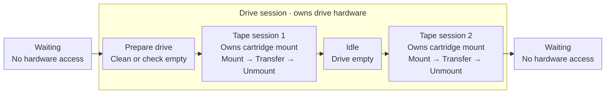
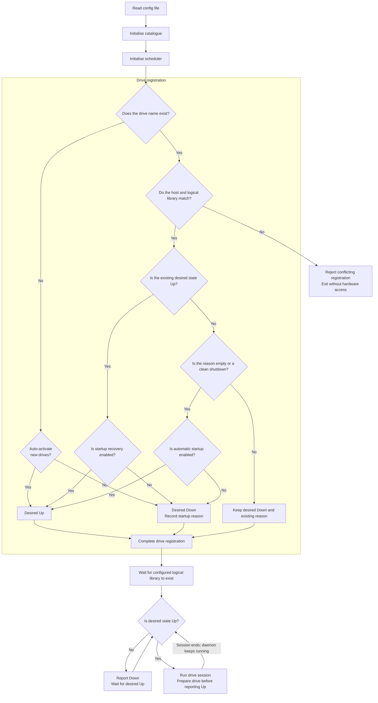
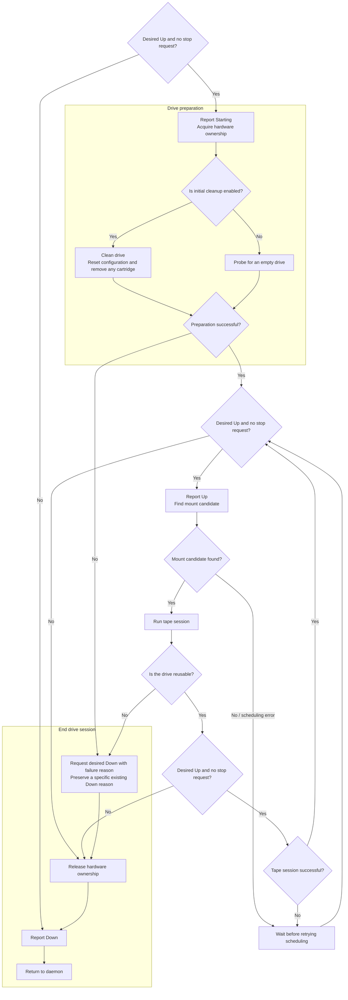
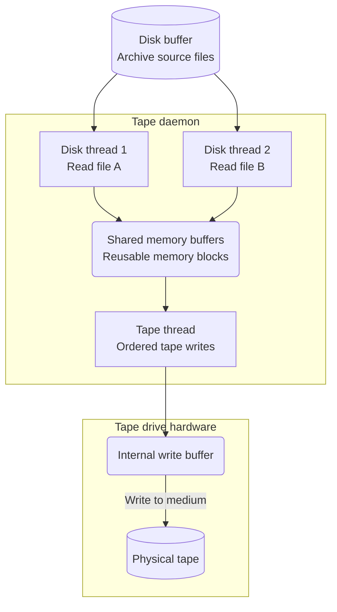
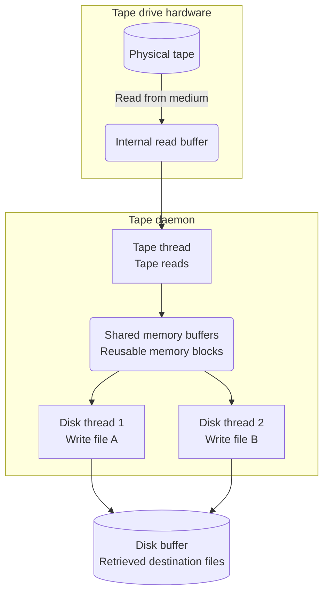

# CTA Tape Daemon

The **tape daemon** (`cta-taped`) runs on a [Tape Server](../tape/servers.md) and controls a single tape drive.
It obtains scheduled work, transfers files between disk and tape, and coordinates cartridge movements with the [Media Changer Daemon](media-changer-daemon.md).

A **drive session** is a period during which the daemon owns access to the drive hardware.
It can contain zero or more **tape sessions**, which transfer files or clean up a cartridge already in the drive.
The daemon runs one drive session at a time, and each drive session runs one tape session at a time.

## Drive state and hardware access

Operators need to control hardware access for maintenance, drive replacement, or investigation.
Hardware faults, such as a stuck cartridge, can also require the daemon to stop accepting work and release the drive.

The daemon tracks drive availability separately from the progress of an individual tape session:

| State | Question it answers | Examples |
| --- | --- | --- |
| **Drive state** | Is the drive available for work? | An available drive can be idle or running a tape session. |
| **Tape session state** | What stage has the current tape session reached? | Mounting a cartridge, transferring files, or returning the cartridge to the library. |

### Desired and reported state

The **desired state** is the requested availability: `Up` permits the daemon to use the drive; `Down` asks it to stop scheduling and release the hardware.
The **reported state** describes the daemon's progress in carrying out that request.
A request and its completion need not happen at the same time.

The drive lifecycle has four operational states:

| Operational state | Meaning |
| --- | --- |
| `Down` | The daemon is not using the drive. |
| `Starting` | The drive has been requested `Up`; the daemon is waiting to start or preparing it for scheduled work. |
| `Up` | Preparation has succeeded; the daemon is waiting for work or running tape sessions. |
| `Stopping` | The daemon has been requested to stop using the drive; it finishes ongoing work and cleanup before becoming `Down`. |

Every drive session follows these rules:

- **Prepare before scheduling.** Report `Starting` before accessing hardware.
  Depending on configuration, clean the drive or check that it is empty.
  Report `Up` only after preparation succeeds and desired `Up` still holds.
  If preparation fails, return to `Down` without reaching `Up`.
- **Finish before releasing hardware.** Let active tape sessions and cleanup finish, then release hardware ownership and report `Down`.
- **Leave the hardware alone while waiting.** While reported `Down` and waiting for desired `Up`, do not access the drive.
- **Keep reported and desired state separate.** Reporting progress does not change the desired state.
  If desired `Up` is requested while a session is ending, reporting `Down` preserves that request.

Only `Up` and `Down` can be requested; `Starting` and `Stopping` describe transitions.
The daemon can also request `Down` during startup, shutdown, or failure handling.
**Desired `Down` requests release of the hardware; reported `Down` confirms that the daemon has stopped using it.**

### Tape session state

A tape session describes transfer or cleanup activity involving a cartridge.
An idle drive has no tape session state.

| Tape session state | Meaning |
| --- | --- |
| `Start` | Starting the tape session. |
| `Mount` | Mounting the cartridge and preparing it for transfer. |
| `Transfer` | Reading files from or writing files to tape. |
| `Unload` | Unloading the tape within the drive. |
| `Unmount` | Returning the cartridge to the library. |
| `DrainToDisk` | Finishing outstanding retrieval writes to disk after tape-side work and cleanup attempts have ended. |

Starting or finishing a tape session does not itself change drive availability.
A tape session can continue writing retrieved data to disk after tape reads and unmounting have finished.

### Down reasons

A **down reason** explains why desired `Down` was requested.
Operators can request `Down` with their own reason, such as maintenance; the daemon uses predefined reasons for conditions such as shutdown or hardware failure.
The [down reason reference](../../ops/troubleshooting/tape-daemon.md#drive-down-reasons) describes the daemon's predefined reasons.

## Sessions and ownership

A daemon runs one drive session at a time and can start another after the previous session ends.
Between sessions, it releases hardware access, allowing operations such as maintenance.
Each drive session includes preparation, tape sessions, idle time, and outstanding cleanup.
It ends by releasing hardware ownership and reporting `Down`.

!!! note "Hardware ownership is local to the daemon"

    Ownership controls when this daemon may access the drive.
    It does not exclude other processes from the device; SCSI reservations are not yet implemented.

Preparation may include a cleanup tape session [if configured](#cleaning-the-drive-at-the-start-of-a-drive-session).

A transfer tape session's lifecycle has three phases:

- **Mount:** move the cartridge into the drive and prepare it for reading or writing.
- **Transfer:** read files from tape to disk, or write files from disk to tape. One mounted cartridge can serve many files.
- **Unmount:** unload the tape and return the cartridge to the library, leaving the drive empty and ready for reuse.

## From startup to shutdown

This section describes the normal lifecycle.
Many of these operations can fail; how the daemon handles those failures is covered separately in [Failure scenarios](#failure-scenarios).

Each lifetime has its own entry and exit actions.
Finishing a tape session need not end the drive session, and ending a drive session need not stop the daemon.

### Daemon lifetime

The daemon runs drive sessions sequentially: each drive session must end before the next can begin.
Once the drive is reported `Down` and the daemon is waiting, it must not access the drive hardware until desired `Up` authorises a new drive session.

#### On startup

1. Register the configured drive name, which identifies its catalogue entry. Create an entry if none exists; for an existing entry, require its host and logical library to match the daemon configuration.
2. Decide whether to request desired `Up` automatically, using the catalogue state found before registration as described below.
3. Wait for the configured logical library to exist before starting drive sessions. Scheduling requires this entry, but the catalogue allows a drive to reference a library that does not yet exist.

Registration does not by itself make the hardware ready for transfers.

##### Choosing the initial desired state

Initial desired state depends on the catalogue state found before registration:

| State found before registration | Startup decision |
| --- | --- |
| No existing drive entry | Request desired `Up` only when automatic activation on first registration is enabled. |
| Existing desired `Down` with an absent, empty, or clean-shutdown reason | Eligible for automatic startup of an existing drive. |
| Existing desired `Down` with an operator or failure reason | Preserve desired `Down` and its reason. |
| Existing desired `Up` | Preserve it only when startup recovery is enabled. |

Recovery, automatic startup, and first-registration activation are separate policies.
During recovery, registration reports `Down` while preserving desired `Up`.

Configuration names, defaults, and their interaction are documented in [Drive startup and preparation](../../ops/deploy-and-configure/configuration/tape-daemon.md#drive-startup-and-preparation).

#### While running

Between drive sessions, the daemon stays alive and refreshes reported `Down` without accessing hardware.
It starts the next drive session when desired `Up` is set.

#### On shutdown

The daemon is intended to run indefinitely.
Finishing a tape session, having no eligible work, or setting desired `Down` does not stop the daemon; it continues running and waits for work or desired `Up`.
An orderly shutdown begins when the process receives a stop request, such as `SIGTERM` during a service stop or restart.
Startup failures and fatal runtime failures can also end the process; those cases are covered under [Failure scenarios](#failure-scenarios).

For an orderly shutdown:

1. Request that scheduling stop. If drive registration completed, set desired `Down` while preserving an existing specific operator or failure reason.
2. Allow an active tape session to finish transferring files, unmount its cartridge, and finish outstanding disk writes and reporting. Then end the drive session, relinquishing hardware ownership and reporting `Down`.
3. Record a clean shutdown reason unless an existing operator or failure reason must be preserved.
4. Exit, leaving the catalogue entry available to explain the drive's state.

Shutdown relies on tape session completion to release an active cartridge mount; it does not perform an additional physical cleanup after the drive session ends.
The division of responsibility is explained under [Cleanup guarantees](#cleanup-guarantees).
For fatal failures and abrupt termination, see [Failure scenarios](#failure-scenarios).

### Drive session lifetime

A drive session establishes that the drive is empty and reusable before scheduling tape sessions.
The drive session owns access to the drive hardware throughout its lifetime, including idle periods between tape sessions.
It runs tape sessions sequentially and permits another only after safe reuse has been established.

#### On entry

1. Check that the drive still has desired `Up` before accessing hardware.
2. Report `Starting` before acquiring hardware access, then prepare the drive.
   With initial cleanup enabled, remove any remaining cartridge and reset drive configuration as necessary.
   Otherwise, probe for emptiness without modifying configuration; a cartridge or probe failure prevents scheduling.
3. Recheck desired state after successful preparation. Begin scheduling only if desired `Up` is still set.

If desired `Down` is set during drive cleanup, cleanup already in progress finishes, but scheduling does not begin.
For failures during drive preparation, see [Failure scenarios](#failure-scenarios).

#### While active

The drive session retains ownership of the hardware across tape sessions and idle waits.
Successful tape sessions and idle scheduling attempts do not repeat the initial drive preparation.
Work selection is described in [Scheduling](../data-management/scheduling.md).

#### On exit

A drive session ends when desired `Down` is observed or the daemon is stopping.
Failures can also end a drive session; those cases are covered under [Failure scenarios](#failure-scenarios).
Completing a tape session or having no eligible work does not end the drive session.

1. Stop starting further tape sessions.
2. Relinquish access to the drive hardware. Tape session completion has already handled normal cartridge cleanup; no additional physical cleanup is performed on drive session exit.
3. Report `Down`. Ending the drive session does not itself change the desired state.

If desired `Up` remains set, the daemon may start a new drive session after the previous one ends.
The new session must prepare the drive again as configured before scheduling, including after a daemon restart.

### Tape session lifetime

A transfer tape session begins with scheduled work for one cartridge and an empty, reusable drive supplied by the enclosing drive session.
It owns the physical cartridge mount, attempts to leave the drive empty and reusable on completion, and reports the cleanup outcome to the enclosing drive session.
The limits of physical cleanup are explained under [Cleanup guarantees](#cleanup-guarantees).
The steps below describe transfer sessions; cleanup sessions do not schedule file transfers.

#### On entry

1. Fetch an initial batch of file-transfer jobs from the scheduler and confirm that work is available for the selected cartridge before mounting it.
2. Request that the cartridge be mounted in the drive.
3. Wait for the drive to finish loading the tape. Configure encryption and data protection as required, and check the tape label before reading or writing files.

If the initial fetch finds no file-transfer jobs, the session ends before the cartridge is mounted.

#### During transfer

The session owns that cartridge mount while processing its files.
The disk and tape threads exchange data through the buffers described under [Transfer threads and buffers](#transfer-threads-and-buffers).
File-transfer checks are described in [Data Integrity](../data-management/data-integrity.md).

#### On completion

1. Finish reading or writing the session's files. For writes, flush the tape drive's internal write buffer to the physical tape before unloading.
2. Clean up the physical mount: unload the tape and return the cartridge to the library.
3. Wait for disk threads to finish writing retrieved data from the daemon’s memory buffers to disk, and finish reporting file-transfer outcomes. Disk writes can continue after the cartridge has been unmounted.
4. Notify the scheduler that the mount has ended, and report the cleanup outcome to the enclosing drive session so it can decide whether to schedule another tape session.

!!! note "Unmounting does not complete retrieval"

    Tape cleanup and disk writes can overlap. An empty drive does not necessarily mean that all retrieved files have been written to disk.
    This is what the `DrainToDisk` reported state is for.

If cleanup leaves the drive reusable and desired `Up` remains set, another tape session can follow within the same drive session.
For mount, transfer, or cleanup failures, see [Failure scenarios](#failure-scenarios).

### Requests to stop

Desired `Down` is checked at scheduling boundaries; it does not currently interrupt an active tape session.
Changes to desired `Down` are not observed instantaneously.

For example, requesting a drive `Down` during a transfer puts the drive into `Stopping`.
The tape session can remain in `Transfer` while it finishes its work.
The drive reaches reported `Down` only after the session finishes and hardware ownership is released.

Unlike setting desired `Down` alone, stopping the daemon also ends the daemon run.
Active transfers and blocking operations are not immediately interrupted; see [Daemon lifetime](#daemon-lifetime) for the shutdown sequence.

## Cleanup guarantees

The key invariant is that **the daemon must establish that the drive is empty and reusable before starting another transfer tape session**.
Here, cleanup means preparing or resetting the drive and removing a cartridge; it does not mean using a cleaning cartridge.
Responsibility for establishing this depends on which ownership period is beginning or ending.

### Cleaning the drive at the start of a drive session

At the start of a drive session, the daemon cannot assume the drive is empty.
A cartridge may remain from an interrupted daemon run or from hardware operations performed outside a drive session.

Before scheduling work, the daemon must establish that the drive is empty and reusable.
Desired `Up` permits this preparation: depending on configuration, the daemon either cleans the drive or checks that it is empty.
If preparation fails, the drive returns to `Down` without scheduling work.
See [Drive startup and preparation](../../ops/deploy-and-configure/configuration/tape-daemon.md#drive-startup-and-preparation) for the policy details.

Recovery cleanup after an unexpected tape-session exception runs regardless of the initial cleanup policy while the drive session still owns the hardware.

### Completing a tape session

Each transfer tape session owns the physical cartridge mount that it creates.
It is responsible for unloading and unmounting that cartridge when its work finishes, leaving the drive empty and reusable for the next tape session.
The drive session retains hardware ownership between tape sessions; it does not repeat cleaning after every successful session.

### Ending a drive session or shutting down

On normal completion of the last tape session, its cartridge has already been unmounted.
If preparation succeeded but no tape session ran, the initial cleanup or probe has already established that the drive is empty.
Neither ending the drive session nor shutting down the daemon therefore needs another physical cleanup.

This also matters when the daemon is stopped while the drive is already reported `Down`.
Hardware ownership has been relinquished, and a cartridge may have been loaded by another operation.
Shutdown must not access the hardware to remove it; daemon cleanup requires a new request for desired `Up` and initial cleanup enabled for the new drive session.

**Reported `Down` does not mean empty.**
If normal cleanup cannot complete, the daemon must not assume that the cartridge was removed.
Recovery or deferred cleanup is covered under [Failure scenarios](#failure-scenarios); preparation at the start of the next drive session establishes whether scheduling can resume.
With initial cleanup disabled, a remaining cartridge must be removed before the emptiness probe can succeed.

## Failure handling and recovery

The response to a failure depends on whether the daemon can still establish safe hardware reuse and whether it remains running.
A failed transfer does not automatically require desired `Down`; an unusable drive does.
The table describes operational failure categories rather than every possible error.

### Failure scenarios

Failures have different effects on the three lifetimes:

| Failure affects | Consequence |
| --- | --- |
| Registration or daemon startup | No drive session begins until the required configuration and catalogue resources are available. Some errors end the daemon run; a missing logical library causes it to wait. |
| Scheduling | A recoverable error can be retried within the same drive session without repeating preparation. |
| A tape session | Failed work is reported and cleanup is attempted. A reusable drive can continue with another tape session. |
| Drive preparation or reuse | The daemon requests desired `Down` and ends the drive session rather than schedule more work on an unusable drive. |
| The daemon process | Abrupt termination can leave stale reported state and a cartridge still loaded; recovery begins with a new daemon run. |

Unexpected tape-session failures can require recovery cleanup while the drive session still owns the hardware, even if desired `Down` has been requested.
This recovery cleanup is independent of the initial cleanup policy.
If the process cannot safely complete shutdown, normal cleanup and final state reporting may not occur.

The detailed scenario-by-scenario behavior and recovery actions are in [Tape daemon failure recovery](../../ops/troubleshooting/tape-daemon.md#tape-daemon-failure-recovery).

### Recovery after a crash

An abrupt crash cannot publish shutdown state, so the last recorded desired state remains unchanged unless another actor changes it.
Reported state can be stale and a cartridge may remain loaded.
Once the old process has ended, a new daemon run follows the normal [startup behavior](#daemon-lifetime).
Recovery of an existing desired `Up` takes precedence over automatic startup of a previously desired-Down drive.

Every new drive session prepares the drive again.
If initial cleanup is disabled, a remaining cartridge prevents the emptiness probe from succeeding.
A handled fatal failure or orderly shutdown can instead record desired `Down` before exiting.
A specific failure reason is preserved; a clean-shutdown reason can permit automatic startup when configured.
Recovering the drive does not establish that interrupted file transfers completed successfully.

The settings and defaults are described in [Drive startup and preparation](../../ops/deploy-and-configure/configuration/tape-daemon.md#drive-startup-and-preparation).

### Tape session failures and event counters

Throughout a tape session, the daemon counts failed operations by category, such as disk reads, tape writes, cleanup, and reporting.
It separately tracks informational events, such as reaching the end of a tape, and hardware tape alerts.
These records distinguish failed operations from normal stopping conditions and hardware diagnostics.

A completed session is considered unsuccessful if any failure counter is nonzero, including failures during cleanup or final reporting.
Informational events and tape alerts alone do not make it unsuccessful.
Successfully transferring some files or subsequently cleaning the drive does not erase an earlier failure.

Session success and drive reusability are separate: a failed session can leave an empty, reusable drive and allow further scheduling, while unsafe reuse requires the drive to stop accepting work.
For the corresponding log fields and how to interpret the final session summary, see [Tape session logging](../../ops/run-and-maintain/monitoring/tape-session-diagnostics.md#tape-session-logging).

#### Failure counters

These counters identify the operation that failed, rather than counting failed files or independently identifying root causes.
One file can encounter several failures, such as a transfer error followed by a reporting error.

| Failure category | What is tracked |
| --- | --- |
| Reading from disk | Opening or reading an archive source file failed. |
| Checking source size | The source size differs from the expected size, either at the initial check or while reading. |
| Writing to disk | Opening, writing, or closing a retrieval destination failed. |
| Mounting and loading | Mounting the cartridge or waiting for the drive to load it failed. |
| Checking tape suitability | Checking drive-reported tape alerts, checking whether the tape can be written, or validating its label failed or rejected tape access. |
| Configuring the drive | Enabling or clearing encryption, or disabling logical block protection, failed. |
| Positioning and file sequence | Positioning for tape access failed, or the write file sequence was inconsistent. |
| Reading tape | Reading a file from tape failed. |
| Writing tape | Writing a file's header, data, or trailer, or flushing the drive's internal write buffer, failed. |
| Skipping an archive file | A file was not archived. This counts as a failure even if the session continues with other files. |
| Physical cleanup | Unloading, returning the cartridge to the library, or another cleanup operation failed. |
| Reporting | Recording or publishing session activity, transfer outcomes, completion, or statistics failed. This can make a session unsuccessful even after data transfer and cleanup succeeded. |
| Supplying work and coordinating threads | Supplying transfer tasks or signalling a thread failed. |
| Otherwise unclassified failures | A session or file operation failed without a more specific recorded classification. |

#### Informational events and tape alerts

The following events do not by themselves make a session fail.
A session that transfers no files can therefore finish successfully if no failure was recorded.

| Tracked event | Meaning |
| --- | --- |
| Disk-space reservation test failure; disk-space reservation failure | The daemon could not confirm or reserve enough destination disk space, so it did not start retrieving the affected files. |
| No retrieval files; no archival files | The scheduler assigned a tape session, but the initial job fetch found no files to transfer. Assignment and fetching jobs are separate steps, so assignment alone does not guarantee work. The session ends before physically mounting the cartridge. |
| Empty mount | The assigned session ended before mounting a cartridge because no jobs could be started, for example because none were available, destination disk space could not be reserved or another taped process has claimed the mount. Here, “mount” refers to the scheduler assignment, not a cartridge already loaded in the drive. |
| Tape full | The tape reached capacity. This is recorded once per session, rather than counting every subsequent observation. |

Tape alerts are counted separately by alert code.
Recording an alert alone does not mark the session as failed.
If an alert check rejects an operation, the corresponding operation failure is also recorded and makes the session unsuccessful.

## Transfer threads and buffers

A tape session moves data through a pipeline rather than reading and writing each file in a single thread.
Several **disk threads** can perform disk I/O concurrently, while a single **tape thread** performs the session's tape reads or writes.
A pool of memory blocks in the tape daemon passes data between these threads, allowing disk I/O and tape I/O to overlap.

There are three distinct places where data can be buffered:

| Buffer | Location and purpose |
| --- | --- |
| **Disk buffer** | Storage holding archive source files or retrieved destination files. |
| **Daemon memory buffers** | A bounded pool of memory blocks in the tape daemon. Disk and tape threads exchange file data through these blocks and reuse them after their contents have been consumed. |
| **Tape drive buffer** | Memory inside the physical tape drive.  |

The daemon's memory buffers absorb short differences in disk and tape transfer rates; they do not remove sustained bottlenecks.
When no free memory blocks remain, a thread producing data must wait for blocks to be released.
When no data is available, the consuming thread must wait for it.

### Archival: disk to tape

The arrows show file-data flow; disk reads and tape writes can overlap through the daemon's memory buffers.
Two disk threads are shown as an example; the number of threads is configurable.

1. Disk threads read source files from the disk buffer into the daemon's memory blocks.
2. The tape thread consumes those blocks in tape-write order and sends their contents to the drive. The memory blocks can then be reused for more disk reads.
3. The drive writes the data from its internal buffer onto the physical tape.

Passing data to the drive does not by itself establish that it has reached the tape medium.
The tape thread periodically flushes the drive's internal write buffer and performs a final flush when there is no more data to write.
Successful flushing allows the associated batch of archive writes to be reported as successful.
Thus, flushing before unloading refers to data buffered **inside the tape drive**, after the daemon has supplied it, rather than data still waiting in the daemon's memory.

### Retrieval: tape to disk

After tape reading ends, data already in the daemon's memory buffers can continue flowing to disk without the cartridge remaining mounted.

1. The tape thread reads file data from the drive into the daemon's memory blocks.
2. Disk threads consume those blocks and write the retrieved files to the disk buffer.
3. Consumed memory blocks return to the pool for further tape reads.

The tape thread can finish reading all required data before the disk threads finish writing it.
The cartridge can then be unmounted while the disk threads continue consuming data already held in the daemon's memory buffers.
This is the activity reported as `DrainToDisk`: it concerns the disk side of retrieval, not flushing the tape drive's write buffer.
The state can also follow failed tape cleanup, so it does not prove that the cartridge was removed.
The tape session finishes only after the outstanding disk work and reporting have also completed.
