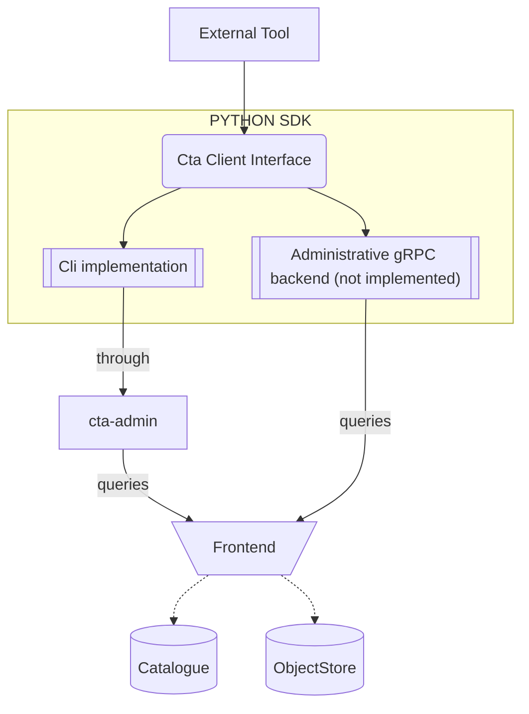
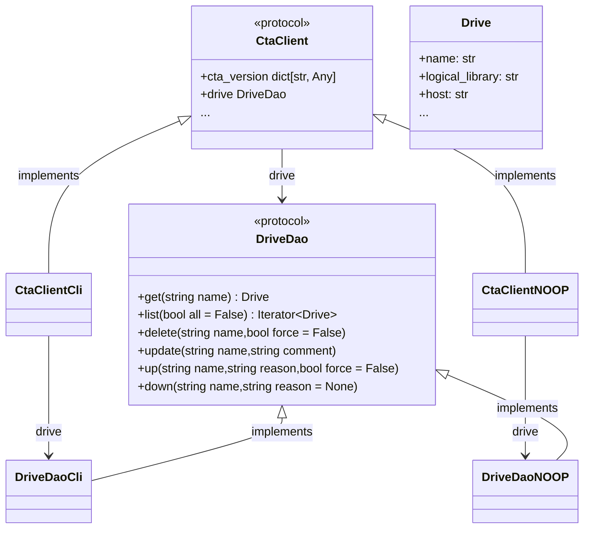

# Overview

The `cta-sdk` is a Python package that offers a high-level, object-oriented API for interacting with the CERN Tape Archive (CTA). It provides functionality equivalent to the `cta-admin` command-line tool but with the benefits of a modern Python interface, including full static typing support and comprehensive domain models.

The main motivation of building this SDK was to have a cleaner way to build scripts with a higher confidence thanks to static type checker, unit tests and dataclasses models, to avoid to parse and run `cta-admin` subprocesses.

With this SDK, you can initialize a `CtaClient` and access **resource DAOs** (e.g., `TapeDao`, `DriveDao`, `UserRequestDao`) to perform operations like creating, retrieving, updating, and deleting CTA resources. Each dao returns data as structured Python `dataclasses`, providing a clear and type-safe way to work with CTA objects, complete with IDE autocompletion and static analysis support.


**Key Features:**:

- 🔒 **Fully typed** with Python 3.9+ type hints
- 📊 **Comprehensive domain models** with nested dataclasses for complex resources
- ⚡ **Streaming support** for large result sets
- 🔐 **XRootD SSS authentication** via keytab files
- 📦 **Protocol-based architecture** enabling multiple backends


> This SDK is the first package to consider when you want to develop tools which talks to `cta-frontend` from an operator perspective.


## Architecture



### Code structure

`CtaClient` exposes a DAO for each supported CTA resource.  
Diagram here only shows one daos/resource (`drive`) with two different "backends" implementation examples (`CLI` and `NOOP`).



### DAOs 

For the available resource DAOs, see [CtaClient Reference ](../../../../api/python/cta-sdk/reference/client/) 

### Backends

The SDK is designed to support multiple backends for communicating with CTA. Currently, only the **`CLI`** backend is fully implemented and a **`FILE`** backend for local development . You can select a backend using the `get_cta_client` factory function.

!!! note "See also"
    [CtaClient reference](../../../../api/python/cta-sdk/reference/client/)

!!! info
    **`FILE`** backend is only available when installing with dev extra `cta-sdk[dev]`

!!! info
    The administrative factory supports `CLI` and `FILE`.
    The separate [gRPC workflow client](../../../../api/python/cta-sdk/reference/workflow/) handles archive and retrieve requests; it is not a `get_cta_client("GRPC")` backend.

## Installation

!!! abstract "Command"
    ```bash
    python3 -m pip install --extra-index-url https://cta-public-repo.web.cern.ch/cta-operations/stable/pypi/simple/ cta-sdk
    ```

## configuration

The only configuration provided for now, is during the backend instantiation when getting a CtaClient object. The backend can be configured by passing parameters to the `get_cta_client()` function, or directly by using the corresponding CtaClient implementation as `CtaClientCli`.

???+ Example
    ```python
    from cta.sdk import get_cta_client

    # Create client with custom configuration
    cta_client = get_cta_client(
        "CLI",
        exec_path="/usr/bin/cta-admin",        # Path to cta-admin executable
        timeout=60,                             # Command timeout in seconds (default: 60)
        sss_keytab_file="/etc/cta/tape-local.sss.keytab",  # Path to XRootD SSS keytab
        cta_conf_file="/etc/cta/cta-cli.conf"  # Optional CTA configuration file to specify the frontend to talk too
    )
    ```

!!! note
    See also [CtaClient reference](../../../../api/python/cta-sdk/reference/client/).

`CTAXrdSecSSSKT` environment variable can be used to override the keytab file location.

??? Example
    ```python
    import os

    # Override keytab file location
    os.environ['CTAXrdSecSSSKT'] = '/path/to/custom.keytab'

    # Create client - will use the custom keytab if readable
    cta_client = get_cta_client("CLI")
    ```

!!! note
    If `CTAXrdSecSSSKT` is set and the file is readable, it takes precedence over the `sss_keytab_file` parameter. If the keytab file is not available or not readable, the SDK does not set a keytab override.


## Usage

Please see [API Usage](api-usage.md) page.

## Type Support and IDE Integration

The SDK is fully type-annotated, providing excellent IDE support. All resource models are defined in `cta.sdk.models` package for type hinting and runtime use.


## License

GPL-3.0-or-later  
Copyright © 2026 CERN
