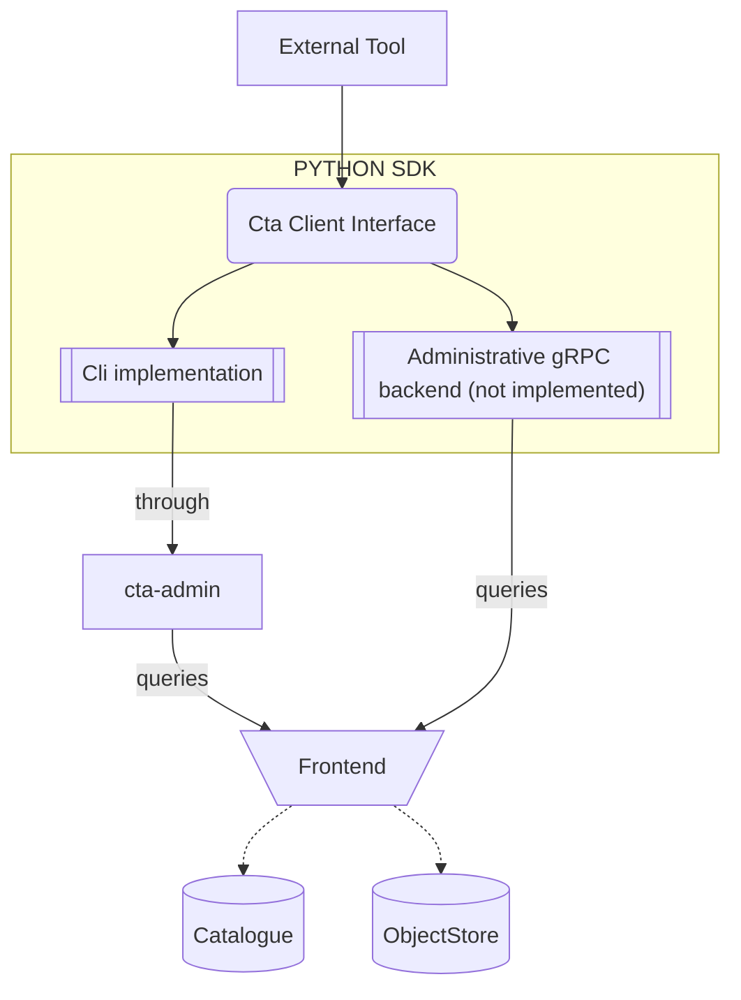
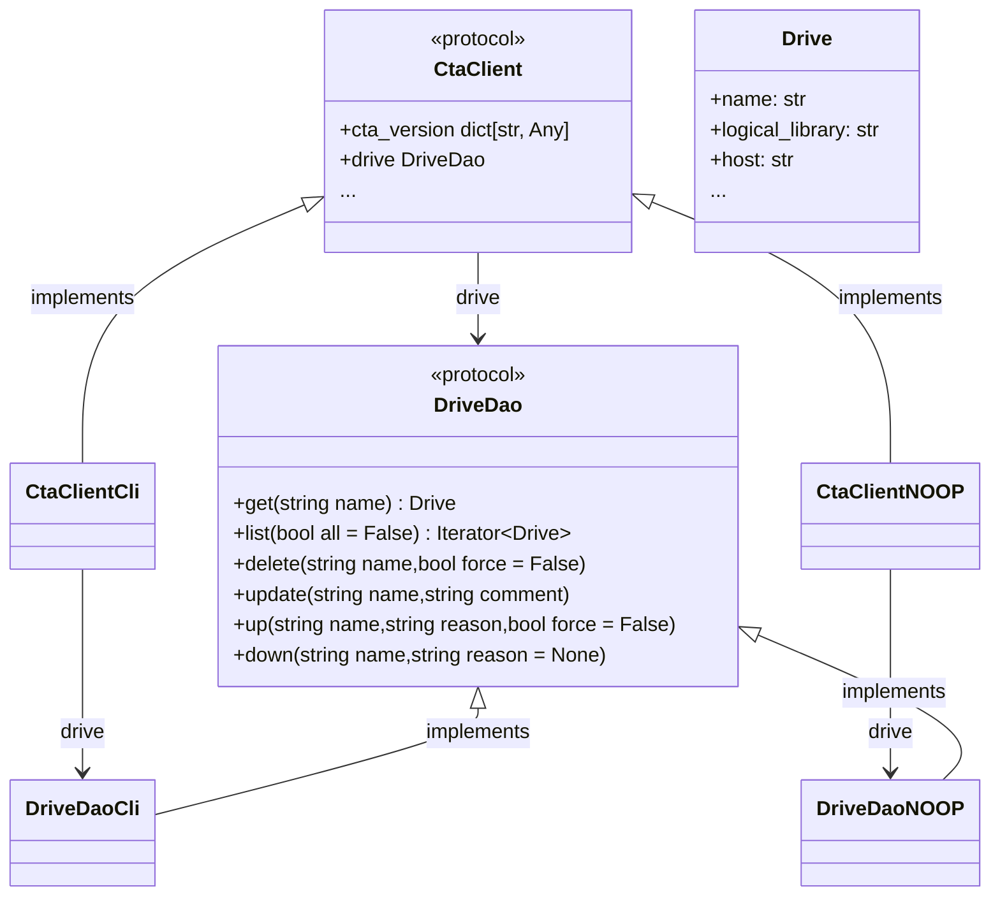

# Overview

`cta-sdk` provides a typed Python interface for administering CTA resources.
Its `CtaClient` exposes resource DAOs such as `TapeDao` and `DriveDao`, which return Python dataclasses.
The CLI backend runs `cta-admin` and parses its output for the caller.

The SDK supports streaming results, XRootD SSS authentication through keytab files, and backend interfaces defined with Python protocols.

## Architecture



### Code structure

`CtaClient` exposes a DAO for each supported CTA resource.  
Diagram here only shows one daos/resource (`drive`) with two different "backends" implementation examples (`CLI` and `NOOP`).



### DAOs 

For the available resource DAOs, see [CtaClient Reference ](../../../../api/python/cta-sdk/reference/client.md) 

### Backends

The SDK is designed to support multiple backends for communicating with CTA. Currently, only the **`CLI`** backend is fully implemented and a **`FILE`** backend for local development . You can select a backend using the `get_cta_client` factory function.

!!! note "See also"
    [CtaClient reference](../../../../api/python/cta-sdk/reference/client.md)

!!! info
    **`FILE`** backend is only available when installing with dev extra `cta-sdk[dev]`

!!! info
    The administrative factory supports `CLI` and `FILE`.
    The separate [gRPC workflow client](../../../../api/python/cta-sdk/reference/workflow.md) handles archive and retrieve requests; it is not a `get_cta_client("GRPC")` backend.

## Installation

!!! abstract "Command"
    ```bash
    python3 -m pip install --extra-index-url https://cta-public-repo.web.cern.ch/cta-operations/stable/pypi/simple/ cta-sdk
    ```

## configuration

The only configuration provided for now, is during the backend instantiation when getting a CtaClient object. The backend can be configured by passing parameters to the `get_cta_client()` function, or directly by using the corresponding CtaClient implementation as `CtaClientCli`.

???+ Example
    ```python
    from cta.sdk import get_cta_client

    # Create client with custom configuration
    cta_client = get_cta_client(
        "CLI",
        exec_path="/usr/bin/cta-admin",        # Path to cta-admin executable
        timeout=60,                             # Command timeout in seconds (default: 60)
        sss_keytab_file="/etc/cta/tape-local.sss.keytab",  # Path to XRootD SSS keytab
        cta_conf_file="/etc/cta/cta-cli.conf"  # Optional CTA configuration file to specify the frontend to talk too
    )
    ```

!!! note
    See also [CtaClient reference](../../../../api/python/cta-sdk/reference/client.md).

`CTAXrdSecSSSKT` environment variable can be used to override the keytab file location.

??? Example
    ```python
    import os

    # Override keytab file location
    os.environ['CTAXrdSecSSSKT'] = '/path/to/custom.keytab'

    # Create client - will use the custom keytab if readable
    cta_client = get_cta_client("CLI")
    ```

!!! note
    If `CTAXrdSecSSSKT` is set and the file is readable, it takes precedence over the `sss_keytab_file` parameter. If the keytab file is not available or not readable, the SDK does not set a keytab override.


## Usage

See [Usage](api-usage.md) for examples.

## Type Support and IDE Integration

The SDK includes type annotations and defines its resource models in `cta.sdk.models`.


## License

GPL-3.0-or-later  
Copyright © 2026 CERN
