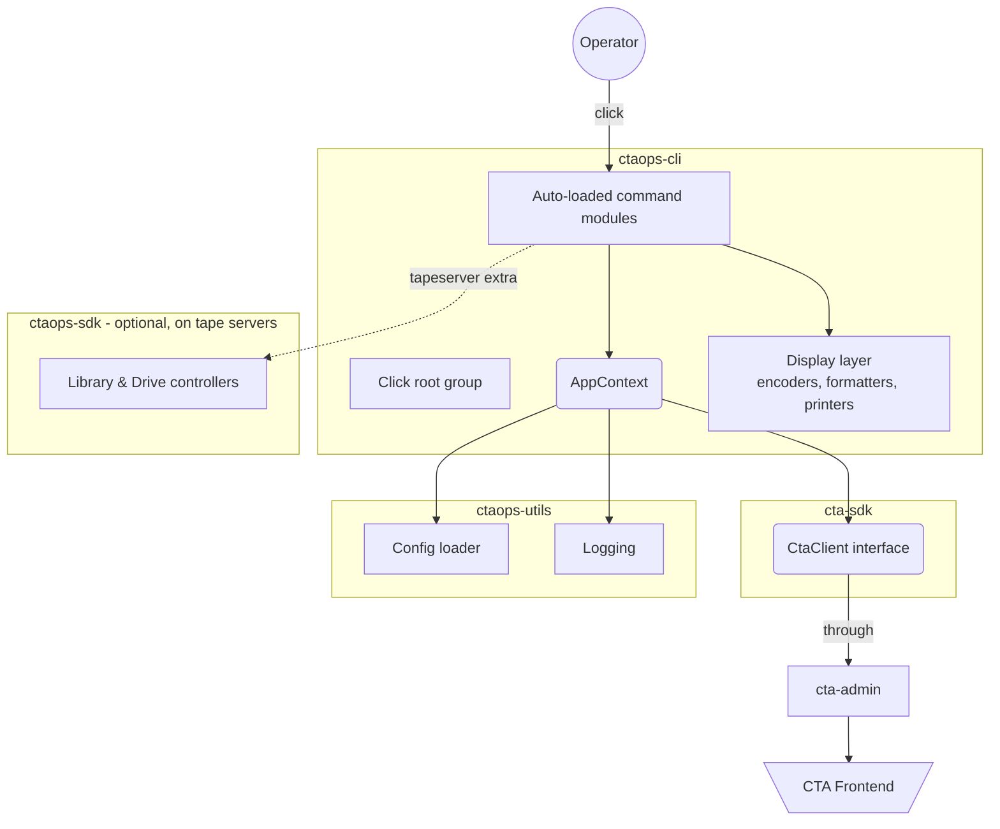

# Extending ctaops

See the [operator guide](../../../ops/tools/ctaops.md) for installation and configuration.

## Architecture

### Command resolution

1. Operator types e.g. `ctaops tape list --all`.
2. Click's root group (`ctaops`) parses the global options and builds the [AppContext](../../../api/python/ctaops-cli/reference/entrypoint.md#ctaops.cli.context.AppContext).
3. The root group resolves `tape` (or its alias `ta`) using the custom [ClickAliasedGroup](../../../api/python/ctaops-cli/reference/entrypoint.md#ctaops.cli.click_extension.aliases.ClickAliasedGroup).
4. The `list` subcommand executes against the [CtaClient](../../../api/python/cta-sdk/reference/client.md#cta.sdk.client.protocol.CtaClient) held in the context.
5. The result is formatted by the [display layer](../../../api/python/ctaops-cli/reference/display.md#ctaops.cli.display.printers) according to the selected format (`table` / `json` / `raw`).

### Extensible by convention

New command groups are picked up automatically: drop a new module in [ctaops.cli.commands](../../../api/python/ctaops-cli/reference/commands.md#ctaops.cli.commands) that exports a `click.Group`, and the next CLI invocation will load it via [load_commands](../../../api/python/ctaops-cli/reference/entrypoint.md#ctaops.cli.main.load_commands).
