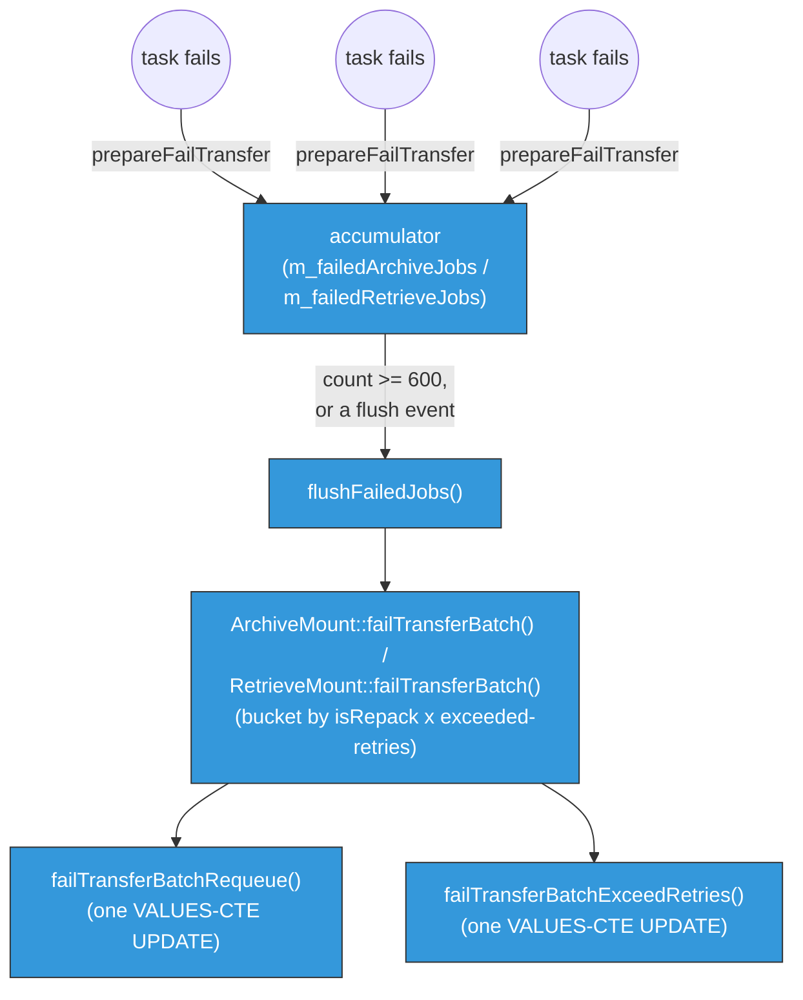

!!! info "PostgreSQL scheduler"

    This page describes the PostgreSQL scheduler backend.

# Batching failed-job reports

Reporting a transfer failure back to the scheduler DB is on the same hot path as a successful
transfer, but it used to pay for it file by file: each failed read or write cost its own scheduler-DB
round trip, serializing DB connection usage exactly when a drive or library is already in trouble
(many files failing in quick succession). Batching merges many jobs' failure reports into one SQL
statement, the same idea as [opportunistic batching](opportunistic-batching.md) applied to the
report path instead of the queueing path.

This is implemented for the postgres scheduler backend (pgsched) only. The objectstore backend
always reports file by file; its `prepareFailTransfer()`/`failTransferBatch()` are unimplemented
stubs (`NotImplementedException`) for exactly this reason — see
[Why the single-job path still exists](#why-the-single-job-path-still-exists) below.

## In-memory accumulation

When a task fails, `MigrationReportPacker`/`RecallReportPacker` call `prepareFailTransfer(reason)` on
the job. This updates the job's in-memory state only — it appends to `failureLogs`/`reportFailureLogs`
and bumps the retry counters — and does **not** touch the DB. The job is then pushed onto an
in-process accumulator (`m_failedArchiveJobs` / `m_failedRetrieveJobs`).

The accumulator is flushed (`flushFailedJobs()`) whenever any of these happen, whichever comes first:

- it reaches `c_failedJobsBatchMax` (600, hardcoded, identical for archive and retrieve);
- a `ReportFlush` event fires (the same periodic/count-driven event — governed by `flushMaxFiles`/
  `flushMaxBytes` — that also flushes the successful-jobs batch to EOS, see
  [below](#two-different-batch-sizes-on-purpose));
- `ReportLastBatchError` or `ReportEndofSession` runs.

So in practice 600 only matters as a *worst case within one flush window*: a dense burst of failures
(e.g. a dying drive failing every file) can hit it before the next periodic flush would have fired
anyway. If `failTransferBatch()` throws, the whole in-flight batch is dropped (not retried) and left
for the garbage collector to pick up later — see [Garbage Collection](garbage-collection.md).

## The batched SQL

`flushFailedJobs()` hands the accumulated jobs to `ArchiveMount::failTransferBatch()` /
`RetrieveMount::failTransferBatch()`, which buckets them by `isRepack` and by whether each job has
exceeded `maxTotalRetries`, then issues **one** SQL statement per bucket:

- `ArchiveJobQueueRow`/`RetrieveJobQueueRow`::`failTransferBatchRequeue()` — under budget, moves the
  whole bucket back to `(REPACK_)*_PENDING_QUEUE` in one `VALUES`-CTE `UPDATE`.
- `failTransferBatchExceedRetries()` — budget exceeded, sets the whole bucket's status to
  `*_ToReportTo{User,Repack}ForFailure` in one statement.

This is live for repack on both archive and retrieve, as well as for ordinary user jobs — the
counters and retry/exceed logic are identical; only the destination queue/status differs.

### Append-once `FAILURE_LOG`

Each row's `FAILURE_LOG`/`REPORT_FAILURE_LOG` column must never be duplicated across retries.
`updateJobRowFailureLog()` appends onto a value that was *already loaded from the DB column* at
row-construction time, so by the time the batched SQL runs, the in-memory string already contains
old+new text. The SQL binds that string directly (`:FL`) rather than re-concatenating it with
`||`/`COALESCE` against the DB column — the few places that still use `||` are bound from a fresh
literal marker (e.g. `"UNPROCESSED_TASK_QUEUE_JOB_REQUEUED"`), not from the loaded log, and are
correctly additive.

### Repack reporting is a separate mechanism entirely

Repack's failure *reporting* to the operator (aggregate `FILE_COUNT`/`FILE_BYTES` stats per repack
request) is architecturally unrelated to anything above: `getNextFailedArchiveRepackReportBatch()` /
`getNextFailedRetrieveRepackReportBatch()` work off aggregate counters via
`moveFailedRepackJobBatchToFailedQueueTable()` + `RepackRequestTrackingRow::updateRepackRequestFailuresBatch()`.
There is no per-job `FAILURE_LOG` concatenation and no retry-count concept there; it never reaches
disk/EOS reporting at all. What this page describes is purely the *transfer*-retry mechanism
(deciding whether a failed job gets another attempt or is given up on) — repack jobs go through it
exactly like user jobs, but repack's own *reporting* of the outcome to the operator is a different
layer downstream.

## Two different batch sizes, on purpose

`c_failedJobsBatchMax` (600) is easy to confuse with `flushMaxFiles` (the config key governing how
many *successful* jobs accumulate before `reportSuccessfulJobsBatch()` reports them to EOS — e.g.
8000 in the stress-scale CI preset), but they bound different things and are tuned independently:

| | Failed-job batch (`c_failedJobsBatchMax`) | Successful-job batch (`flushMaxFiles`) |
|---|---|---|
| Downstream call | Scheduler-DB `UPDATE` only | One XRootD/EOS WFE call + DB write |
| Configurable? | No — compile-time `constexpr`, same for every deployment | Yes — per-mount-type Helm/config value |
| Blast radius if the batch call throws | Whole batch dropped, rescued later by GC | Whole batch falls back to a slow per-file retry path (documented in `ArchiveMount.hpp`) |

The asymmetry is a real gap worth knowing about rather than an active bug: `flushMaxFiles` has been
raised for scale testing (2000 → 4000/8000) while `c_failedJobsBatchMax` never moved and isn't even
wired to config. In practice this rarely bites, because failed jobs are *also* flushed on every
periodic `ReportFlush` event regardless of count (see above) — so 600 only matters during an unusually
dense failure burst within a single flush window. But if a future deployment needs to push
`flushMaxFiles` much higher for scale, revisit `c_failedJobsBatchMax` at the same time: a failure
storm is exactly the moment you don't want the system falling back to smaller, more numerous DB
round trips than the success path was tuned for.

## Why the single-job path still exists

`ArchiveRdbJob`/`RetrieveRdbJob`'s `failTransfer()` → `requeueFailedJob()`/`updateFailedJobStatus()`/
`handleExceedTotalRetries()` is the pre-batching, one-job-at-a-time mechanism. Under `CTA_PGSCHED`, no
production taped session calls it any more — `MigrationReportPacker`/`RecallReportPacker` only ever
call it from their `#else` (objectstore) branch.

It cannot simply be deleted or made to throw, because it is part of the common
`SchedulerDatabase::ArchiveJob`/`RetrieveJob` interface that both backends must implement, and
`SchedulerDatabaseTest.cpp` exercises it directly (`popAndRequeueArchiveRequests`) against *both*
backends via `INSTANTIATE_TEST_CASE_P`. That generic test cannot be switched to the batched
`prepareFailTransfer()`/`failTransferBatch()` calls instead, because those two methods are
deliberately unimplemented (`throw NotImplementedException`) on the objectstore side — batching is
pgsched-only by design. So `failTransfer()` stays as the one call both backends genuinely support,
even though the taped session's own report packers never reach it under pgsched today.
