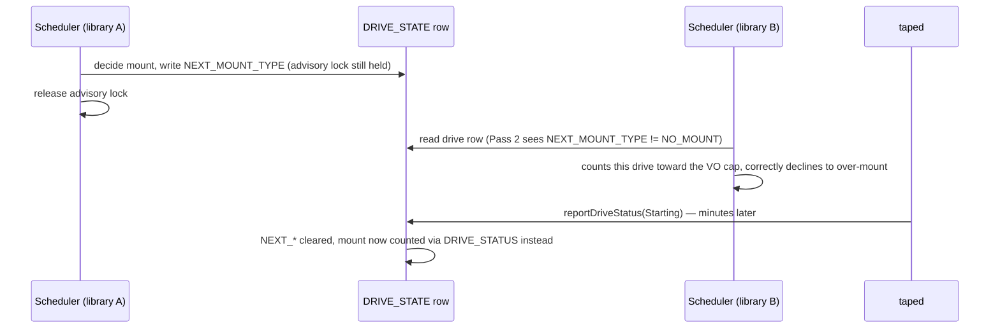

!!! info "PostgreSQL scheduler"

    This page describes the PostgreSQL scheduler backend.

!!! warning "Known gap, not a final fix"

    The mechanism on this page is a mitigation that narrows a race window. It is not a correct
    fix. See [Why this is not the final fix](#why-this-is-not-the-final-fix) below.

# VO mount-limit race: next-mounts not counted toward the active-mount cap

## The problem

A virtual organization's `readMaxDrives`/`writeMaxDrives` caps how many drives may be mounted for
it at once. `Scheduler::getExistingAndNextMounts()` enforces this by counting, per VO, how many
drives are already doing something for it before deciding whether one more mount is allowed.

Under pgsched, each logical library is protected by its own PostgreSQL advisory lock, so
schedulers for *different* libraries run concurrently — unlike the objectstore backend, which
serializes all scheduling decisions behind one global lock. That concurrency is what exposes the
race: a drive that has just been assigned a mount is only visible as "doing something for this VO"
once `DRIVE_STATE.DRIVE_STATUS` reflects it (`Starting`, `Mounting`, `Transferring`, …). But that
column is written by **taped**, seconds to minutes after the scheduler committed the mount decision
and released its advisory lock. In that window, the drive's row still reads `Up` with nothing
pending. A second, concurrent scheduler decision (for a different library, racing to mount tape for
the same VO) reads that same row, undercounts the VO's active mounts, and approves a mount that
pushes the VO over its cap.

## The mitigation: `NEXT_*` columns

`DRIVE_STATE` carries four `NEXT_*` columns (`NEXT_MOUNT_TYPE`, `NEXT_VID`, `NEXT_TAPE_POOL`,
`NEXT_VO`) that record a *pending* mount before taped ever reports `Starting`.
`TapeMountDecisionInfo::createArchiveMount()`/`createRetrieveMount()` write them immediately after
deciding the mount, still inside the scope of the advisory lock, via `RdbmsDriveStateCatalogue::
updateTapeDriveStatus()`. `Scheduler::getExistingAndNextMounts()` then counts active mounts in two
passes: Pass 1 via `DRIVE_STATUS` (as before), Pass 2 via `NEXT_MOUNT_TYPE != NO_MOUNT`. Pass 2 is
what closes the specific window described above. The marker is cleared unconditionally whenever the
drive's status next changes (`RdbmsDriveStateCatalogue::updateTapeDriveStatus()`, Case 2) — once
taped reports `Starting`, the mount is counted via `DRIVE_STATUS` instead, so leaving `NEXT_*` set
would double-count it.

## Why this is not the final fix

The `NEXT_*` write is a plain, unsynchronized read-modify-write against a row that other actors can
change at any time (taped's own status reports, operator `cta-admin dr` commands, heartbeat
updates), and it is **not transactionally tied to the mount decision it is meant to record**:

- **Orphaned marker on rollback.** `createArchiveMount()`/`createRetrieveMount()` write `NEXT_*`
  through the catalogue's own connection pool — a separate, independently-autocommitting connection
  from the scheduler-DB transaction (`m_txn`) that the advisory lock and the actual mount decision
  live in. If `commit()` subsequently throws (both call sites catch exactly this and call
  `m_txn->abort()`), the scheduler-DB side is correctly rolled back — no mount is granted, no jobs
  move — but the `NEXT_*` write already happened and cannot be un-committed from inside that catch
  block. The drive is left looking like it has a pending mount for a VO that was, in fact, never
  granted one. Nothing clears this except the drive's *next genuine status transition* (Case 2
  above) — if the drive simply stays `Up` and idle afterwards, the marker, and the inflated VO
  count it causes, can persist indefinitely.
- **Lost-update race on the write itself.** The write is read-then-write, not compare-and-swap
  under a lock that also covers the read: `getTapeDrive()` reads the row, then
  `updateTapeDriveStatus()` writes it back with `NEXT_*` added, using the *old* status as its
  optimistic match (`WHERE DRIVE_STATUS = :old_status`, Case 1). If some other writer changes the
  row in between — taped reporting a status change on this exact drive, for instance — Case 1's
  match fails and the code falls through to Case 2, which unconditionally overwrites the *entire*
  row (status, mount type, session ID, timestamps, …) using the stale struct from the original
  read. That silently reverts whatever the concurrent writer had just set.
- **Heuristic, not a closure.** The whole mechanism only narrows the race to "whatever a single
  catalogue row and a per-library advisory lock can coordinate." It has no notion of the VO as a
  resource with its own atomicity guarantee — it works today only because every current caller
  happens to go through the same advisory-lock-protected path, not because the VO's mount count is
  actually protected.

None of this is covered by the regression tests added alongside this mechanism
(`createArchiveMountSetsNextMountTypeBeforeLockRelease`, `createRetrieveMountSetsNextMountTypeBeforeLockRelease`,
and the `DriveStateCatalogueTest` `NEXT_*` cases): they all exercise the single-writer happy path.

## The real fix

Closing this properly needs one of:

1. **A catalogue-level row lock on the VO table itself**, so that the read-count-decide sequence
   for a given VO's active-mount cap is atomic and serialized across every scheduler and every
   library — not merely narrowed by a per-library advisory lock plus a best-effort marker on an
   unrelated table.
2. **A dedicated, centralized mount-scheduling service** that owns mount decisions across all
   libraries and VOs in one place, removing the need for several independent per-library lock
   holders to coordinate through shared catalogue state at all. This approach is prototyped in
   [cta/CTA!1437](https://gitlab.cern.ch/cta/CTA/-/merge_requests/1437).

Until one of these lands, treat the `NEXT_*` mechanism as a mitigation that makes the race much
rarer in practice, not as a guarantee that `readMaxDrives`/`writeMaxDrives` can never be exceeded.
