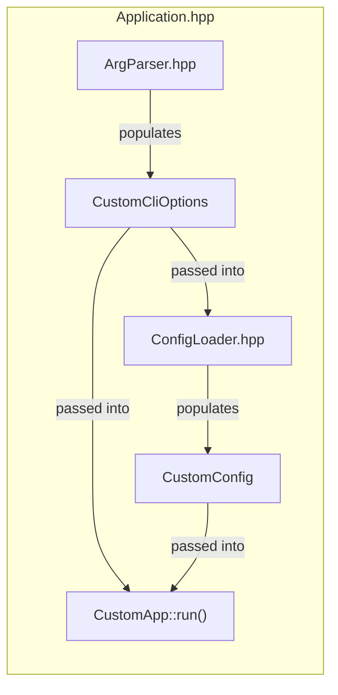
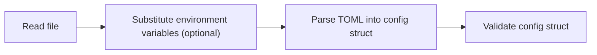

# Service Runtime

The runtime library in `lib/runtime/` provides common application startup, configuration, logging, signals, health, and telemetry infrastructure. It reduces boilerplate and checks application contracts at compile time. This page is for developers implementing tools and daemons; deployed-service settings belong in [Operations](../../ops/deploy-and-configure/configuration/service-runtime.md).

## Application model

Each application/tool has the same two inputs:

1. The commandline arguments.
2. The config file.

The main idea behind the implementation library here is to separate between (1) what the code representation of these two inputs look like and (2) how this code representation is populated from what the user provided.

Both the commandline arguments and the config file are internally defined as simple immutable struct (a data class if you will).
In addition, the main App is specified as a simple class.
This means that the developer defines three things (in this order):

1. The struct to store the commandline options
2. The struct to store the config
3. The class of your main application

Then the way you define an app is as follows:

```c++
runtime::Application<CustomApp, CustomConfig, CustomCliOptions> app("my-app", "This is a description of my app");
app.run(argc, argv);
```

A picture is worth a few words; a very simplified view of `Application.hpp` is this:



## Configuration validation

Config loading is done using a combination of [tomlplusplus](https://github.com/marzer/tomlplusplus) to read TOML files and a custom parser to populate the struct.

The runtime library loads configuration through the following steps:



Parsing remains available without expansion, including for already-resolved text and literal data such as JWT revocation files.

The only thing the developer needs to take care of is that the structure of the config struct matches the structure of TOML files. Both in terms of types and in terms of hierarchy and names. See e.g. `maintd/` for an example of what this looks like.

Configuration checking is split into three layers with distinct responsibilities:

1. The TOML parser reads TOML into the config struct. It checks syntax, structure, types, numeric bounds, signedness, and strict-mode requirements such as missing or unknown fields.
2. The config struct's `ValidationResult validate() const` method checks the fully initialized struct. It collects semantic constraints such as non-empty strings, strictly positive values, supported values, and valid combinations of entries. It must not read TOML or inspect external resources.
3. Application-specific initialization checks external state. Examples include checking that a configured file exists or is readable, connecting to a database, and verifying that a remote service is reachable.

`ConfigLoader` calls `validate()` after the parser has successfully populated the root config struct. If validation reports errors, the loader presents all of them in one `UserError`. Root and parent config structs must explicitly merge the validation result from each custom config child. Keeping these calls explicit makes the validation flow visible and allows parent validation to enforce relationships between its children.

### Optional fields and feature activation

Strict mode MUST require every applicable setting to be explicit, except where absence is a valid, documented state.
Disabling a feature allows its configuration to be omitted.
Enabling it requires its settings to be explicit again.

#### When a field may be optional

There are two valid reasons to make a field or section optional:

- **It does not apply:** an explicit feature gate or mode selector makes it unnecessary.
- **Absence has a meaning:** the application supports leaving it unset without choosing a fallback value.

Use this table when classifying a field:

| Field | May be omitted in strict mode? | Example |
| --- | --- | --- |
| Section for a disabled feature | Yes | Telemetry configuration when telemetry is disabled |
| Section for an enabled feature | No | JWT configuration when JWT is enabled |
| Setting with a default, used by an active feature | No | JWT cache refresh interval |
| Required value with no sensible default | No | Kerberos keytab path |
| Value with a supported absence state and no fallback | Yes | No additional certificate-chain file |
| Integer setting supporting automatic sizing or delegation | No; explicitly supply `0` to select that behaviour | Worker count calculated from CPU count |

For a field to remain optional when it applies, all of these requirements MUST hold:

- Its documentation explains what absence means, and the application supports that state.
- Its C++ initial state is `std::nullopt`.
- Consumers preserve absence rather than substitute a default, including library, operating-system, scheduler or calculated defaults.
  Check fallback code such as `value_or(default)`.
- Supplied values receive the normal type and semantic checks.

For example, an omitted token-revocation path can mean that no additional file is used.
An omitted stack size that selects the operating-system default does not qualify.
Use an explicit integer sentinel as described below.

Empty strings, zero and empty collections are explicit values with their own validation rules.
They do not generally mean “absent”.
Strict mode still requires an explicit empty collection when that is the intended setting, for example `attributes = {}` for no additional logging attributes.
Do not describe defaulted fields as optional.
In example files, explain the strict-mode rule once in the header rather than repeating it for each setting.

#### Example configuration comments

Use the same format for each setting: a short operational description, `Type: <TOML type>; default: <value>.`, and an `Allowed: ...` line for constrained string values.
Keep the introduction to the purpose of the file and one strict-mode rule; do not redefine “required” there.
Lead setting descriptions with what the setting controls, then explain special values or a useful operational consequence.
Avoid repeating the key name, metadata or an allowed-values list in prose.
Keep shared rules at section level and longer explanations in the service documentation.
Use `default: none; required` for settings that must be supplied whenever their section is active, even in non-strict mode.
Use `default: none; optional` only for values that may be omitted even in an active section under strict mode, and explain what absence means.
For defaulted fields, omit the requiredness label: the header explains that these fields are required in strict mode and defaulted otherwise.
Describe whether a feature is optional, recommended or selected above its section, separately from the requiredness of its fields.
An optional feature may have required settings.
Describe units, special values such as `0`, and the consequences of changing a setting in the description.
Document the actual accepted values and defaults from the configuration structs and validators, not from the example assignments.

Treat service examples as recommended starting configurations with deployment-specific placeholders, rather than minimal configurations or exact copies of every default.
Show recommended optional features such as telemetry and health endpoints enabled, with their settings present.
Keep numeric assignments equal to struct defaults where defaults exist; document any deployment-specific exception.
A required numeric field without a valid default needs an explicitly illustrative value.
If an alternative numeric value is generally preferable, reconsider the struct default rather than silently recommending different tuning in the example.
Keep documented defaults accurate even when feature selections, logging attributes or deployment-specific values differ.
Leave unused optional scalar settings and mutually exclusive alternatives commented out, with instructions for switching alternatives.
Document free-form maps at the map level; example keys are not predefined configuration fields.
Describe prerequisites and relationships between settings at section level.
For feature lists, list the allowed names and any restrictions on combinations.
Keep shared sections in the same order across service examples: catalogue, scheduler, logging, telemetry, health server, XRootD, gRPC and authentication, followed by service-specific settings.
Keep each parent table and its children together, and use the same order in objectstore and PostgreSQL variants.
Show logging labels under `[logging.attributes]`, including an `instance` example; explain the map once rather than documenting arbitrary keys as predefined optional fields.
Use two spaces for settings beneath a table, a blank line between settings, and comments above assignments.
Expand inline tables when their members need individual descriptions.

When updating examples, check the starting configuration and relevant enabled, disabled and alternative-feature variants with the matching service's strict configuration check.
Keep validation coverage separate from recommendations about which features to enable.
This detects stale keys and missing settings; it does not verify prose or claimed defaults.

#### Automatic sizing and integer sentinels

For integer settings that support automatic sizing or delegation to another component, use `0` to explicitly select that behaviour.
Positive values specify a fixed value in the field's documented units.
Keep the field integer-valued; do not introduce an `"auto"` string alternative or a separate policy field.
Strict mode requires the field whenever it applies, including an explicit `0` when automatic behaviour is wanted.
These settings are not optional merely because they support automatic behaviour.

Document what `0` means for each field, including how the value is calculated or which component supplies it.
Strict mode makes that choice explicit; it does not freeze the calculated result across environments or implementation changes.
Validation must accept the documented sentinel and reject other invalid values.
Consumers must resolve the sentinel before passing the value to an API that expects a positive count or size.

For example:

```toml
[grpc]
# Calculate the thread limit from the CPU count; a positive value fixes the limit.
number_of_threads = 0

[scheduler.client]
number_of_threads = 500
# Use the system's thread-stack size; a positive value specifies the size in MB.
thread_stack_size_mb = 0
```

The scheduler client settings above apply to objectstore builds.
The current gRPC calculation is eight times `std::thread::hardware_concurrency()`; a CPU count of zero is treated as one CPU, and the resulting thread limit is capped to the integer range supported by gRPC.

Zero is not a universal spelling of “automatic”.
Preserve other documented meanings, such as “unlimited”, and keep zero invalid for fields where it has no supported meaning.
For `defaults.repack.max_files_to_select`, `0` means all files.
This field is required in strict mode; it does not inherit a scheduler-selected limit.

#### How features are enabled

Use `enabled_features` and `enabled_experimental_features` at the service root for stable and experimental service-wide capabilities.
For nested behaviour, use a domain-specific selector in the parent, such as `transfers.retrieve.rao_enabled`, `transfers.encryption_enabled`, or `routines.enabled_routines`.
Do not add empty experimental lists to nested sections.
Classify telemetry and PostgreSQL workflow batching as experimental; health endpoints, maintenance routines, encryption and RAO are stable.
Experimental means the interface may change incompatibly or be removed; selecting a feature in the experimental list is the explicit opt-in.
Use a more specific name where helpful, such as `auth.enabled_methods` for authentication.
For mutually exclusive alternatives, use one mode selector, such as `transport = "tcp"` or `"unix"`.
Do not put an `enabled` flag inside the section it controls.

**Activation lists:**

- Strict mode requires both root feature lists, including `[]` when no features of that class are enabled, and all applicable nested selectors.
- In non-strict mode, both feature lists default to empty.
- Use `validateFeatureLists()` with disjoint stable and experimental name sets to reject names in the wrong list, with guidance to move them.
- A feature cannot appear in both lists.
- On promotion to stable, move its name to the stable set and validate its section against `enabled_features`; configurations must move the selection to that list.
  Keep its settings section at the same path and document the migration.
- Unknown and duplicate names are errors in both modes.
- List order has no meaning.

Keep defaults in configuration member initializers, including the complete backend-specific `enabled_routines` list and populated routine sections.
`RoutinesConfig::isSectionEnabled(name)` lets the loader distinguish selected defaults from inactive sections.
The loader parses non-optional members before optional sections, so selection is independent of declaration and TOML key order.
For configs defining this hook, omitted selected sections retain their member initializers only in non-strict mode; strict mode requires the sections and their settings explicitly.
Omitted inactive sections are cleared, and explicitly supplied inactive sections are rejected in both modes.
Configs without the hook retain the usual optional-field absence semantics.
The hook must classify every optional member in its config; it must not introduce fallback values or mutate configuration.

**Sections must match the selection in both modes:**

| Selection | Required configuration |
| --- | --- |
| Feature enabled | Its section must be explicit in strict mode. Non-strict mode may use a section default declared by the config and selected through `isSectionEnabled()`. |
| Feature disabled | Its section must be absent. |
| Mode selected | The applicable section must be present; sections for other modes must be absent. |

A supplied section never enables a feature implicitly.

The [OpenTelemetry Collector](https://opentelemetry.io/docs/collector/configuration/) also separates extension configuration from activation.
CTA additionally rejects sections for disabled features so that supplied configuration cannot silently remain unused.

## Application configuration

The following example describes the current application interface.

```c++
struct CustomConfig final {
  // Add this if the app/tool uses the catalogue
  cta::runtime::CatalogueConfig catalogue;
  // Add this if the app/tool uses the scheduler
  cta::runtime::SchedulerConfig scheduler;
  // Must always be present; all tools and apps support logging
  cta::runtime::LoggingConfig logging;
  // Add this if the app should be able to produce telemetry
  std::optional<cta::runtime::TelemetryConfig> telemetry;
  // Add this if the app needs a separate health endpoint
  // Don't add this if the app already natively exposes a health endpoint (e.g. a REST API)
  std::optional<cta::runtime::HealthServerConfig> health_server;
  // Explicitly select optional capabilities.
  std::vector<std::string> enabled_features;
  std::vector<std::string> enabled_experimental_features;
  // Add this if the app uses XRootD
  cta::runtime::XRootDConfig xrootd;
  // Put whatever you want here; will be populated from the config file and available in the run() function
  MyCustomConfStruct customConf;

  // All configs must have this function (limitation of custom reflection implementation)
  // If this number is not consistent with the actual number of members, it won't compile
  static constexpr std::size_t memberCount() { return 9; }

  cta::runtime::ValidationResult validate() const {
    cta::runtime::ValidationResult result;
    result.merge("catalogue", catalogue.validate());
    result.merge("scheduler", scheduler.validate());
    result.merge("logging", logging.validate());
    cta::runtime::validateFeature(result, enabled_experimental_features, "telemetry", telemetry);
    cta::runtime::validateFeature(result, enabled_features, "health_server", health_server);
    result.merge("", cta::runtime::validateFeatureLists(
      enabled_features, enabled_experimental_features, {"health_server"}, {"telemetry"}));
    result.merge("xrootd", xrootd.validate());
    result.merge("customConf", customConf.validate());
    return result;
  }
};

class CustomApp {
public:
  CustomApp() = default;
  ~CustomApp() = default;
  void stop(); // Every app MUST have a stop() function
  int run(const CustomConfig& config, cta::log::Logger& log);
  // Alternatively this would compile as well:
  // int run(const CustomConfig& config, const runtime::CommonCliOptions& opts, cta::log::Logger& log);
  bool isLive() const; // Since there is a health_server config, it MUST have an isLive() function
  bool isReady() const; // Since there is a health_server config, it MUST have an isReady() function
  // Optional program-owned OpenTelemetry resource attributes.
  static std::map<std::string, std::string> getStaticTelemetryAttributes(const CustomConfig& config);
  // Optional program-owned attributes added to every log record.
  static std::map<std::string, std::string> getStaticLogAttributes(const CustomConfig& config);
};

int main(const int argc, char** const argv) {
  using namespace cta;
  return runtime::safeRun([argc, argv]() {
    runtime::Application<CustomApp, CustomConfig, runtime::CommonCliOptions> app("cta-custom-app", "description");
    return app.run(argc, argv);
  });
}
```

Program-owned telemetry resource attributes can be returned by the optional `getStaticTelemetryAttributes()` static application method.
Operator-configured resource attributes belong in the declarative OpenTelemetry configuration file.
For temporary backward compatibility, the runtime replaces hyphens in the application name with dots for `service.name`.
Runtime identity attributes such as `service.name`, `service.version`, `service.instance.id`, `host.name`, and the scheduler namespace are reserved.
Attribute keys and values cannot contain commas, equals signs, carriage returns, or line feeds because they are serialized into `CTA_OTEL_RESOURCE_ATTRIBUTES`.

Program-owned attributes added to every log record can be returned by the optional `getStaticLogAttributes()` static application method.
Both hooks extract attributes from configuration and return an owning map by value.

## Custom command-line options

```c++
struct CustomCliOptions : public cta::runtime::CommonCliOptions {
  std::string iAmExtra;
};

// Typically if you want to add custom CLI options, it means your app should consume them.
// As such, the run() method of CustomApp example would change to:
int run(const CustomConfig& config, const CustomCliOptions& opts, cta::log::Logger& log);

int main(const int argc, char** const argv) {
  using namespace cta;
  return runtime::safeRun([argc, argv]() {
    runtime::Application<CustomApp, CustomConfig, CustomCliOptions> app("cta-custom-app", "description");
    app.parser().withStringArg(&CustomCliOptions::iAmExtra, "extra", 'e', "STUFF", "my description");
    return app.run(argc, argv);
  });
}
```

## Minimal application

```c++
struct MinimalConfig final {
  cta::runtime::LoggingConfig logging;

  static constexpr std::size_t memberCount() { return 1; }

  cta::runtime::ValidationResult validate() const {
    cta::runtime::ValidationResult result;
    result.merge("logging", logging.validate());
    return result;
  }
};

class MinimalApp {
public:
  MinimalApp() = default;
  ~MinimalApp() = default;
  void stop(); // Every app MUST have a stop() function
  int run(const MinimalConfig& config, cta::log::Logger& log);
  // Alternatively this would compile as well:
  // int run(const MinimalConfig& config, const runtime::CommonCliOptions& opts, cta::log::Logger& log);
};

int main(const int argc, char** const argv) {
  using namespace cta;
  return runtime::safeRun([argc, argv]() {
    runtime::Application<MinimalApp, MinimalConfig, runtime::CommonCliOptions> app("cta-custom-app", "description");
    return app.run(argc, argv);
  });
}
```


## Lifecycle and runtime state

Each `Application` instance accepts one call to `run()`, including invocations that fail during setup or exit after help, version, or configuration checking.
Create a new instance for another invocation.

`lib/runtime/include/runtime/Application.hpp` owns the startup sequence and shared services. It parses the command line, loads and validates configuration, initializes logging and signals, and starts configured health and telemetry services before calling the application's `run()` method. `--config-check` exits after validation without starting the application.

The runtime emits `program_starting` as its first message and `program_stopped` as its last message.
Applications emit `program_started` after successful initialization and `program_stopping` when entering their shutdown path.
Abrupt termination such as SIGKILL cannot emit `program_stopped`.

The signal reactor invokes `stop()` on `SIGTERM`; the application must arrange for its work to finish and `run()` to return. `SIGHUP` refreshes the log file descriptor without reloading configuration. Register additional application signal handlers with `Application::addSignalFunction()`.

When `--runtime-dir` is supplied, the runtime records configuration and process metadata there.
`Application` reads and expands the main configuration once, saves the original and resolved text, and parses the same resolved buffer.
This keeps the snapshots consistent with what was loaded and avoids repeated expansion. See [runtime-directory configuration](../../ops/deploy-and-configure/configuration/service-runtime.md#runtime-directory).

## Running a runtime-based application with systemd

System services using the runtime library should let systemd create their ephemeral runtime directories and persistent log directories. Use a service-specific runtime directory such as `/run/cta/<service>` rather than sharing `/run/cta` directly: the runtime library writes deterministic names including `config.toml` and `version.json`, which would collide if multiple services shared one directory.

A service unit should follow this pattern, replacing `<service>` with the service name:

```systemd
[Service]
User=cta
Group=cta
RuntimeDirectory=cta/<service>
RuntimeDirectoryMode=0750
LogsDirectory=cta cta/old
LogsDirectoryMode=0755
ExecStart=/usr/bin/cta-<service> --config=/etc/cta/cta-<service>.toml --config-strict --runtime-dir=/run/cta/<service> --log-file=/var/log/cta/cta-<service>.log
```

The service account uses `cta` as its primary group.
Only `cta-taped` and `cta-rmcd` add `SupplementaryGroups=tape` to access tape hardware.

For file logging, rotate by renaming the active file and then use `systemctl kill --kill-whom=main --signal=HUP <unit>` to make the service reopen it. Do not expose this as `ExecReload` unless the application genuinely reloads its configuration: operators reasonably expect `systemctl reload` to apply configuration changes. Do not use `copytruncate`: runtime-based applications refresh their log file descriptor on `SIGHUP`. Use `delaycompress` so compression cannot race with writes made before the signal is processed. If rotated files use an `olddir`, it must be on the same filesystem as the active log.

`cta-maintd` currently implements this convention. Other daemons should adopt it when they migrate to the runtime library. A container that runs exactly one CTA process may use `/run/cta` directly because there is no risk of another process overwriting the deterministic runtime filenames. The image must create that directory with the service account as owner; no runtime volume is required unless the metadata must survive container replacement. Container logging should normally use stdout rather than a systemd-managed log directory.

## Deploying configuration

Packages should install a documented example configuration, but should not copy it automatically to the live configuration path. Examples necessarily contain deployment-specific placeholders or illustrative values; treating one as a working default can start a service against the wrong resources. This is especially important for services such as `cta-taped`, where values such as the drive name must be supplied by the operator.

Service units should pass the live configuration path explicitly and enable `--config-strict`. An operator or configuration-management system should create the live file from the packaged example, replace every site-specific value, and validate it before starting the service:

```console
cta-<service> --config=/etc/cta/cta-<service>.toml --config-strict --config-check
```

Leaving the live file absent is intentional: a fresh installation then fails closed until it has been configured. Example files remain useful as versioned references and may gain new settings during package upgrades without overwriting an operator's live configuration.

## Implementation and tests

- `include/runtime/Application.hpp` and `SafeRun.hpp`: application contracts, lifecycle, and error handling.
- `include/runtime/config/` and `src/config/`: configuration loading, parsing, and validation.
- `include/runtime/cli/`: argument parsing and common options.
- `src/signals/` and `src/health/`: signal handling and health serving.
- `test/ApplicationTest.cpp`: application integration tests.
- `test/config/`, `test/cli/`, `test/signals/`, and `test/health/`: focused tests of the shared infrastructure.

Paths above are relative to `lib/runtime/`. When changing lifecycle behavior, cover startup failure, shutdown, and cleanup in the affected tests. Use `maintd/` as a working application example. Packaging and deployment rules belong in [RPM SPEC and Service Integration](../guides/conventions/rpm-packaging.md).
