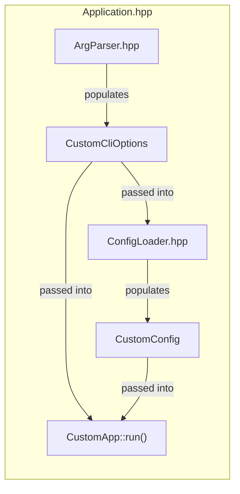
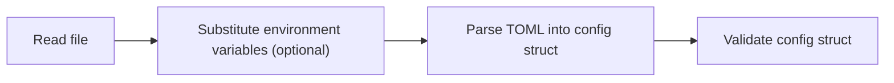

# Service Runtime

The runtime library in `lib/runtime/` provides common application startup, configuration, logging, signals, health, and telemetry infrastructure. It reduces boilerplate and checks application contracts at compile time. This page is for developers implementing tools and daemons; deployed-service settings belong in [Operations](../../ops/deploy-and-configure/configuration/service-runtime.md).

## Application model

Each application/tool has the same two inputs:

1. The commandline arguments.
2. The config file.

The main idea behind the implementation library here is to separate between (1) what the code representation of these two inputs look like and (2) how this code representation is populated from what the user provided.

Both the commandline arguments and the config file are internally defined as simple immutable struct (a data class if you will).
In addition, the main App is specified as a simple class.
This means that the developer defines three things (in this order):

1. The struct to store the commandline options
2. The struct to store the config
3. The class of your main application

Then the way you define an app is as follows:

```c++
runtime::Application<CustomApp, CustomConfig, CustomCliOptions> app("my-app", "This is a description of my app");
app.run(argc, argv);
```

A picture is worth a few words; a very simplified view of `Application.hpp` is this:



## Configuration validation

Config loading is done using a combination of [tomlplusplus](https://github.com/marzer/tomlplusplus) to read TOML files and a custom parser to populate the struct.

The runtime library loads configuration through the following steps:



Parsing remains available without expansion, including for already-resolved text and literal data such as JWT revocation files.

The only thing the developer needs to take care of is that the structure of the config struct matches the structure of TOML files. Both in terms of types and in terms of hierarchy and names. See e.g. `maintd/` for an example of what this looks like.

Configuration checking is split into three layers with distinct responsibilities:

1. The TOML parser reads TOML into the config struct. It checks syntax, structure, types, numeric bounds, signedness, and strict-mode requirements such as missing or unknown fields.
2. The config struct's `ValidationResult validate() const` method checks the fully initialized struct. It collects semantic constraints such as non-empty strings, strictly positive values, supported values, and valid combinations of entries. It must not read TOML or inspect external resources.
3. Application-specific initialization checks external state. Examples include checking that a configured file exists or is readable, connecting to a database, and verifying that a remote service is reachable.

`ConfigLoader` calls `validate()` after the parser has successfully populated the root config struct. If validation reports errors, the loader presents all of them in one `UserError`. Root and parent config structs must explicitly merge the validation result from each custom config child. Keeping these calls explicit makes the validation flow visible and allows parent validation to enforce relationships between its children.

### Optional fields and feature activation

Strict mode requires every applicable setting explicitly, including settings with defaults.
Use optional fields only for sections controlled by a feature or mode selector, or for values whose absence is a supported state.
An optional value must start as `std::nullopt`, document what absence means, and preserve that state in consumers rather than substitute a fallback.
Validate active settings and genuinely optional values normally.
Empty strings, zero and empty collections are explicit values, subject to their own validation rules.

#### Example configuration comments

Describe each setting briefly, including units and special values, followed by `Type: <TOML type>; default: <value>.`.
Add `Allowed: ...` for constrained strings.
Use `default: none; required` for values required in either mode and `default: none; optional` when absence is supported in either mode.
Explain the strict-mode rule once in the file header.

Examples should provide recommended starting configurations with clearly identified deployment-specific placeholders.
Keep defaults and accepted values consistent with the configuration structs and validators.
Group related settings, explain prerequisites at section level, and comment out unused alternatives.
Check examples and supported feature variants with the service's `--config-strict --config-check` options.

#### Automatic sizing and integer sentinels

For integer settings supporting automatic sizing or system defaults, use an explicit `0` to select that behaviour and positive values for fixed counts or sizes.
Strict mode still requires the setting.
Document the meaning of the sentinel, validate it, and resolve it before calling an API that requires a positive value.
Preserve other documented meanings of zero, such as “unlimited”.

#### How features are enabled

Use root `enabled_features` and `enabled_experimental_features` lists for stable and experimental service-wide capabilities.
Both default to empty in non-strict mode and must be explicit in strict mode.
Experimental interfaces may change incompatibly or be removed.
For nested behaviour, put a domain-specific selector in the parent, such as `auth.enabled_methods` or `transfers.encryption_enabled`.
Use a mode selector for mutually exclusive alternatives, such as `transport = "tcp"` or `"unix"`.

Declare a static `features` tuple using `stableFeature(name, member)` and `experimentalFeature(name, member)` to associate names with optional sections.
Initialise the validation result with `validateFeatures(*this)`, then merge ordinary child validations as shown below.
The helper validates the selections and their settings.

For a domain-specific selection list, use `validateFeatureSelection(config, enabled, descriptors, fieldName)`.
Descriptors without settings can omit the member pointer; `featureNames(descriptors)` supplies an all-enabled default.
Consumers use named accessors such as `isTelemetryEnabled()`, or the corresponding boolean or mode field, before using the settings.

Keep defaults in configuration member initialisers.
For nested selectors, implement `isSectionEnabled(name)` so the loader can identify active optional members.
Non-strict loading retains initialisers for omitted active sections; strict mode requires those sections explicitly.
Other omitted optional fields become `std::nullopt`.
See [Service Runtime](../../ops/deploy-and-configure/configuration/service-runtime.md#using-the-example-configurations) for configuration rules.

## Application configuration

```c++
struct CustomConfig final {
  // Add this if the app/tool uses the catalogue
  cta::runtime::CatalogueConfig catalogue;
  // Add this if the app/tool uses the scheduler
  cta::runtime::SchedulerConfig scheduler;
  // Must always be present; all tools and apps support logging
  cta::runtime::LoggingConfig logging;
  // Add this if the app should be able to produce telemetry
  std::optional<cta::runtime::TelemetryConfig> telemetry;
  // Add this if the app needs a separate health endpoint
  // Don't add this if the app already natively exposes a health endpoint (e.g. a REST API)
  std::optional<cta::runtime::HealthServerConfig> health_server;
  // Explicitly select optional capabilities.
  std::vector<std::string> enabled_features;
  std::vector<std::string> enabled_experimental_features;
  // Add this if the app uses XRootD
  cta::runtime::XRootDConfig xrootd;
  // Put whatever you want here; will be populated from the config file and available in the run() function
  MyCustomConfStruct customConf;

  // All configs must have this function (limitation of custom reflection implementation)
  // If this number is not consistent with the actual number of members, it won't compile
  static constexpr std::size_t memberCount() { return 9; }

  // Associate each feature with its settings section.
  static constexpr auto telemetryFeature = cta::runtime::experimentalFeature("telemetry", &CustomConfig::telemetry);
  static constexpr auto healthServerFeature = cta::runtime::stableFeature("health_server", &CustomConfig::health_server);
  static constexpr auto features = std::tuple {telemetryFeature, healthServerFeature};

  bool isTelemetryEnabled() const { return cta::runtime::featureEnabled(*this, telemetryFeature); }

  bool isHealthServerEnabled() const { return cta::runtime::featureEnabled(*this, healthServerFeature); }

  cta::runtime::ValidationResult validate() const {
    auto result = cta::runtime::validateFeatures(*this);
    result.merge("catalogue", catalogue.validate());
    result.merge("scheduler", scheduler.validate());
    result.merge("logging", logging.validate());
    result.merge("xrootd", xrootd.validate());
    result.merge("customConf", customConf.validate());
    return result;
  }
};

class CustomApp {
public:
  CustomApp() = default;
  ~CustomApp() = default;
  void stop(); // Every app MUST have a stop() function
  int run(const CustomConfig& config, cta::log::Logger& log);
  // Alternatively this would compile as well:
  // int run(const CustomConfig& config, const runtime::CommonCliOptions& opts, cta::log::Logger& log);
  bool isLive() const; // Since there is a health_server config, it MUST have an isLive() function
  bool isReady() const; // Since there is a health_server config, it MUST have an isReady() function
  // Optional program-owned OpenTelemetry resource attributes.
  static std::map<std::string, std::string> getStaticTelemetryAttributes(const CustomConfig& config);
  // Optional program-owned attributes added to every log record.
  static std::map<std::string, std::string> getStaticLogAttributes(const CustomConfig& config);
};

int main(const int argc, char** const argv) {
  using namespace cta;
  return runtime::safeRun([argc, argv]() {
    runtime::Application<CustomApp, CustomConfig, runtime::CommonCliOptions> app("cta-custom-app", "description");
    return app.run(argc, argv);
  });
}
```

Program-owned telemetry resource attributes can be returned by the optional `getStaticTelemetryAttributes()` static application method.
Operator-configured resource attributes belong in the declarative OpenTelemetry configuration file.
For temporary backward compatibility, the runtime replaces hyphens in the application name with dots for `service.name`.
Runtime identity attributes such as `service.name`, `service.version`, `service.instance.id`, `host.name`, and the scheduler namespace are reserved.
Attribute keys and values cannot contain commas, equals signs, carriage returns, or line feeds because they are serialized into `CTA_OTEL_RESOURCE_ATTRIBUTES`.

Program-owned attributes added to every log record can be returned by the optional `getStaticLogAttributes()` static application method.
Both hooks extract attributes from configuration and return an owning map by value.

## Custom command-line options

```c++
struct CustomCliOptions : public cta::runtime::CommonCliOptions {
  std::string iAmExtra;
};

// Typically if you want to add custom CLI options, it means your app should consume them.
// As such, the run() method of CustomApp example would change to:
int run(const CustomConfig& config, const CustomCliOptions& opts, cta::log::Logger& log);

int main(const int argc, char** const argv) {
  using namespace cta;
  return runtime::safeRun([argc, argv]() {
    runtime::Application<CustomApp, CustomConfig, CustomCliOptions> app("cta-custom-app", "description");
    app.parser().withStringArg(&CustomCliOptions::iAmExtra, "extra", 'e', "STUFF", "my description");
    return app.run(argc, argv);
  });
}
```

## Minimal application

```c++
struct MinimalConfig final {
  cta::runtime::LoggingConfig logging;

  static constexpr std::size_t memberCount() { return 1; }

  cta::runtime::ValidationResult validate() const {
    cta::runtime::ValidationResult result;
    result.merge("logging", logging.validate());
    return result;
  }
};

class MinimalApp {
public:
  MinimalApp() = default;
  ~MinimalApp() = default;
  void stop(); // Every app MUST have a stop() function
  int run(const MinimalConfig& config, cta::log::Logger& log);
  // Alternatively this would compile as well:
  // int run(const MinimalConfig& config, const runtime::CommonCliOptions& opts, cta::log::Logger& log);
};

int main(const int argc, char** const argv) {
  using namespace cta;
  return runtime::safeRun([argc, argv]() {
    runtime::Application<MinimalApp, MinimalConfig, runtime::CommonCliOptions> app("cta-custom-app", "description");
    return app.run(argc, argv);
  });
}
```


## Lifecycle and runtime state

Each `Application` instance accepts one call to `run()`, including invocations that fail during setup or exit after help, version, or configuration checking.
Create a new instance for another invocation.

`lib/runtime/include/runtime/Application.hpp` owns the startup sequence and shared services. It parses the command line, loads and validates configuration, initializes logging and signals, and starts configured health and telemetry services before calling the application's `run()` method. `--config-check` exits after validation without starting the application.

The runtime emits `program_starting` as its first message and `program_stopped` as its last message.
Applications emit `program_started` after successful initialization and `program_stopping` when entering their shutdown path.
Abrupt termination such as SIGKILL cannot emit `program_stopped`.

The signal reactor invokes `stop()` on `SIGTERM`; the application must arrange for its work to finish and `run()` to return. `SIGHUP` refreshes the log file descriptor without reloading configuration. Register additional application signal handlers with `Application::addSignalFunction()`.

When `--runtime-dir` is supplied, the runtime records configuration and process metadata there.
`Application` reads and expands the main configuration once, saves the original and resolved text, and parses the same resolved buffer.
This keeps the snapshots consistent with what was loaded and avoids repeated expansion. See [runtime-directory configuration](../../ops/deploy-and-configure/configuration/service-runtime.md#runtime-directory).

## Running a runtime-based application with systemd

System services using the runtime library should let systemd create their ephemeral runtime directories and persistent log directories. Use a service-specific runtime directory such as `/run/cta/<service>` rather than sharing `/run/cta` directly: the runtime library writes deterministic names including `config.toml` and `version.json`, which would collide if multiple services shared one directory.

A service unit should follow this pattern, replacing `<service>` with the service name:

```systemd
[Service]
User=cta
Group=cta
RuntimeDirectory=cta/<service>
RuntimeDirectoryMode=0750
LogsDirectory=cta cta/old
LogsDirectoryMode=0755
ExecStart=/usr/bin/cta-<service> --config=/etc/cta/cta-<service>.toml --config-strict --runtime-dir=/run/cta/<service> --log-file=/var/log/cta/cta-<service>.log
```

The service account uses `cta` as its primary group.
Only `cta-taped` and `cta-rmcd` add `SupplementaryGroups=tape` to access tape hardware.

For file logging, rotate by renaming the active file and then use `systemctl kill --kill-whom=main --signal=HUP <unit>` to make the service reopen it. Do not expose this as `ExecReload` unless the application genuinely reloads its configuration: operators reasonably expect `systemctl reload` to apply configuration changes. Do not use `copytruncate`: runtime-based applications refresh their log file descriptor on `SIGHUP`. Use `delaycompress` so compression cannot race with writes made before the signal is processed. If rotated files use an `olddir`, it must be on the same filesystem as the active log.

`cta-maintd` currently implements this convention. Other daemons should adopt it when they migrate to the runtime library. A container that runs exactly one CTA process may use `/run/cta` directly because there is no risk of another process overwriting the deterministic runtime filenames. The image must create that directory with the service account as owner; no runtime volume is required unless the metadata must survive container replacement. Container logging should normally use stdout rather than a systemd-managed log directory.

## Deploying configuration

Packages should install a documented example configuration, but should not copy it automatically to the live configuration path. Examples necessarily contain deployment-specific placeholders or illustrative values; treating one as a working default can start a service against the wrong resources. This is especially important for services such as `cta-taped`, where values such as the drive name must be supplied by the operator.

Service units should pass the live configuration path explicitly and enable `--config-strict`. An operator or configuration-management system should create the live file from the packaged example, replace every site-specific value, and validate it before starting the service:

```console
cta-<service> --config=/etc/cta/cta-<service>.toml --config-strict --config-check
```

Leaving the live file absent is intentional: a fresh installation then fails closed until it has been configured. Example files remain useful as versioned references and may gain new settings during package upgrades without overwriting an operator's live configuration.

## Implementation and tests

- `include/runtime/Application.hpp` and `SafeRun.hpp`: application contracts, lifecycle, and error handling.
- `include/runtime/config/` and `src/config/`: configuration loading, parsing, and validation.
- `include/runtime/cli/`: argument parsing and common options.
- `src/signals/` and `src/health/`: signal handling and health serving.
- `test/ApplicationTest.cpp`: application integration tests.
- `test/config/`, `test/cli/`, `test/signals/`, and `test/health/`: focused tests of the shared infrastructure.

Paths above are relative to `lib/runtime/`. When changing lifecycle behavior, cover startup failure, shutdown, and cleanup in the affected tests. Use `maintd/` as a working application example. Packaging and deployment rules belong in [RPM SPEC and Service Integration](../guides/conventions/rpm-packaging.md).
