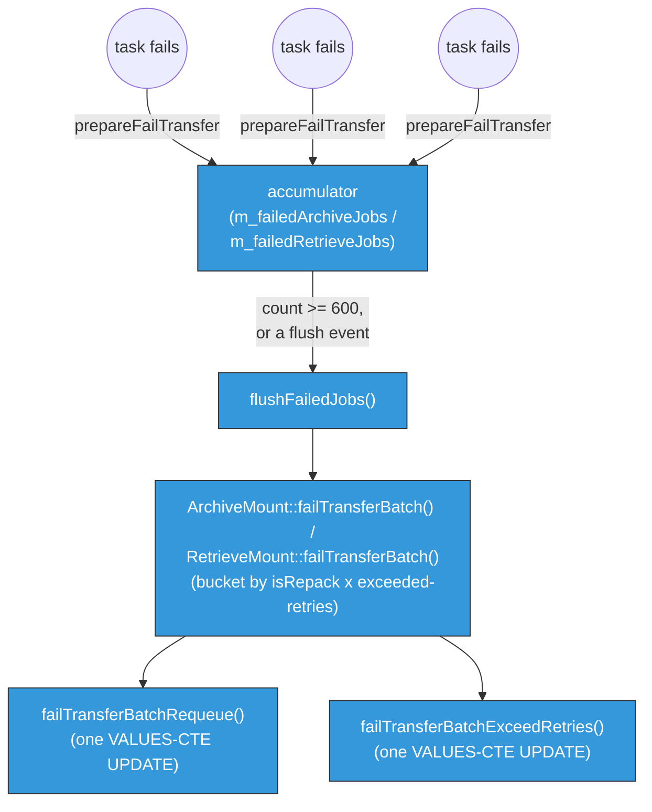
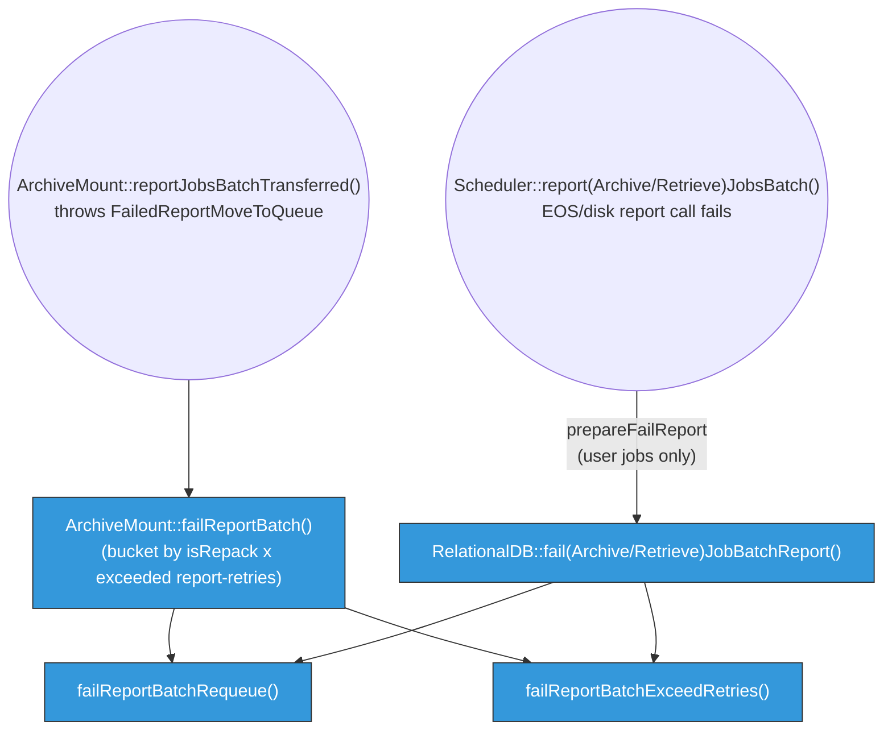
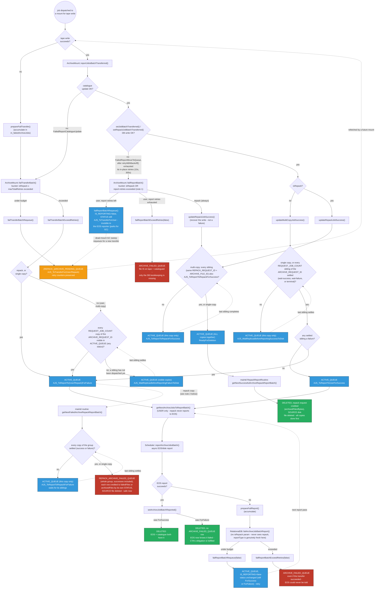
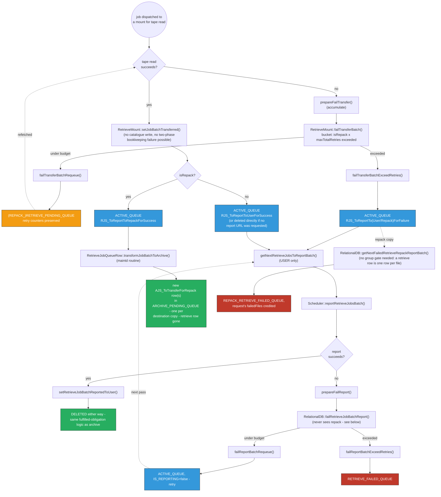

!!! info "PostgreSQL scheduler"

    This page describes the PostgreSQL scheduler backend.

# Failure handling

How a failed archive or retrieve job reaches a terminal state: which copies fail together, where
the row ends up, and how the failure is accounted for. Two axes run through all of it — user versus
repack, and a *transfer* failure versus a *report* failure — and they do not behave the same way.
[Who fails together](#who-fails-together-the-userrepack-split) is the short version of that matrix;
the lifecycle diagrams further down trace every path in full. The mechanism underneath is batching,
covered first.

## Batching failed-job reports

Reporting a failure is on the same hot path as reporting a success. Paying one scheduler-DB round
trip per failed file serializes DB connection usage exactly when a drive, library, or disk endpoint
is already failing many files in quick succession — the objectstore backend pays that cost (see
[the stubs section](#why-failtransferfailreport-still-exist-as-stubs)). Batching merges many jobs'
failure reports into one SQL statement, the same idea as
[opportunistic batching](opportunistic-batching.md) applied to the report path. Two distinct
mechanisms are built this way: batching *transfer*-retry decisions (below) and batching
*report*-retry decisions ([further down](#batching-failed-report-retries)). Both exist only under
pgsched: `prepareFailTransfer()`/`prepareFailReport()` are declared only under `#ifdef CTA_PGSCHED`;
the batch entry points are unimplemented stubs on the objectstore side.



### In-memory accumulation

When a task fails, `MigrationReportPacker`/`RecallReportPacker` call `prepareFailTransfer(reason)`
on the job: in-memory only — append to the failure logs, bump the retry counters — then push the job
onto the accumulator. The accumulator flushes (`flushFailedJobs()`) at whichever comes first:

- `c_failedJobsBatchMax` (600, hardcoded, same for archive and retrieve);
- a `ReportFlush` event (the same periodic event, governed by `flushMaxFiles`/`flushMaxBytes`, that
  flushes the successful-jobs batch — see [below](#two-different-batch-sizes-on-purpose));
- `ReportLastBatchError` or `ReportEndofSession`.

So 600 only matters as a worst case within one flush window — a dense failure burst. If
`failTransferBatch()` throws, the in-flight batch is dropped and left for
[garbage collection](garbage-collection.md).

### The batched SQL

`ArchiveMount`/`RetrieveMount::failTransferBatch()` buckets the jobs by `isRepack` and by whether
each exceeded `maxTotalRetries`, then issues **one** statement per bucket:

- `failTransferBatchRequeue()` — under budget, back to `(REPACK_)*_PENDING_QUEUE`;
- `failTransferBatchExceedRetries()` — budget exceeded, status to
  `*_ToReportTo{User,Repack}ForFailure`.

User and repack jobs share the counters and retry logic; only the destination queue/status differs.

#### Repack reporting is a separate mechanism entirely

This section is purely the *transfer*-retry mechanism — repack jobs go through it exactly like user
jobs. Repack's failure *reporting* to the operator is a different layer downstream: aggregate
`FILE_COUNT`/`FILE_BYTES` counters via `moveFailedRepackJobBatchToFailedQueueTable()` +
`updateRepackRequestFailuresBatch()`, with no per-job `FAILURE_LOG`, no retry concept, and no
disk/EOS report. Repack does reach the *other* batching mechanism below.

### Batching failed report retries

A second mechanism covers what happens *after* a transfer succeeds: persisting that success to the
scheduler DB, and (user jobs only) reporting it to EOS. Same accumulation idea
(`prepareFailReport()`), same per-bucket SQL shape, two trigger points:



1. **Mount-level bookkeeping failure** (`ArchiveMount::failReportBatch()`): tape write and
   catalogue update succeeded, but the mount's `setJobBatchTransferred()`/
   `setRepackJobBatchTransferred()` DB write failed. The only place repack reaches report-failure
   batching. Retrieve has no equivalent — it never writes to the catalogue, so there is no
   two-phase write to recover.
2. **Disk-report failure** (`RelationalDB::fail{Archive,Retrieve}JobBatchReport()`): the success
   was persisted, but the later EOS/disk report failed. Repack never reaches this path —
   `getNextArchiveJobsToReportBatch()` only selects user jobs.

Both funnel into `failReportBatchRequeue()` (under budget: `IS_REPORTING = FALSE`, counters bumped,
status unchanged) / `failReportBatchExceedRetries()` (over budget — or any repack job, whose
"exceed" branch is the `updateRepackJobSuccess()` recovery, safe on every attempt — terminal).
`ArchiveMount::failReportBatch()` buckets on `isRepack` and the report-retry counters, never on
`reportType` — see Note 1 below for why, and for what the requeue bucket means at that entry point.

#### Retrying the write before falling back: `retryWithBackoff()`

Point 1 has a sharp edge: its requeue bucket cannot retry the *report* (Note 1, further down —
`STATUS` never reached a report status, so the row only parks for the GC sweep and the file is
eventually transferred again from scratch).
`cta::utils::retryWithBackoff()` (`common/utils/RetryWithBackoff.hpp`) softens this by retrying the
write itself after a `cta::exception::Exception`. The report worker waits 10 seconds before the
first retry and 300 seconds before the second, for 310 seconds of waiting if both delays are used.
It logs each retry and rethrows the last exception if both retries fail. It wraps exactly one call site —
`ArchiveMount::reportJobsBatchTransferred()`'s `set(Repack)JobBatchTransferred()` call — and is
deliberately restricted to background/worker-thread work; it must never wrap a frontend-synchronous
RPC path where a caller is blocked waiting.

`RetrieveMount::setJobBatchTransferred()` looks similar but is *not* wrapped: it first calls
`releaseDiskSpace()`, a non-idempotent `RESERVED_BYTES -= bytes` decrement, and its scheduler-DB
writes run as up to three separate transactions that swallow their own exceptions. Retrying the
whole function could double-decrement reserved space or replay an already-committed sub-call — it
needs restructuring for idempotency first, not wrapping.

#### Repack's "terminal" failure here isn't a failure

For repack, exceeding report retries means the DB *write* of an already-successful transfer failed
repeatedly, not that the job failed. Recovery is replaying that write via
`updateRepackJobSuccess()` — only it knows whether the other copies of a multi-copy request have
settled, and bypassing it would risk `getNextSuccessfulArchiveRepackReportBatch()` deleting the
source file before every copy exists. `failReportBatchExceedRetries()` branches on `isRepack` for
exactly this reason; the non-repack move to `ARCHIVE_FAILED_QUEUE` never applies to repack.

## Who fails together: the user/repack split

When a job fails terminally, does it drag the other copies of its request down with it? The answer
differs between user and repack, deliberately — getting it wrong in either direction mishandles
data:

| Workflow | Transfer failure, retries exhausted | Report failure, retries exhausted |
|---|---|---|
| **archive · user · single copy** | `AJS_ToReportToUserForFailure`, this `JOB_ID` | `ReadyForDeletion`, row moved to `ARCHIVE_FAILED_QUEUE` |
| **archive · user · multi copy** | every *dispatched* copy of the `ARCHIVE_REQUEST_ID` fails together, immediately once all `REQUEST_JOB_COUNT` copies are visible in `ARCHIVE_ACTIVE_QUEUE`, parked at `AJS_WaitReplicasBeforeReportingFailureToDisk` otherwise until the last one is | **every** copy of the `ARCHIVE_REQUEST_ID`, moved together |
| **archive · repack · single copy** | `AJS_ToReportToRepackForFailure`, this `JOB_ID` | not a failure at all — `updateRepackJobSuccess()` recovers the lost write |
| **archive · repack · multi copy** | this `JOB_ID` **only**; siblings keep transferring | same recovery, still per `JOB_ID` |
| **retrieve · user** | `RJS_ToReportToUserForFailure`, this `JOB_ID` | `ReadyForDeletion`, row moved to `RETRIEVE_FAILED_QUEUE` |
| **retrieve · repack** | `RJS_ToReportToRepackForFailure`, this `JOB_ID` | n/a — repack retrieve never reports to a disk system |

Retrieve has no multi-copy rows to reconcile: one row per file, with the other tape copies in that
row's `ALTERNATE_VIDS`/`ALTERNATE_FSEQS` columns (used to rotate tapes on requeue, not to fan out
into siblings). Every retrieve row is keyed on `JOB_ID` alone, on both sides.

### Why user requests fail as a group

A user archive request's copies exist for redundancy. Once one copy is permanently lost the request
cannot meet that goal, so the others are wasted work: both exceed-retries functions expand to every
copy of the `ARCHIVE_REQUEST_ID` when `REQUEST_JOB_COUNT > 1`. Force-settling a copy a drive is
still writing is safe here because **nothing in the user workflow reads "all copies terminal" as
permission to delete anything** — the source file belongs to the user's disk system.

That `ARCHIVE_REQUEST_ID`-wide reach cuts both ways: any path that touches a copy's row by `JOB_ID`
alone, without checking its status, can silently *undo* the settlement. `requeueJobBatch()` — used
by `TapeWriteSingleThread::requeueUnprocessedTasks()` and `ReportLastBatchError` — moves jobs it
believes still unprocessed back to `ARCHIVE_PENDING_QUEUE` from an in-memory list that can be stale
by the time it runs. Its `DELETE` therefore carries a `STATUS` guard (the same predicate as
`failTransferBatchRequeue()`): only a row still genuinely at the active-transfer status is moved.

A sibling not yet *dispatched* has no row in `ARCHIVE_ACTIVE_QUEUE` at all. Promoting the visible
copies straight to the terminal failure status would let `getNextArchiveJobsToReportBatch()` report
and delete them before the sibling ever ran — if it later succeeded, no group would remain to tell
it so. `failTransferBatchExceedRetries()` therefore promotes only once all `REQUEST_JOB_COUNT`
copies are present; otherwise it parks the visible ones at
`AJS_WaitReplicasBeforeReportingFailureToDisk` — the mirror image of the pre-existing
`AJS_WaitReplicasBeforeReportingSuccessToDisk`, for the mirror-image reason: an unstarted copy
might still succeed, so the group's fate is genuinely undecided.

!!! warning "Schema migration required"

    `AJS_WaitReplicasBeforeReportingFailureToDisk` is a new `ARCHIVE_JOB_STATUS` enum value, and the
    pgsched schema has no migration tooling — run
    `scheduler/rdbms/schema/manual_migration_add_wait_replicas_failure_to_disk_status.sql` against
    every existing scheduler schema before deploying binaries that write it; otherwise the first
    write fails with "invalid input value for enum ARCHIVE_JOB_STATUS".

Whichever side settles the *last* copy — a late success reaching `updateMultiCopyJobSuccess()` or a
late failure reaching `failTransferBatchExceedRetries()` — resolves the whole group in that one
statement: both count a sibling at either wait status, or terminally failed, as settled, and the
group fails if any sibling did. A row only reaches `AJS_ToReportToUserFor{Success,Failure}` once
the whole group settled, so `flagReportingJobsByStatus()` needs no completeness check of its own —
it runs strictly after settlement, never racing to re-derive it. The two diagrams trace the case
that motivated the wait status — a copy failing while its sibling has not been dispatched:

```mermaid
sequenceDiagram
    participant A as Copy A (dispatched, drive 1)
    participant Q as ARCHIVE_ACTIVE_QUEUE
    participant P as ARCHIVE_PENDING_QUEUE
    participant B as Copy B (not yet dispatched)

    Note over Q,P: REQUEST_JOB_COUNT = 2. A has a row in Q; B is still in P, undispatched.
    A->>Q: exceeds retries - failTransferBatchExceedRetries()
    Q->>Q: present copies in Q for this ARCHIVE_REQUEST_ID = 1, < REQUEST_JOB_COUNT (2)
    Q->>Q: A parked at AJS_WaitReplicasBeforeReportingFailureToDisk (not reportable yet)
    Note over B: B is later dispatched out of P, transfers, and ALSO exceeds its retries
    B->>Q: exceeds retries - failTransferBatchExceedRetries() again
    Q->>Q: present copies now = 2, >= REQUEST_JOB_COUNT (2) - group complete
    Q->>Q: BOTH A and B -> AJS_ToReportToUserForFailure, in this one statement
    Note over Q: getNextArchiveJobsToReportBatch() can now report both together
```

```mermaid
sequenceDiagram
    participant A as Copy A (dispatched, drive 1)
    participant Q as ARCHIVE_ACTIVE_QUEUE
    participant P as ARCHIVE_PENDING_QUEUE
    participant B as Copy B (not yet dispatched)

    Note over Q,P: Same start: A failed and parked; B still undispatched.
    A->>Q: exceeds retries - failTransferBatchExceedRetries()
    Q->>Q: A parked at AJS_WaitReplicasBeforeReportingFailureToDisk
    Note over B: B is later dispatched and this time its transfer SUCCEEDS
    B->>Q: transfer succeeds - updateMultiCopyJobSuccess()
    Q->>Q: sibling_settlement sees A at the wait-failure status - counted as settled, any_failed = true
    Q->>Q: BOTH A and B -> AJS_ToReportToUserForFailure (NOT ForSuccess), in this one statement
    Note over Q: B's own transfer succeeding cannot resurrect a request that already lost a copy
```

The second diagram is the hard case: `updateMultiCopyJobSuccess()` must count A's *parked* row as
settled, not just a terminally-failed sibling — otherwise B's success would see no settled sibling
and park forever at `AJS_WaitReplicasBeforeReportingSuccessToDisk`, a status nothing else reads.

#### Why objectstore never needed any of this

Objectstore keeps every copy of a request as fields inside one serialized `ArchiveRequest` object,
locked and read as a unit — a copy is never invisible for being undispatched, so completeness is a
loop over an in-memory list, never a query that can miss a row. Its report-once policy is a
`reportdecided` flag: the *first* permanent loss reports the request as failed immediately (one
loss already decides the outcome); every other copy just completes silently, and a success report
happens only via the last copy with no failure recorded. Same policy as above — it just needs no
wait *status*, because there is nothing for one to park against.

### Why repack copies must fail alone

Repack **does** own a shared source file: the repack buffer copy on disk, which every copy reads
and which CTA itself deletes. Deletion is gated on the whole group having settled —
`getNextFailedArchiveRepackReportBatch()` calls `deleteDiskFiles()` once
`moveFailedRepackJobBatchToFailedQueueTable()` reports the group complete;
`getNextSuccessfulArchiveRepackReportBatch()` mirrors it once the group reaches `ReadyForDeletion`
— and completeness is inferred from `STATUS` alone. Marking a copy another drive is still writing
as failed makes that inference false: the buffer would be deleted under a live reader, and a copy
that nevertheless finished would be catalogued with no scheduler row left to report it. So a failed
repack copy settles alone; the group is swept, surviving successes included, only once every copy
has reached a terminal status of its own.

The wait costs nothing in the statistics, which are per **copy**, not per file: expansion
increments `totalFilesToArchive` once per `copyNbsToRearchive` entry, and both report paths credit
one per row. A request completes when
`archivedFiles + failedArchiveFiles + failedToCreateArchiveReq >= totalFilesToArchive` and ends
`RRS_Failed` if *any* failure was recorded — the operator safety property (a repack that lost a
copy is never `RRS_Complete`, so its source tape is not reclaimed) rests on
`failedArchiveFiles > 0`, not on how many copies were counted as failed.

### How a mixed group is accounted for

A swept group is not uniformly a failure. For a two-copy file whose first copy failed permanently
while the second reached tape, `moveFailedRepackJobBatchToFailedQueueTable()` returns each row's
own `STATUS`, and `updateRepackRequestFailuresBatch()` applies both counts in one `UPDATE`:

| | `archivedFiles` | `failedArchiveFiles` | sum vs `totalFilesToArchive` = 2 | final status |
|---|---|---|---|---|
| Credit every swept row as a failure | 0 | 2 | 2 ✓ | `RRS_Failed` ✓ |
| **Bucket on `STATUS` (what happens)** | **1** | **1** | 2 ✓ | `RRS_Failed` ✓ |

Both balance and both end `RRS_Failed`, but only the second tells the truth about what reached
tape, which is what `cta-admin repack ls` reports. **Both** buckets still move to
`REPACK_ARCHIVE_FAILED_QUEUE` — the group did not achieve what the repack asked for, and keeping
the surviving copy's row beside the failed one makes the partial outcome inspectable. What the
counters cannot say is whether the source tape is safe to reclaim: they do not record *which* copy
failed (the moved one, whose only instance is still the source tape, or an added one). That needs
per-copy state the tracking table does not carry.

## Invariants the group logic rests on

Five properties hold the grouping together. Each has been a bug at least once.

**`REQUEST_JOB_COUNT` equals the number of archive rows the file actually has.**
`transformJobBatchToArchive()` inserts exactly one archive job per `REPACK_REARCHIVE_COPY_NBS`
entry (the contract objectstore keeps by construction), so
`rows == CARDINALITY(REPACK_REARCHIVE_COPY_NBS) == REQUEST_JOB_COUNT` — also the request's
`TOTAL_FILES_TO_ARCHIVE` contribution. `BASE_INSERT` is gated on the retrieved copy being a
rearchive target: true for `MoveOnly`/`MoveAndAddCopies`, false for `AddCopiesOnly`. A count below
the real group size makes every completeness check pass on the first copy to settle.

**A group is `(REPACK_REQUEST_ID, ARCHIVE_FILE_ID)`, never `ARCHIVE_FILE_ID` alone.** The same file
can be in two repack requests at once — two tapes each holding one of its copies. Those rows are
not siblings: counting them together both stalls genuinely complete groups and lets one request's
progress sweep away the other's rows.

**Concurrent settlers serialize on sorted group row locks.** `updateRepackJobSuccess()` and
`updateMultiCopyJobSuccess()` first `FOR UPDATE`-lock every row of every group the batch touches,
in sorted key order, then read completeness in a fresh statement — otherwise two calls completing
different copies of one file can both read "sibling not settled", both park, and strand the group.
Sorted order prevents two multi-group batches deadlocking A-then-B against B-then-A. The
completeness counts use `COUNT(DISTINCT JOB_ID)` (or `EXISTS` semi-joins on the failure sweep), so
batch composition — even two copies of one file in one call — cannot inflate them.

**A row is modified once per statement.** PostgreSQL silently discards a `DELETE` of a row the same
statement already updated (`TM_SelfModified`). Every queue-to-queue move is therefore
`DELETE … RETURNING *` first, `INSERT` second, and the user report-failure move (which also writes
a status) is two statements, not one chained CTE — folded together, the row strands in the active
queue at `ReadyForDeletion`, where nothing collects it.

**Row locks never block across groups in the failure sweep.**
`moveFailedRepackJobBatchToFailedQueueTable()` takes its candidate and sibling locks with
`SKIP LOCKED`. A blocking sibling lock deadlocks two reporters working the two copies of one file
(PostgreSQL aborts one with `40P01`, losing the batch). Skipping fails in the safe direction: a
sibling locked elsewhere drops out of the count, the group reads incomplete, and the move defers to
whichever pass finds it uncontended.

## The full archive lifecycle: every path to a terminal state

End to end for archive (retrieve is the simpler subset,
[below](#the-full-retrieve-lifecycle)). Four terminal dispositions exist; which one a job reaches
depends on *where* it stops succeeding:

| Terminal state | Meaning | Who reaches it |
|---|---|---|
| **Back to `ARCHIVE_PENDING_QUEUE`** | Retry, counters preserved | Transfer failure, under budget |
| **Stays in `ARCHIVE_ACTIVE_QUEUE`**, `STATUS` changed | Interim — something still needs to happen | Every non-terminal step below |
| **`ARCHIVE_FAILED_QUEUE`** (row moved, deleted from active) | CTA could not fulfil an obligation — admin-visible | Transfer retries exhausted and reported; OR a report/bookkeeping write that itself couldn't be delivered |
| **Deleted outright, no `ARCHIVE_FAILED_QUEUE` row** | CTA's obligation was fulfilled, even if the *outcome* was a failure | A failure that WAS successfully reported to EOS; a repack request where every copy reached `ReadyForDeletion` |



**Note 1 — the mount-level bookkeeping path retries the write in place, then parks for GC.** A job
reaching `ArchiveMount::failReportBatch()` still carries the `reportType` set at `initialize()`
time, when its `STATUS` was `AJS_ToTransferFor(User/Repack)` — which maps to `NoReportRequired` and
is never re-evaluated (the status change a successful transfer implies lives only in the DB write
that just failed). The bucket split is therefore keyed on `isRepack` and the report-retry counters,
never on `reportType` — a `reportType` check would be true for every job unconditionally and send a
single transient bookkeeping failure straight to `ARCHIVE_FAILED_QUEUE` without ever spending its
report-retry budget. A user job is handled in two layers:
[`retryWithBackoff()`](#retrying-the-write-before-falling-back-retrywithbackoff) first retries the
write itself in place (10s, then 300s); once that is exhausted, a job with report retries left
takes the requeue bucket — which at this entry point is a parking spot, not a report retry: with
`STATUS` still `AJS_ToTransferForUser` the EOS reporter never sees the row, and the dead-mount GC
sweep eventually requeues it for a full new transfer. Only a job over its report-retry budget moves
to `ARCHIVE_FAILED_QUEUE`. Repack always takes the "exceed" branch, which for it is just
`updateRepackJobSuccess()` — recovery, safe on every attempt. The other entry point,
`RelationalDB::failArchiveJobBatchReport()`, is fed by a fresh fetch whose `initialize()` sees the
real report status, so its requeue bucket drives genuine EOS-report retries.

**Note 2 — repack's two sides gate the source-file deletion symmetrically.**
`updateRepackJobSuccess()` reaches `ReadyForDeletion` only once every copy of the group succeeded;
`moveFailedRepackJobBatchToFailedQueueTable()` moves a failed copy's whole group, successes
included, only once every copy has settled either way. A copy still mid-transfer is never counted
and never touched, so `deleteDiskFiles()` cannot run while a sibling still reads the buffer. The
two checks are deliberately blind to each other's statuses: a transfer failure is invisible to the
success-side count (a waiting successful copy neither stalls nor promotes on its own), and the
failure-side sweep is what eventually settles a mixed group.

**Note 3 — the user side's gate exists for sibling *visibility*, not shared-file safety.** A user
request owns no shared file, so the two wait statuses exist only because an undispatched sibling
has no row to check completeness against. Once every copy has a row, both checks resolve the group
immediately — settling a still-writing user copy early is always safe.

## The full retrieve lifecycle

Retrieve is the same shape with two whole branches removed: it never writes to the catalogue and
has no mount-level bookkeeping-write recovery (`RetrieveMount` has no `failReportBatch()`):



Retrieve's repack success is not a terminal state: `transformJobBatchToArchive()` turns it directly
into new `ARCHIVE_PENDING_QUEUE` rows (one per destination copy), which run the entire archive
lifecycle from the top. `failRetrieveJobBatchReport()` never sees repack — repack retrieve failures
are tracked by `getNextFailedRetrieveRepackReportBatch()`'s aggregate counters, via
`moveFailedRepackJobBatchToFailedQueueTable()`. That sweep credits two counters at different
granularities: `failedFilesToRetrieve` once per failed row (per file), but
`failedToCreateArchiveReq` once per `REPACK_REARCHIVE_COPY_NBS` entry — the archive jobs the failed
recall prevented — because `totalFilesToArchive` was counted per destination copy at expansion, and
a per-file credit would leave a multi-copy file's request permanently short of completeness.

## Two different batch sizes, on purpose

`c_failedJobsBatchMax` (600) is easy to confuse with `flushMaxFiles` (how many *successful* jobs
accumulate before the EOS report — e.g. 8000 in the stress-scale CI preset), but they bound
different things:

| | Failed-job batch (`c_failedJobsBatchMax`) | Successful-job batch (`flushMaxFiles`) |
|---|---|---|
| Downstream call | Scheduler-DB `UPDATE` only | One XRootD/EOS WFE call + DB write |
| Configurable? | No — compile-time `constexpr`, same for every deployment | Yes — per-mount-type Helm/config value |
| Blast radius if the batch call throws | Whole batch dropped, rescued later by GC | Whole batch falls back to a slow per-file retry path (documented in `ArchiveMount.hpp`) |

A gap worth knowing rather than an active bug: `flushMaxFiles` has been raised for scale testing
while `c_failedJobsBatchMax` never moved and is not wired to config. It rarely bites — failed jobs
also flush on every periodic `ReportFlush` — but if a deployment pushes `flushMaxFiles` much
higher, revisit `c_failedJobsBatchMax` too: a failure storm is exactly when the system should not
fall back to smaller, more numerous DB round trips than the success path was tuned for.

## Why `failTransfer()`/`failReport()` still exist (as stubs)

Under `CTA_PGSCHED`, no production code calls the single-job
`ArchiveRdbJob`/`RetrieveRdbJob::failTransfer()`/`failReport()` — the report packers call them only
from their `#else` (objectstore) branch — and the pgsched implementations are
`NotImplementedException` stubs. On objectstore they are the real, live, one-job-at-a-time
mechanism (no batching layer exists there). They cannot be deleted: they are unconditional members
of the common `SchedulerDatabase` job interface — unlike `prepareFailTransfer()`/
`prepareFailReport()`, which exist only under `#ifdef CTA_PGSCHED` — and
`SchedulerDatabaseTest.cpp` exercises the interface against *both* backends: its pgsched branch
calls `prepareFailTransfer()` + `failTransferBatch()` (the live pgsched path), its `#else` branch
keeps calling `failTransfer()` directly (the live objectstore path).
