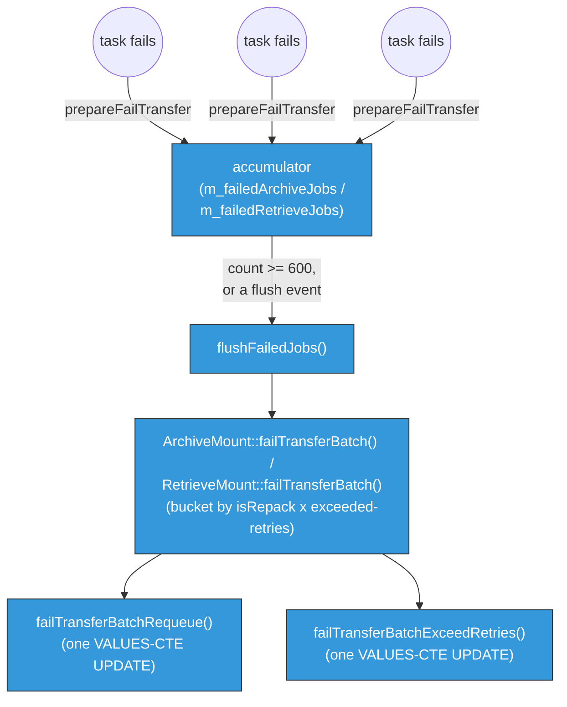
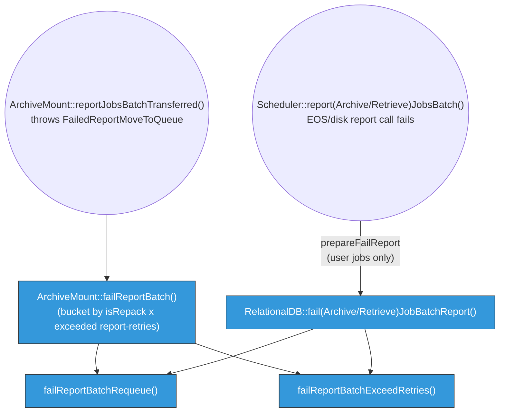
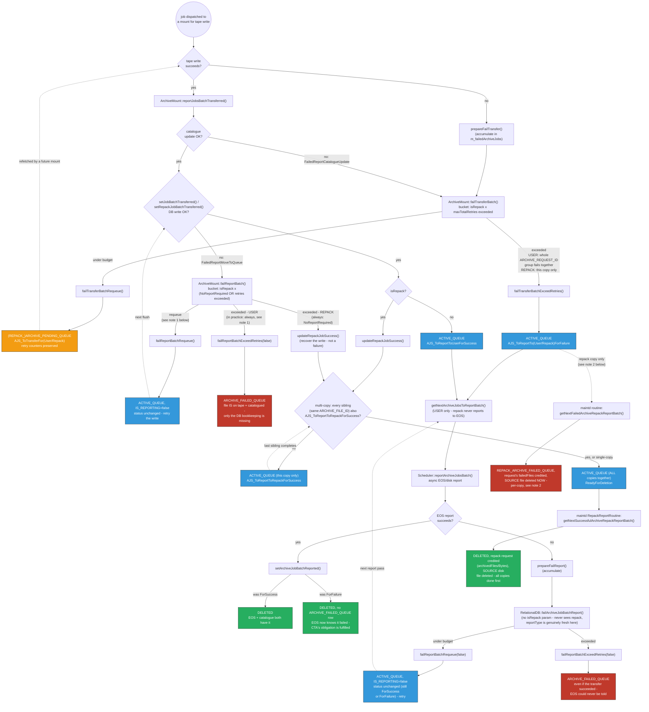
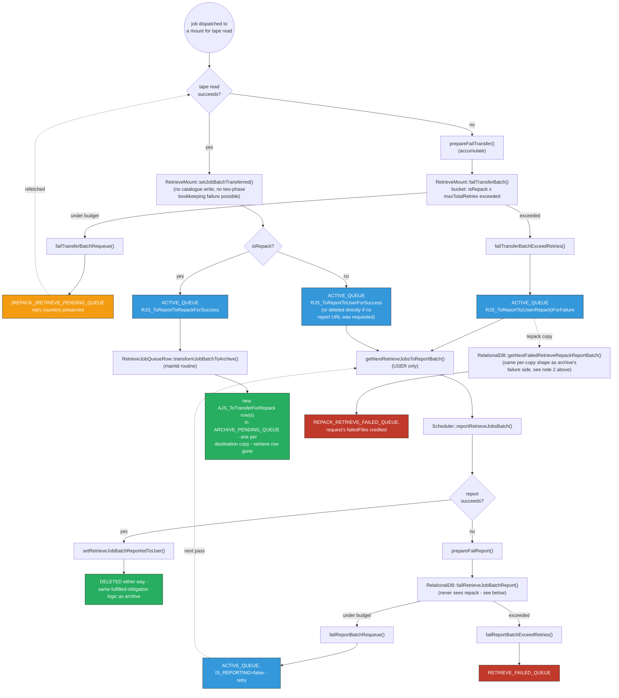

!!! info "PostgreSQL scheduler"

    This page describes the PostgreSQL scheduler backend.

# Batching failed-job reports

Reporting a failure back to the scheduler DB is on the same hot path as reporting a success, but it
used to pay for it file by file: each failed read, write, or report cost its own scheduler-DB round
trip, serializing DB connection usage exactly when a drive, library, or disk endpoint is already in
trouble (many files failing in quick succession). Batching merges many jobs' failure reports into
one SQL statement, the same idea as [opportunistic batching](opportunistic-batching.md) applied to
the report path instead of the queueing path.

This page covers two related but distinct mechanisms, built the same way but triggered from
different places: batching *transfer*-retry decisions below, and
[batching *report*-retry decisions](#batching-failed-report-retries) further down.

Both are implemented for the postgres scheduler backend (pgsched) only. The objectstore backend
always reports file by file; its `prepareFailTransfer()`/`failTransferBatch()` (and the report-side
equivalents) are unimplemented stubs (`NotImplementedException`) for exactly this reason — see
[Why the single-job path still exists](#why-the-single-job-path-still-exists) below.

## In-memory accumulation

When a task fails, `MigrationReportPacker`/`RecallReportPacker` call `prepareFailTransfer(reason)` on
the job. This updates the job's in-memory state only — it appends to `failureLogs`/`reportFailureLogs`
and bumps the retry counters — and does **not** touch the DB. The job is then pushed onto an
in-process accumulator (`m_failedArchiveJobs` / `m_failedRetrieveJobs`).

The accumulator is flushed (`flushFailedJobs()`) whenever any of these happen, whichever comes first:

- it reaches `c_failedJobsBatchMax` (600, hardcoded, identical for archive and retrieve);
- a `ReportFlush` event fires (the same periodic/count-driven event — governed by `flushMaxFiles`/
  `flushMaxBytes` — that also flushes the successful-jobs batch to EOS, see
  [below](#two-different-batch-sizes-on-purpose));
- `ReportLastBatchError` or `ReportEndofSession` runs.

So in practice 600 only matters as a *worst case within one flush window*: a dense burst of failures
(e.g. a dying drive failing every file) can hit it before the next periodic flush would have fired
anyway. If `failTransferBatch()` throws, the whole in-flight batch is dropped (not retried) and left
for the garbage collector to pick up later — see [Garbage Collection](garbage-collection.md).

## The batched SQL

`flushFailedJobs()` hands the accumulated jobs to `ArchiveMount::failTransferBatch()` /
`RetrieveMount::failTransferBatch()`, which buckets them by `isRepack` and by whether each job has
exceeded `maxTotalRetries`, then issues **one** SQL statement per bucket:

- `ArchiveJobQueueRow`/`RetrieveJobQueueRow`::`failTransferBatchRequeue()` — under budget, moves the
  whole bucket back to `(REPACK_)*_PENDING_QUEUE` in one `VALUES`-CTE `UPDATE`.
- `failTransferBatchExceedRetries()` — budget exceeded, sets the whole bucket's status to
  `*_ToReportTo{User,Repack}ForFailure` in one statement.

This is live for repack on both archive and retrieve, as well as for ordinary user jobs — the
counters and retry/exceed logic are identical; only the destination queue/status differs.

### Append-once `FAILURE_LOG`

Each row's `FAILURE_LOG`/`REPORT_FAILURE_LOG` column must never be duplicated across retries.
`updateJobRowFailureLog()` appends onto a value that was *already loaded from the DB column* at
row-construction time, so by the time the batched SQL runs, the in-memory string already contains
old+new text. The SQL binds that string directly (`:FL`) rather than re-concatenating it with
`||`/`COALESCE` against the DB column — the few places that still use `||` are bound from a fresh
literal marker (e.g. `"UNPROCESSED_TASK_QUEUE_JOB_REQUEUED"`), not from the loaded log, and are
correctly additive.

### Repack reporting is a separate mechanism entirely

Repack's failure *reporting* to the operator (aggregate `FILE_COUNT`/`FILE_BYTES` stats per repack
request) is architecturally unrelated to anything on this page: `getNextFailedArchiveRepackReportBatch()` /
`getNextFailedRetrieveRepackReportBatch()` work off aggregate counters via
`moveFailedRepackJobBatchToFailedQueueTable()` + `RepackRequestTrackingRow::updateRepackRequestFailuresBatch()`.
There is no per-job `FAILURE_LOG` concatenation and no retry-count concept there; it never reaches
disk/EOS reporting at all. What this section describes is purely the *transfer*-retry mechanism
(deciding whether a failed job gets another attempt or is given up on) — repack jobs go through it
exactly like user jobs, but repack's own *reporting* of the outcome to the operator is a different
layer downstream. Repack does, however, reach the *other* batching mechanism this page covers —
see [Batching failed report retries](#batching-failed-report-retries) below.

## Batching failed report retries

A second, distinct batching mechanism covers a different kind of failure: not the tape transfer
itself, but the two things that happen *after* a transfer succeeds — persisting that success to
the scheduler DB, and (for user jobs only) reporting it back to EOS. Both reuse the same
in-memory-accumulation idea (`prepareFailReport()`, the report-side mirror of
`prepareFailTransfer()` above) and the same per-bucket SQL shape
(`failReportBatchRequeue()`/`failReportBatchExceedRetries()`), but are triggered from two
different places:

1. **Mount-level bookkeeping failure** (`ArchiveMount::failReportBatch()`, called from
   `MigrationReportPacker::reportSuccessfulJobsBatch()`'s `FailedReportMoveToQueue` catch): the
   tape write and catalogue update both succeeded, but the live mount's own
   `setJobBatchTransferred()`/`setRepackJobBatchTransferred()` DB write failed. This is the one
   place repack jobs reach report-failure batching — see below. Retrieve has no equivalent: it
   never writes to the catalogue, so there is no comparable two-phase write to recover from.
2. **Disk-report failure** (`RelationalDB::failArchiveJobBatchReport()` /
   `failRetrieveJobBatchReport()`, called from `Scheduler::reportArchiveJobsBatch()` /
   `reportRetrieveJobsBatch()`): the job's success was already persisted, but the later,
   independent EOS/disk report of it then failed. Repack never reaches this path —
   `getNextArchiveJobsToReportBatch()` only ever selects user jobs, since repack never reports to
   disk/EOS at all (see [above](#repack-reporting-is-a-separate-mechanism-entirely)).

Both funnel into the same `ArchiveJobQueueRow`/`RetrieveJobQueueRow`::`failReportBatchRequeue()`/
`failReportBatchExceedRetries()` pair, bucketed the same way as the transfer-failure path above:
under budget requeues (`IS_REPORTING = FALSE`, retry counters bumped, status otherwise unchanged);
over budget — or `NoReportRequired`, which is permanently true for every repack job — is terminal.

### Repack's "terminal" failure here isn't a failure

For repack, landing in the "exceeded report retries" bucket doesn't mean the *job* failed — it
means the DB *write* of an already-successful transfer failed repeatedly. Recovery means replaying
that write via `updateRepackJobSuccess()`, exactly like the single-job path
(`ArchiveRdbJob::failReport()` → `updateJobStatusForFailedReport()`) already does, not moving the
row to `ARCHIVE_FAILED_QUEUE`: only `updateRepackJobSuccess()` knows whether a multi-copy request's
other copies have also succeeded, and bypassing it would risk
`getNextSuccessfulArchiveRepackReportBatch()` deleting the source file before every copy exists.
`ArchiveJobQueueRow::failReportBatchExceedRetries()` branches on `isRepack` for exactly this reason
— the non-repack branch's UPDATE+INSERT+DELETE sequence (a genuine terminal failure, moving the row
to `ARCHIVE_FAILED_QUEUE`) does not apply to repack at all.

## The full archive lifecycle: every path to a terminal state

Putting both mechanisms above together, end to end, for archive (where every nuance lives — retrieve
is the simpler subset covered [separately](#the-full-retrieve-lifecycle) below). Four terminal
dispositions exist, and which one a job reaches depends on *where* it stops succeeding, not just
*whether* it eventually does:

| Terminal state | Meaning | Who reaches it |
|---|---|---|
| **Back to `ARCHIVE_PENDING_QUEUE`** | Retry, counters preserved | Transfer failure, under budget |
| **Stays in `ARCHIVE_ACTIVE_QUEUE`**, `STATUS` changed | Interim — something still needs to happen | Every non-terminal step below |
| **`ARCHIVE_FAILED_QUEUE`** (row moved, deleted from active) | CTA could not fulfil an obligation — admin-visible | Transfer retries exhausted and reported; OR a report/bookkeeping write that itself couldn't be delivered |
| **Deleted outright, no `ARCHIVE_FAILED_QUEUE` row** | CTA's obligation was fulfilled, even if the *outcome* was a failure | A failure that WAS successfully reported to EOS; a repack request where every copy reached `ReadyForDeletion` |

**Note 1 — the mount-level bookkeeping path (`ArchiveMount::failReportBatch()`) never actually
retries, for either job type.** The job object reaching it still carries the `reportType` it was
given at `initialize()` time, when `getNextJobBatch()` fetched it — at that point its `STATUS` was
`AJS_ToTransferFor(User/Repack)`, which `ArchiveRdbJob::initialize()` maps to `NoReportRequired`
(see the `switch` there). Nothing re-evaluates `reportType` between then and
`failReportBatch()` — a successful transfer changes what the row's `STATUS` *should* become, but
that happens only in the DB write that just failed, not on the in-memory object. So
`reportType == NoReportRequired` is true for every job reaching this function, user or repack,
and the bucket condition (`NoReportRequired || retries exceeded`) is therefore always true: the
`requeue` bucket for THIS entry point is unreachable in practice. For repack that is harmless —
`failReportBatchExceedRetries()`'s repack branch is just `updateRepackJobSuccess()`, safe to call
on every attempt. **For user jobs it means a single transient failure of
`setJobBatchTransferred()` sends the job straight to `ARCHIVE_FAILED_QUEUE`**, never actually
spending any of `maxReportRetries` at this layer — worth a second look independently of the
batching work this page otherwise covers, since it looks unintentional rather than designed. The
*other* report-failure entry point, `RelationalDB::failArchiveJobBatchReport()`, does not have this
problem: it is fed by a fresh `getNextArchiveJobsToReportBatch()` fetch, whose `initialize()` call
sees the real `AJS_ToReportToUserFor{Success,Failure}` status, so `reportType` is genuinely
`CompletionReport`/`FailureReport` there and the retry budget is honoured.

**Note 2 — repack's failure-side source-file deletion does not wait for sibling copies, unlike its
success side.** `updateRepackJobSuccess()` (the success side) is deliberately careful: for a
multi-copy request it only reaches `ReadyForDeletion` — and therefore only lets
`getNextSuccessfulArchiveRepackReportBatch()` delete the source file — once *every* copy
(same `ARCHIVE_FILE_ID`) has succeeded. `getNextFailedArchiveRepackReportBatch()` /
`moveFailedRepackJobBatchToFailedQueueTable()` on the failure side has no equivalent check: each
copy that exhausts its transfer retries is moved to `REPACK_ARCHIVE_FAILED_QUEUE` and has its
`SRC_URL` queued for disk deletion independently, with no query against sibling copies' state at
all. For a `MoveAndAddCopies` request where one copy permanently fails while a sibling copy is
still mid-transfer (or not yet dispatched), this deletes the very file that sibling copy still
needs to read from disk. This predates the batching work on this page — it is part of the original
repack-for-the-relational-DB-backend implementation — but is a real correctness question for
multi-copy repack, not merely a documentation nuance, and is called out here because this page is
where that asymmetry becomes visible.

## The full retrieve lifecycle

Retrieve is the same shape with two whole branches removed, because retrieve never writes to the
catalogue and has no mount-level bookkeeping-write-recovery concept at all — `RetrieveMount` has no
`failReportBatch()`, and no `setRepackJobBatchTransferred()`-equivalent two-phase write to fail in
the first place:

Retrieve's repack success isn't a terminal state at all — `transformJobBatchToArchive()` turns a
successfully-retrieved repack job directly into one or more new `ARCHIVE_PENDING_QUEUE` rows (one
per destination tape pool, for `MoveAndAddCopies`), which then go through the entire archive
lifecycle above from the top. `failRetrieveJobBatchReport()` never sees repack, same reasoning as
the [archive-reporting section above](#repack-reporting-is-a-separate-mechanism-entirely): repack
retrieve failures are tracked by `getNextFailedRetrieveRepackReportBatch()`'s own aggregate counters
instead, going through `RetrieveJobQueueRow::moveFailedRepackJobBatchToFailedQueueTable()`.

## Two different batch sizes, on purpose

`c_failedJobsBatchMax` (600) is easy to confuse with `flushMaxFiles` (the config key governing how
many *successful* jobs accumulate before `reportSuccessfulJobsBatch()` reports them to EOS — e.g.
8000 in the stress-scale CI preset), but they bound different things and are tuned independently:

| | Failed-job batch (`c_failedJobsBatchMax`) | Successful-job batch (`flushMaxFiles`) |
|---|---|---|
| Downstream call | Scheduler-DB `UPDATE` only | One XRootD/EOS WFE call + DB write |
| Configurable? | No — compile-time `constexpr`, same for every deployment | Yes — per-mount-type Helm/config value |
| Blast radius if the batch call throws | Whole batch dropped, rescued later by GC | Whole batch falls back to a slow per-file retry path (documented in `ArchiveMount.hpp`) |

The asymmetry is a real gap worth knowing about rather than an active bug: `flushMaxFiles` has been
raised for scale testing (2000 → 4000/8000) while `c_failedJobsBatchMax` never moved and isn't even
wired to config. In practice this rarely bites, because failed jobs are *also* flushed on every
periodic `ReportFlush` event regardless of count (see above) — so 600 only matters during an unusually
dense failure burst within a single flush window. But if a future deployment needs to push
`flushMaxFiles` much higher for scale, revisit `c_failedJobsBatchMax` at the same time: a failure
storm is exactly the moment you don't want the system falling back to smaller, more numerous DB
round trips than the success path was tuned for.

## Why the single-job path still exists

`ArchiveRdbJob`/`RetrieveRdbJob`'s `failTransfer()` → `requeueFailedJob()`/`updateFailedJobStatus()`/
`handleExceedTotalRetries()` is the pre-batching, one-job-at-a-time mechanism. Under `CTA_PGSCHED`, no
production taped session calls it any more — `MigrationReportPacker`/`RecallReportPacker` only ever
call it from their `#else` (objectstore) branch.

It cannot simply be deleted or made to throw, because it is part of the common
`SchedulerDatabase::ArchiveJob`/`RetrieveJob` interface that both backends must implement, and
`SchedulerDatabaseTest.cpp` exercises it directly (`popAndRequeueArchiveRequests`) against *both*
backends via `INSTANTIATE_TEST_CASE_P`. That generic test cannot be switched to the batched
`prepareFailTransfer()`/`failTransferBatch()` calls instead, because those two methods are
deliberately unimplemented (`throw NotImplementedException`) on the objectstore side — batching is
pgsched-only by design. So `failTransfer()` stays as the one call both backends genuinely support,
even though the taped session's own report packers never reach it under pgsched today.
