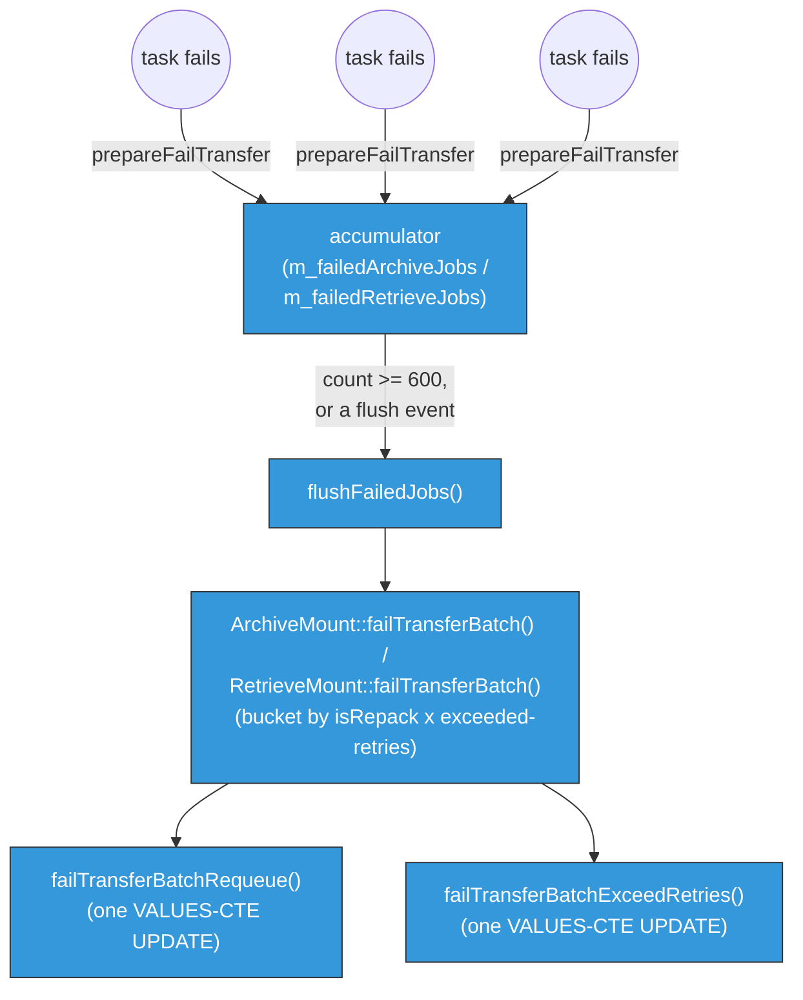
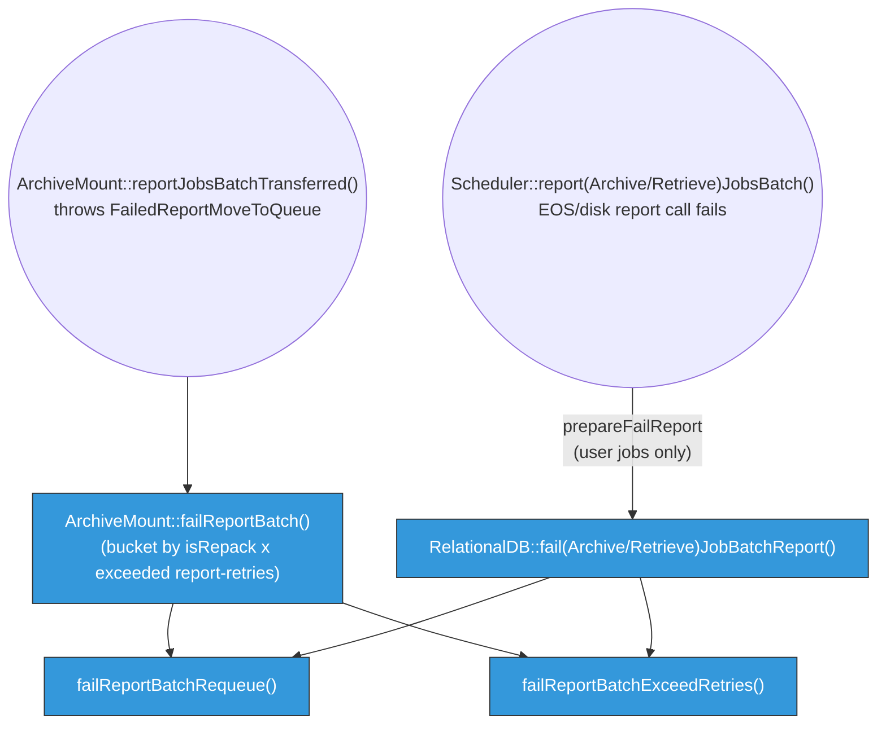
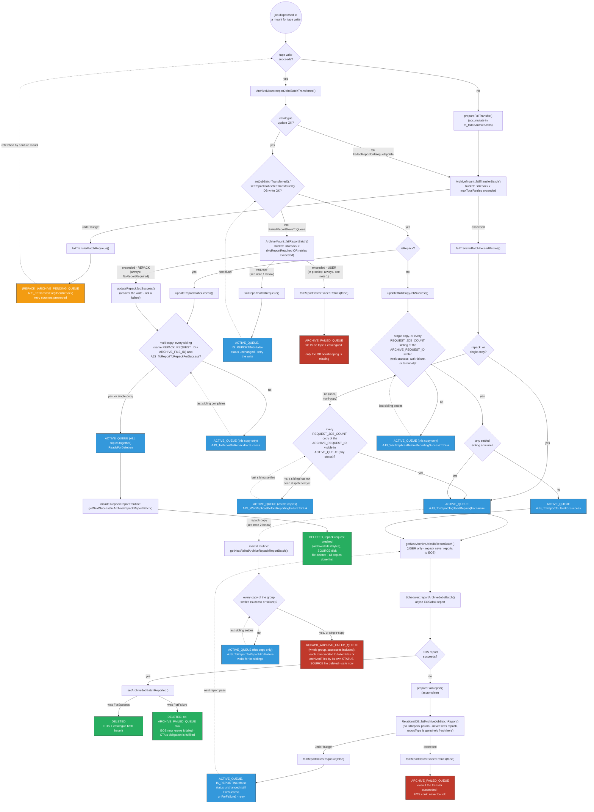
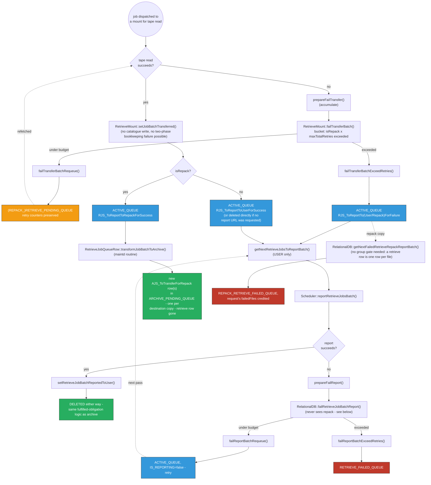

!!! info "PostgreSQL scheduler"

    This page describes the PostgreSQL scheduler backend.

# Failure handling

How a failed archive or retrieve job reaches a terminal state in the PostgreSQL scheduler backend:
which copies fail together, where the row ends up, and how the failure is accounted for. Two axes
run through all of it — user versus repack, and a *transfer* failure versus a *report* failure — and
they do not behave the same way. [Who fails together](#who-fails-together-the-userrepack-split) is
the short version of that matrix; the lifecycle diagrams further down trace every path in full.

The mechanism underneath all of them is batching, covered first.

## Batching failed-job reports

Reporting a failure back to the scheduler DB is on the same hot path as reporting a success. Paying
for it file by file - one scheduler-DB round trip per failed read, write, or report - serializes DB
connection usage exactly when a drive, library, or disk endpoint is already in trouble (many files
failing in quick succession); the objectstore backend pays that cost (see below). Batching merges
many jobs' failure reports into one SQL statement instead, the same idea as
[opportunistic batching](opportunistic-batching.md) applied to the report path instead of the
queueing path.

Two related but distinct mechanisms are built this way, triggered from different places: batching
*transfer*-retry decisions below, and
[batching *report*-retry decisions](#batching-failed-report-retries) further down.

Both are implemented for the postgres scheduler backend (pgsched) only. The objectstore backend
always reports file by file: `prepareFailTransfer()`/`prepareFailReport()` are declared only under
`#ifdef CTA_PGSCHED` on the `SchedulerDatabase::ArchiveJob`/`RetrieveJob` interface, so they don't
exist at all in an objectstore build; `failTransferBatch()`/`failReportBatch()` (declared
unconditionally, since `ArchiveMount`/`RetrieveMount`'s batch wrappers call them regardless of
backend) are implemented there as unimplemented stubs (`NotImplementedException`) instead — see
[Why `failTransfer()`/`failReport()` still exist](#why-failtransferfailreport-still-exist-as-stubs)
below.



### In-memory accumulation

When a task fails, `MigrationReportPacker`/`RecallReportPacker` call `prepareFailTransfer(reason)` on
the job. This updates the job's in-memory state only — it appends to `failureLogs`/`reportFailureLogs`
and bumps the retry counters — and does **not** touch the DB. The job is then pushed onto an
in-process accumulator (`m_failedArchiveJobs` / `m_failedRetrieveJobs`).

The accumulator is flushed (`flushFailedJobs()`) whenever any of these happen, whichever comes first:

- it reaches `c_failedJobsBatchMax` (600, hardcoded, identical for archive and retrieve);
- a `ReportFlush` event fires (the same periodic/count-driven event — governed by `flushMaxFiles`/
  `flushMaxBytes` — that also flushes the successful-jobs batch to EOS, see
  [below](#two-different-batch-sizes-on-purpose));
- `ReportLastBatchError` or `ReportEndofSession` runs.

So in practice 600 only matters as a *worst case within one flush window*: a dense burst of failures
(e.g. a dying drive failing every file) can hit it before the next periodic flush would have fired
anyway. If `failTransferBatch()` throws, the whole in-flight batch is dropped (not retried) and left
for the garbage collector to pick up later — see [Garbage Collection](garbage-collection.md).

### The batched SQL

`flushFailedJobs()` hands the accumulated jobs to `ArchiveMount::failTransferBatch()` /
`RetrieveMount::failTransferBatch()`, which buckets them by `isRepack` and by whether each job has
exceeded `maxTotalRetries`, then issues **one** SQL statement per bucket:

- `ArchiveJobQueueRow`/`RetrieveJobQueueRow`::`failTransferBatchRequeue()` — under budget, moves the
  whole bucket back to `(REPACK_)*_PENDING_QUEUE` in one `VALUES`-CTE `UPDATE`.
- `failTransferBatchExceedRetries()` — budget exceeded, sets the whole bucket's status to
  `*_ToReportTo{User,Repack}ForFailure` in one statement.

This is live for repack on both archive and retrieve, as well as for ordinary user jobs — the
counters and retry/exceed logic are identical; only the destination queue/status differs.

#### Repack reporting is a separate mechanism entirely

Repack's failure *reporting* to the operator (aggregate `FILE_COUNT`/`FILE_BYTES` stats per repack
request) is architecturally unrelated to anything on this page: `getNextFailedArchiveRepackReportBatch()` /
`getNextFailedRetrieveRepackReportBatch()` work off aggregate counters via
`moveFailedRepackJobBatchToFailedQueueTable()` + `RepackRequestTrackingRow::updateRepackRequestFailuresBatch()`.
There is no per-job `FAILURE_LOG` concatenation and no retry-count concept there; it never reaches
disk/EOS reporting at all. What this section describes is purely the *transfer*-retry mechanism
(deciding whether a failed job gets another attempt or is given up on) — repack jobs go through it
exactly like user jobs, but repack's own *reporting* of the outcome to the operator is a different
layer downstream. Repack does, however, reach the *other* batching mechanism this page covers —
see [Batching failed report retries](#batching-failed-report-retries) below.

### Batching failed report retries

A second, distinct batching mechanism covers a different kind of failure: not the tape transfer
itself, but the two things that happen *after* a transfer succeeds — persisting that success to
the scheduler DB, and (for user jobs only) reporting it back to EOS. Both reuse the same
in-memory-accumulation idea (`prepareFailReport()`, the report-side mirror of
`prepareFailTransfer()` above) and the same per-bucket SQL shape
(`failReportBatchRequeue()`/`failReportBatchExceedRetries()`), but are triggered from two
different places:



1. **Mount-level bookkeeping failure** (`ArchiveMount::failReportBatch()`, called from
   `MigrationReportPacker::reportSuccessfulJobsBatch()`'s `FailedReportMoveToQueue` catch): the
   tape write and catalogue update both succeeded, but the live mount's own
   `setJobBatchTransferred()`/`setRepackJobBatchTransferred()` DB write failed. This is the one
   place repack jobs reach report-failure batching — see below. Retrieve has no equivalent: it
   never writes to the catalogue, so there is no comparable two-phase write to recover from.
2. **Disk-report failure** (`RelationalDB::failArchiveJobBatchReport()` /
   `failRetrieveJobBatchReport()`, called from `Scheduler::reportArchiveJobsBatch()` /
   `reportRetrieveJobsBatch()`): the job's success was already persisted, but the later,
   independent EOS/disk report of it then failed. Repack never reaches this path —
   `getNextArchiveJobsToReportBatch()` only ever selects user jobs, since repack never reports to
   disk/EOS at all (see [above](#repack-reporting-is-a-separate-mechanism-entirely)).

Both funnel into the same `ArchiveJobQueueRow`/`RetrieveJobQueueRow`::`failReportBatchRequeue()`/
`failReportBatchExceedRetries()` pair, bucketed the same way as the transfer-failure path above:
under budget requeues (`IS_REPORTING = FALSE`, retry counters bumped, status otherwise unchanged);
over budget — or `NoReportRequired`, which is permanently true for every repack job — is terminal.

#### Retrying the write before falling back: `retryWithBackoff()`

Point 1 above has a sharp edge: by the time a mount-level bookkeeping failure reaches
`failReportBatch()`, the retry budget it would spend there is already dead on arrival (see Note 1,
further down) — a *single* transient failure of `setJobBatchTransferred()`/
`setRepackJobBatchTransferred()` would otherwise send an already-transferred, already-catalogued
user job straight to `ARCHIVE_FAILED_QUEUE`, and a repack job straight into recovery, with no
actual retry ever attempted at this layer.

`cta::utils::retryWithBackoff()` (`common/utils/RetryWithBackoff.hpp`) closes this by retrying the
write itself, before it ever reaches that dead-on-arrival fallback: a small, generic helper that
calls a function, and on a `cta::exception::Exception`, sleeps for a configured delay and tries
again, up to a fixed list of delays, logging a `WARNING` per retry and an `ERR` once every attempt
is exhausted (at which point it rethrows, and the call reaches `failReportBatch()` exactly as
before). It is wired into two call sites, each the same shape - "the real work already succeeded;
only the DB write recording that fact failed":

- `ArchiveMount::reportJobsBatchTransferred()`'s `setJobBatchTransferred()`/
  `setRepackJobBatchTransferred()` call (delays `{1s, 10s}`).
- `RetrieveMount::setJobBatchTransferred()`'s scheduler-DB write (same delays).

It is deliberately scoped to call sites like these - background/recovery work already running on
a worker thread, where blocking for a few extra seconds costs nothing a caller is waiting on - and
must never wrap a frontend-synchronous RPC path, where a caller is already blocked on a response
and a long retry only delays an eventual failure instead of helping it.

#### Repack's "terminal" failure here isn't a failure

For repack, landing in the "exceeded report retries" bucket doesn't mean the *job* failed — it
means the DB *write* of an already-successful transfer failed repeatedly. Recovery means replaying
that write via `updateRepackJobSuccess()`, not moving the row to `ARCHIVE_FAILED_QUEUE`: only
`updateRepackJobSuccess()` knows whether a multi-copy request's
other copies have also succeeded, and bypassing it would risk
`getNextSuccessfulArchiveRepackReportBatch()` deleting the source file before every copy exists.
`ArchiveJobQueueRow::failReportBatchExceedRetries()` branches on `isRepack` for exactly this reason
— the non-repack branch's UPDATE+INSERT+DELETE sequence (a genuine terminal failure, moving the row
to `ARCHIVE_FAILED_QUEUE`) does not apply to repack at all.

## Who fails together: the user/repack split

Both mechanisms above decide one thing before they touch the DB: when a job fails terminally, does
it drag the other copies of its request down with it? The answer differs between the user and the
repack workflow, and the difference is deliberate — getting it wrong in either direction causes data
to be mishandled, so it is worth stating once, plainly, for all eight combinations.

| Workflow | Transfer failure, retries exhausted | Report failure, retries exhausted |
|---|---|---|
| **archive · user · single copy** | `AJS_ToReportToUserForFailure`, this `JOB_ID` | `ReadyForDeletion`, row moved to `ARCHIVE_FAILED_QUEUE` |
| **archive · user · multi copy** | every *dispatched* copy of the `ARCHIVE_REQUEST_ID` fails together, immediately once all `REQUEST_JOB_COUNT` copies are visible in `ARCHIVE_ACTIVE_QUEUE`, parked at `AJS_WaitReplicasBeforeReportingFailureToDisk` otherwise until the last one is | **every** copy of the `ARCHIVE_REQUEST_ID`, moved together |
| **archive · repack · single copy** | `AJS_ToReportToRepackForFailure`, this `JOB_ID` | not a failure at all — `updateRepackJobSuccess()` recovers the lost write |
| **archive · repack · multi copy** | this `JOB_ID` **only**; siblings keep transferring | same recovery, still per `JOB_ID` |
| **retrieve · user** | `RJS_ToReportToUserForFailure`, this `JOB_ID` | `ReadyForDeletion`, row moved to `RETRIEVE_FAILED_QUEUE` |
| **retrieve · repack** | `RJS_ToReportToRepackForFailure`, this `JOB_ID` | n/a — repack retrieve never reports to a disk system |

Retrieve has no multi-copy rows to reconcile: a retrieve request is one row per file, and its other
tape copies live in that same row's `ALTERNATE_VIDS`/`ALTERNATE_FSEQS` columns, used to rotate to
another tape on requeue rather than to fan out into sibling jobs. So every retrieve row, user or
repack, is keyed on `JOB_ID` alone on both the transfer and the report side.

### Why user requests fail as a group

For a user archive request the copies exist to satisfy a redundancy goal. Once one copy is
permanently lost the request cannot meet that goal, so there is nothing to gain by letting the
others run: `failTransferBatchExceedRetries()` and `failReportBatchExceedRetries()` both expand to
every copy of the `ARCHIVE_REQUEST_ID` when `REQUEST_JOB_COUNT > 1`, matching the single-job
`updateFailedJobStatus()` and `moveJobToFailedQueueTable()`.

It is safe to force-settle a sibling copy that a drive is still writing, because **nothing in the
user workflow reads "all copies are terminal" as permission to delete anything**. The source file
belongs to the user's disk system; CTA only reports the failure to it. There is no point letting a
doomed transfer finish, only a wasted one.

That same `ARCHIVE_REQUEST_ID`-wide reach cuts both ways: any *other* code path that touches a
copy's row by `JOB_ID` alone, without checking it is still at the status it expects, can just as
easily undo this settlement instead of causing it. `ArchiveJobQueueRow::requeueJobBatch()` - used
by `TapeWriteSingleThread::requeueUnprocessedTasks()` after a session-level abort and by
`MigrationReportPacker::ReportLastBatchError::execute()` - is exactly that kind of path: it moves a
job believed to be still-unprocessed back to `ARCHIVE_PENDING_QUEUE` from an in-memory list that
can be stale by the time it runs. Without a `STATUS` guard on its `DELETE`, a sibling's
`failTransferBatchExceedRetries()` sweep landing first would get silently reversed - the row
resurrected back to `AJS_ToTransferForUser` as if the group had never failed. Guarded the same way
as `failTransferBatchRequeue()`'s own `STATUS` predicate, it now only moves a row still genuinely
at the active-transfer status.

A sibling that has not been *dispatched* yet is a different problem: it has no row in
`ARCHIVE_ACTIVE_QUEUE` at all, so there is nothing for the failing copy's `UPDATE` to reach. Sending
the copies that do exist straight to `AJS_ToReportToUserForFailure` in that situation would let
`getNextArchiveJobsToReportBatch()` report and delete them before the undispatched sibling ever ran
— if it later succeeded, there would be no group left to tell it so. `failTransferBatchExceedRetries()`
therefore only promotes the visible copies to the terminal failure status once all `REQUEST_JOB_COUNT`
of them are present in `ARCHIVE_ACTIVE_QUEUE`; otherwise it parks them at
`AJS_WaitReplicasBeforeReportingFailureToDisk` instead — the mirror image of the pre-existing
success-side wait, `AJS_WaitReplicasBeforeReportingSuccessToDisk`, for the mirror-image reason: a
copy that has not even started might still succeed, so the group's fate genuinely is not decided yet.

Whichever side turns out to be the *last* copy of the group to settle — a late success reaching
`updateMultiCopyJobSuccess()`, or a late failure reaching `failTransferBatchExceedRetries()` again —
resolves the whole group to its final verdict in that one statement: `updateMultiCopyJobSuccess()`
counts a sibling parked at either wait status, or already terminally failed, as settled, and fails
the group if any of them is. Because a row only ever reaches
`AJS_ToReportToUserForSuccess`/`AJS_ToReportToUserForFailure` once every copy has already settled
together this way, `flagReportingJobsByStatus()` (called from `getNextArchiveJobsToReportBatch()`)
needs no completeness check of its own — it just picks up rows whose `STATUS` already says so, as a
step that runs strictly after settlement rather than racing to re-derive it.

Whichever function resolves the group reaches *every* row sharing the `ARCHIVE_REQUEST_ID`, not
just its own target - so the function that happens to run second always also resolves whatever the
first one parked, regardless of which side each one is on. A copy parked at
`AJS_WaitReplicasBeforeReportingFailureToDisk` can be pulled out of that park by a *sibling's*
later success reaching `updateMultiCopyJobSuccess()` just as easily as by another failure; a copy
parked at `AJS_WaitReplicasBeforeReportingSuccessToDisk` can be swept to failure by a sibling's
`failTransferBatchExceedRetries()` just as easily as promoted to success by another success. The
two worked examples below trace this for the case that motivated the wait status in the first
place - a copy failing while its sibling has not even been dispatched yet:

```mermaid
sequenceDiagram
    participant A as Copy A (dispatched, drive 1)
    participant Q as ARCHIVE_ACTIVE_QUEUE
    participant P as ARCHIVE_PENDING_QUEUE
    participant B as Copy B (not yet dispatched)

    Note over Q,P: REQUEST_JOB_COUNT = 2. A has a row in Q; B is still in P, undispatched.
    A->>Q: exceeds retries - failTransferBatchExceedRetries()
    Q->>Q: present copies in Q for this ARCHIVE_REQUEST_ID = 1, < REQUEST_JOB_COUNT (2)
    Q->>Q: A parked at AJS_WaitReplicasBeforeReportingFailureToDisk (not reportable yet)
    Note over B: B is later dispatched out of P, transfers, and ALSO exceeds its retries
    B->>Q: exceeds retries - failTransferBatchExceedRetries() again
    Q->>Q: present copies now = 2, >= REQUEST_JOB_COUNT (2) - group complete
    Q->>Q: BOTH A and B -> AJS_ToReportToUserForFailure, in this one statement
    Note over Q: getNextArchiveJobsToReportBatch() can now report both together
```

```mermaid
sequenceDiagram
    participant A as Copy A (dispatched, drive 1)
    participant Q as ARCHIVE_ACTIVE_QUEUE
    participant P as ARCHIVE_PENDING_QUEUE
    participant B as Copy B (not yet dispatched)

    Note over Q,P: Same start: A failed and parked; B still undispatched.
    A->>Q: exceeds retries - failTransferBatchExceedRetries()
    Q->>Q: A parked at AJS_WaitReplicasBeforeReportingFailureToDisk
    Note over B: B is later dispatched and this time its transfer SUCCEEDS
    B->>Q: transfer succeeds - updateMultiCopyJobSuccess()
    Q->>Q: sibling_settlement sees A at the wait-failure status - counted as settled, any_failed = true
    Q->>Q: BOTH A and B -> AJS_ToReportToUserForFailure (NOT ForSuccess), in this one statement
    Note over Q: B's own transfer succeeding cannot resurrect a request that already lost a copy
```

The second diagram is the hard case: `updateMultiCopyJobSuccess()`'s sibling-settlement count must
recognise A's parked row as settled, not just a sibling already at the terminal failure status -
otherwise B's success would see no settled sibling at all and park forever at
`AJS_WaitReplicasBeforeReportingSuccessToDisk` - a status nothing else in the codebase reads.

#### Why objectstore never needed any of this

The objectstore backend keeps every copy of one archive request as fields inside a single
serialized `ArchiveRequest` object, locked and read as one unit
(`objectstore::ArchiveRequest::addTransferFailure()`, which calls `determineNextStep()` once
retries are exhausted, and `asyncUpdateTransferSuccessful()` on the success side). There is no
equivalent of a copy being
invisible because it has not been dispatched yet: every copy's current status is always a field on
the one object a thread already has locked, dispatched or not, so a completeness check there is a
loop over an in-memory list, never a query that can miss a row sitting in a different table.

Reporting is still done once per request, not once per copy, but the policy achieving that is
simpler for the same structural reason: a `reportdecided` flag on the object. The *first* copy to
fail sets it and is immediately enqueued to report the request as a failure to EOS - no waiting for
other copies, because one permanent loss already decides the outcome, the same redundancy
reasoning as the user side of this page. Every other copy's own completion, whether it arrives
before or after that point, just sets its own job to `AJS_Complete` with no further step
(`asyncUpdateTransferSuccessful()`'s `otherJobsToTransfer || m_payload.reportdecided()` branch) - a
second failure is filed without a second report, and a later success cannot undo the one already
sent. A success report happens only via whichever copy turns out to be the *last* one with no
failure yet recorded - the asymmetry (failure reports on the first loss, success waits for the
last copy) is the same policy this page describes for pgsched, just needing no wait *status* at
all, because there is nothing for one to park against: the object already holds every copy's state
together.

### Why repack copies must fail alone

Repack is the case that paragraph does not apply to, because repack **does** own a shared source
file: the repack buffer copy on disk, which every copy of the file reads from and which CTA itself
deletes. The deletion is gated on the whole group having settled —
`getNextFailedArchiveRepackReportBatch()` calls `deleteDiskFiles()` once
`moveFailedRepackJobBatchToFailedQueueTable()` reports the group complete, and
`getNextSuccessfulArchiveRepackReportBatch()` does the same on the success side once the group
reaches `ReadyForDeletion` — and that completeness is inferred from `STATUS` alone.

Marking a copy another drive is still writing as failed makes that inference false. The group would
read as complete, the buffer would be deleted from under a live reader, and a copy that nevertheless
finished writing would land in the catalogue with no scheduler row left to report it. So a failed
repack copy settles alone and the group waits; it is swept up, surviving successes included, only
once every copy has reached a terminal status of its own.

That wait costs nothing in the statistics. The repack counters are per **copy**, not per file:
`Scheduler::expandRepackRequest()` increments `totalFilesToArchive` once per copy it adds to
`copyNbsToRearchive`, and both the success path (`deleteSuccessfulRepackArchiveJobBatch()`) and the
failure path (`getNextFailedArchiveRepackReportBatch()`) credit one per row. A request is complete
when `archivedFiles + failedArchiveFiles + failedToCreateArchiveReq >= totalFilesToArchive`, and it
ends `RRS_Failed` if *any* failure was recorded (`repackRequestStatusSql()`). The safety property
operators rely on — a repack that lost a copy does not end `RRS_Complete`, so its source tape is not
reclaimed — therefore comes from `failedArchiveFiles > 0`, not from how many copies were counted as
failed.

### How a mixed group is accounted for

A swept group is not uniformly a failure, so it is not counted as one. Take a two-copy file whose
first copy failed permanently while the second reached tape and the catalogue: both rows settle,
the group is swept, and `moveFailedRepackJobBatchToFailedQueueTable()` returns each row's own
`STATUS` alongside its `REPACK_REQUEST_ID` and `SIZE_IN_BYTES`.
`getNextFailedArchiveRepackReportBatch()` buckets on it, and
`updateRepackRequestFailuresBatch()` applies both counts in one `UPDATE` so the completeness and
status recomputation sees the final numbers once:

| | `archivedFiles` | `failedArchiveFiles` | sum vs `totalFilesToArchive` = 2 | final status |
|---|---|---|---|---|
| Credit every swept row as a failure | 0 | 2 | 2 ✓ | `RRS_Failed` ✓ |
| **Bucket on `STATUS` (what happens)** | **1** | **1** | 2 ✓ | `RRS_Failed` ✓ |

Both balance and both end `RRS_Failed` — the safety property does not depend on the choice — but
only the second tells the truth about what reached tape, which is what `cta-admin repack ls`
reports. Note that **both** buckets are still moved to `REPACK_ARCHIVE_FAILED_QUEUE`: the group as a
whole did not achieve what the repack asked for, and keeping the surviving copy's row beside the
failed one is what makes the partial outcome inspectable. Only the accounting distinguishes them.

What this still cannot tell you is whether a partially-successful file is *safe* to reclaim the
source tape for. The counters do not record **which** copy failed — the moved one, where the source
tape still holds the only instance of that copy, or an added one, where the source has already been
drained. That distinction needs per-copy state the tracking table does not carry.

## Invariants the group logic rests on

Four properties hold the repack grouping together. Each has been a bug at least once, and each is
load-bearing for the shared buffer file's lifetime.

**`REQUEST_JOB_COUNT` equals the number of archive rows the file actually has.**
`transformJobBatchToArchive()` inserts exactly one archive job per entry in
`REPACK_REARCHIVE_COPY_NBS` — the same contract the objectstore scheduler keeps by construction, one
`SorterArchiveJob` per `copyNbsToRearchive` entry — so
`rows == CARDINALITY(REPACK_REARCHIVE_COPY_NBS) == REQUEST_JOB_COUNT`, and that is also the request's
`TOTAL_FILES_TO_ARCHIVE` contribution. `BASE_INSERT` is therefore gated on the retrieved copy being
one of the copies to re-archive: true for `MoveOnly` and `MoveAndAddCopies`, where
`expandRepackRequest()` puts the moved copy's own `copyNb` in the set, and false for
`AddCopiesOnly`, where the tape is read but not drained and only the missing copies are queued. A
count below the real group size makes every completeness check pass on the first copy to settle.

**A group is `(REPACK_REQUEST_ID, ARCHIVE_FILE_ID)`, never `ARCHIVE_FILE_ID` alone.** The same file
can be in two repack requests at once — two tapes each holding one of its copies, both being
repacked. Those rows are not siblings: each request has its own buffer copy, its own completeness
and its own statistics. Counting them together both stalls genuinely complete groups and lets one
request's progress sweep away the other's rows.

**A row is modified once per statement.** PostgreSQL discards a `DELETE` of a row that the same
statement has already updated — all sub-statements of one statement share a snapshot and a command
id, so `ExecDelete` sees `TM_SelfModified` and skips the row without an error. Every queue-to-queue
move is therefore shaped `DELETE … RETURNING *` first, `INSERT` second, and the user report-failure
move (which has to write a status as well) is split into two statements rather than chained into one
CTE. Folding it back together strands the row in the active queue at `ReadyForDeletion`, where
nothing collects it.

**Row locks never block across groups.** `moveFailedRepackJobBatchToFailedQueueTable()` takes both
its candidate lock and its sibling lock with `SKIP LOCKED`. A blocking sibling lock deadlocks two
concurrent reporters working the two copies of one file — each holds the row the other wants, and
PostgreSQL aborts one with `40P01`, losing a whole batch. Skipping cannot deadlock and fails in the
safe direction: a sibling locked elsewhere drops out of the count, the group reads as incomplete,
and the move is deferred to whichever pass finds the group uncontended.

## The full archive lifecycle: every path to a terminal state

Putting both mechanisms above together, end to end, for archive (where every nuance lives — retrieve
is the simpler subset covered [separately](#the-full-retrieve-lifecycle) below). Four terminal
dispositions exist, and which one a job reaches depends on *where* it stops succeeding, not just
*whether* it eventually does:

| Terminal state | Meaning | Who reaches it |
|---|---|---|
| **Back to `ARCHIVE_PENDING_QUEUE`** | Retry, counters preserved | Transfer failure, under budget |
| **Stays in `ARCHIVE_ACTIVE_QUEUE`**, `STATUS` changed | Interim — something still needs to happen | Every non-terminal step below |
| **`ARCHIVE_FAILED_QUEUE`** (row moved, deleted from active) | CTA could not fulfil an obligation — admin-visible | Transfer retries exhausted and reported; OR a report/bookkeeping write that itself couldn't be delivered |
| **Deleted outright, no `ARCHIVE_FAILED_QUEUE` row** | CTA's obligation was fulfilled, even if the *outcome* was a failure | A failure that WAS successfully reported to EOS; a repack request where every copy reached `ReadyForDeletion` |



**Note 1 — the mount-level bookkeeping path (`ArchiveMount::failReportBatch()`) never actually
retries, for either job type.** The job object reaching it still carries the `reportType` it was
given at `initialize()` time, when `getNextJobBatch()` fetched it — at that point its `STATUS` was
`AJS_ToTransferFor(User/Repack)`, which `ArchiveRdbJob::initialize()` maps to `NoReportRequired`
(see the `switch` there). Nothing re-evaluates `reportType` between then and
`failReportBatch()` — a successful transfer changes what the row's `STATUS` *should* become, but
that happens only in the DB write that just failed, not on the in-memory object. So
`reportType == NoReportRequired` is true for every job reaching this function, user or repack,
and the bucket condition (`NoReportRequired || retries exceeded`) is therefore always true: the
`requeue` bucket for THIS entry point is unreachable in practice. For repack that is harmless —
`failReportBatchExceedRetries()`'s repack branch is just `updateRepackJobSuccess()`, safe to call
on every attempt. **For user jobs it would mean a single transient failure of
`setJobBatchTransferred()` sends the job straight to `ARCHIVE_FAILED_QUEUE`**, never actually
spending any of `maxReportRetries` at this layer — this is exactly the gap
[`retryWithBackoff()`](#retrying-the-write-before-falling-back-retrywithbackoff) closes, by
retrying the write itself before a transient failure ever reaches this
unreachable-requeue-bucket problem. The
*other* report-failure entry point, `RelationalDB::failArchiveJobBatchReport()`, does not have this
problem: it is fed by a fresh `getNextArchiveJobsToReportBatch()` fetch, whose `initialize()` call
sees the real `AJS_ToReportToUserFor{Success,Failure}` status, so `reportType` is genuinely
`CompletionReport`/`FailureReport` there and the retry budget is honoured.

**Note 2 — repack's two sides gate the source-file deletion symmetrically.**
`updateRepackJobSuccess()` only reaches `ReadyForDeletion` — and so only lets
`getNextSuccessfulArchiveRepackReportBatch()` delete the buffer file — once every copy of the
`(REPACK_REQUEST_ID, ARCHIVE_FILE_ID)` group has succeeded.
`moveFailedRepackJobBatchToFailedQueueTable()` mirrors that from the other direction: it moves a
failed copy's whole group, surviving successes included, only once every copy
(`REQUEST_JOB_COUNT` of them) has itself settled, success or failure. A copy still mid-transfer is
never counted and never touched, so the caller's `deleteDiskFiles()` cannot run while a sibling
still needs to read the buffer. The two checks are deliberately blind to each other's statuses: a
transfer failure is invisible to the success-side count (so a waiting successful copy neither
stalls nor promotes on its own), and it is the failure-side sweep that eventually settles such a
mixed group. See [Who fails together](#who-fails-together-the-userrepack-split) for why repack needs
this gate at all — the user workflow has a symmetric-looking one too (Note 3), but for a different
reason.

**Note 3 — the user side's gate exists for sibling *visibility*, not shared-file safety.**
Unlike repack, a user archive request owns no shared file that deletion could race against — see
[Why user requests fail as a group](#why-user-requests-fail-as-a-group) — so `updateMultiCopyJobSuccess()`'s
wait for `AJS_WaitReplicasBeforeReportingSuccessToDisk` siblings, and
`failTransferBatchExceedRetries()`'s symmetric wait for `AJS_WaitReplicasBeforeReportingFailureToDisk`
ones, exist only because a sibling that has not been dispatched out of `ARCHIVE_PENDING_QUEUE` yet
has no row to check completeness against. Once every copy has a row in `ARCHIVE_ACTIVE_QUEUE`, both
checks resolve the whole group immediately — there is no analogue of repack's "wait for a drive that
is still writing," because settling a still-writing user copy early is always safe.

## The full retrieve lifecycle

Retrieve is the same shape with two whole branches removed, because retrieve never writes to the
catalogue and has no mount-level bookkeeping-write-recovery concept at all — `RetrieveMount` has no
`failReportBatch()`, and no `setRepackJobBatchTransferred()`-equivalent two-phase write to fail in
the first place:



Retrieve's repack success isn't a terminal state at all — `transformJobBatchToArchive()` turns a
successfully-retrieved repack job directly into one or more new `ARCHIVE_PENDING_QUEUE` rows (one
per destination tape pool, for `MoveAndAddCopies`), which then go through the entire archive
lifecycle above from the top. `failRetrieveJobBatchReport()` never sees repack, same reasoning as
the [archive-reporting section above](#repack-reporting-is-a-separate-mechanism-entirely): repack
retrieve failures are tracked by `getNextFailedRetrieveRepackReportBatch()`'s own aggregate counters
instead, going through `RetrieveJobQueueRow::moveFailedRepackJobBatchToFailedQueueTable()`.

## Two different batch sizes, on purpose

`c_failedJobsBatchMax` (600) is easy to confuse with `flushMaxFiles` (the config key governing how
many *successful* jobs accumulate before `reportSuccessfulJobsBatch()` reports them to EOS — e.g.
8000 in the stress-scale CI preset), but they bound different things and are tuned independently:

| | Failed-job batch (`c_failedJobsBatchMax`) | Successful-job batch (`flushMaxFiles`) |
|---|---|---|
| Downstream call | Scheduler-DB `UPDATE` only | One XRootD/EOS WFE call + DB write |
| Configurable? | No — compile-time `constexpr`, same for every deployment | Yes — per-mount-type Helm/config value |
| Blast radius if the batch call throws | Whole batch dropped, rescued later by GC | Whole batch falls back to a slow per-file retry path (documented in `ArchiveMount.hpp`) |

The asymmetry is a real gap worth knowing about rather than an active bug: `flushMaxFiles` has been
raised for scale testing (2000 → 4000/8000) while `c_failedJobsBatchMax` never moved and isn't even
wired to config. In practice this rarely bites, because failed jobs are *also* flushed on every
periodic `ReportFlush` event regardless of count (see above) — so 600 only matters during an unusually
dense failure burst within a single flush window. But if a future deployment needs to push
`flushMaxFiles` much higher for scale, revisit `c_failedJobsBatchMax` at the same time: a failure
storm is exactly the moment you don't want the system falling back to smaller, more numerous DB
round trips than the success path was tuned for.

## Why `failTransfer()`/`failReport()` still exist (as stubs)

Under `CTA_PGSCHED`, no production code calls `ArchiveRdbJob`/`RetrieveRdbJob::failTransfer()`/
`failReport()` — `MigrationReportPacker`/`RecallReportPacker` only ever call
`transferFailed()`/`reportFailed()` (which delegate to these) from their `#else` (objectstore)
branch, and that branch is compiled out under pgsched. `failTransfer()`/`failReport()` themselves
are `throw cta::exception::NotImplementedException(...)` stubs on the pgsched side.

On the objectstore backend, by contrast, these are the real, live, one-job-at-a-time mechanism:
`OStoreDB::ArchiveJob`/`RetrieveJob::failTransfer()`/`failReport()` lock and update the
`objectstore::ArchiveRequest`/`RetrieveRequest` object directly (see
[Why objectstore never needed any of this](#why-objectstore-never-needed-any-of-this) above),
since objectstore has no batching layer at all - every failed job is its own scheduler-DB round
trip there (see the top of this page).

They cannot be deleted outright, because they are part of the common
`SchedulerDatabase::ArchiveJob`/`RetrieveJob` interface that both backends must implement
unconditionally — unlike `prepareFailTransfer()`/`prepareFailReport()`, which are declared only
under `#ifdef CTA_PGSCHED` and so don't exist on the objectstore side at all, `failTransfer()`/
`failReport()` are declared unconditionally, and the objectstore backend's own implementation of
them is the real, live one. `SchedulerDatabaseTest.cpp`'s `popAndRequeueArchiveRequests` exercises
this interface method directly against *both* backends via `INSTANTIATE_TEST_CASE_P`; since the
batched path doesn't exist on the objectstore side, that one call site is split with
`#ifdef CTA_PGSCHED`: the pgsched branch calls `prepareFailTransfer()` +
`ArchiveMount::failTransferBatch()` (exercising the real, live pgsched path), the `#else` branch
keeps calling `failTransfer()` directly (the objectstore backend's real, live implementation).
