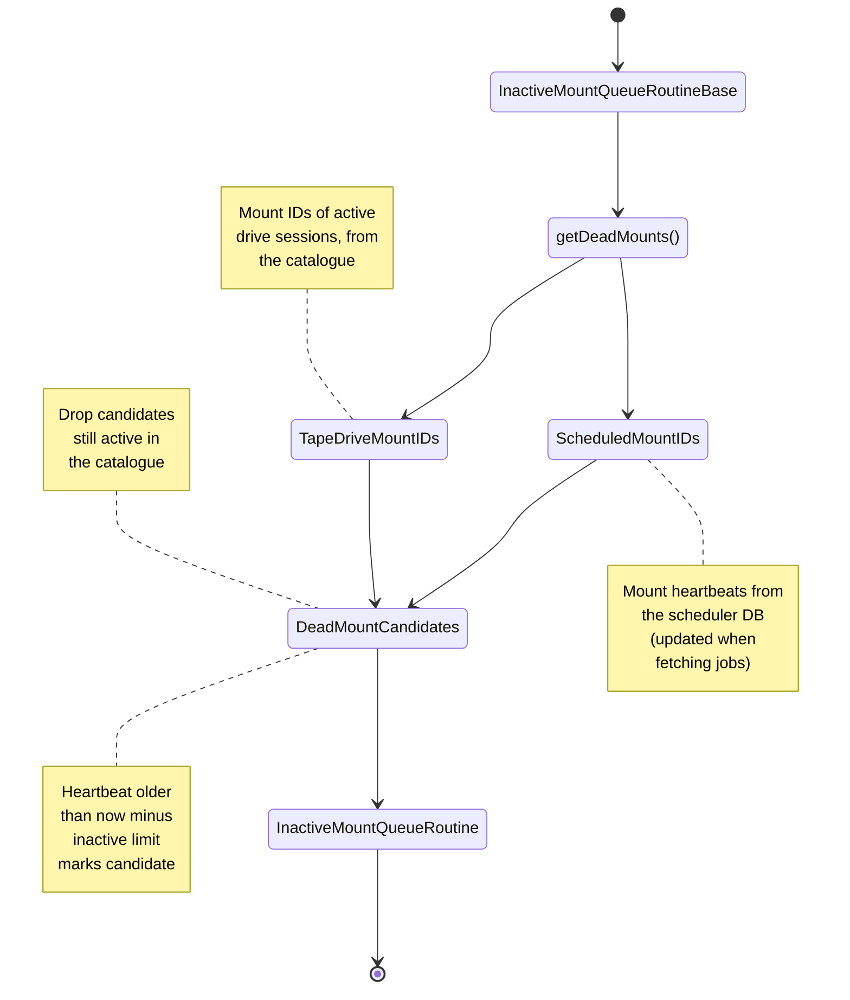

# PostgreSQL Garbage Collection

After a power cut or an unexpected crash of a tape session, jobs can be left owned by a mount that no longer exists, with no process to finish them. `cta-maintd` runs routines that find such dead mounts and release their jobs. The list of routines, and the configuration group that enables each, is in the [Maintenance Daemon](../../../components/maintenance-daemon.md#postgresql-routines) internals; this page explains how they decide which jobs to touch.

## What gets left behind

A dead mount can leave jobs in two places (see [Job lifecycle across the tables](schema.md#job-lifecycle-across-the-tables)):

- **Active tables**: jobs the mount claimed but had not finished. The `*InactiveMountActiveQueueRoutine` routines move them back to the pending table with `MOUNT_ID = NULL`. Only jobs whose status is still a *ToTransfer* status and whose reporting has not started (`IS_REPORTING` false) are moved; jobs already being reported are handled by the reporting cleanup below.
- **Pending tables**: jobs the mount requeued to itself after a failure with retries left in that mount. No other mount would claim them, so the `*InactiveMountPendingQueueRoutine` routines reset their `MOUNT_ID` to `NULL`.

Each of these routines exists for user archive, user retrieve, repack archive and repack retrieve, covering all 12 job tables.

## Detecting dead mounts

`RelationalDB::getDeadMounts` combines two sources:

1. **Heartbeats in the scheduler DB.** `MOUNT_QUEUE_LAST_FETCH` holds one row per (`MOUNT_ID`, `QUEUE_TYPE`). It is updated whenever a mount fetches jobs, and when a job is requeued to the same mount. Rows older than the routine's inactive limit (`age_for_collection_secs` of its configuration group, 900 s by default) are dead-mount candidates (`fetchDeadMountCandidates`).
2. **Active sessions in the catalogue.** `getTapeDriveMountIDs` reads `SESSION_ID` from every row of the catalogue's `DRIVE_STATE` table. The session ID is cleared when the session finishes, crashes or the drive is put down. Any candidate whose mount ID is still a live session is dropped, so a slow but alive mount is never cleaned up, even with a too-short limit.

The remaining candidates are dead: no process can still be changing their rows. Once a routine has cleaned up a (`MOUNT_ID`, `QUEUE_TYPE`) pair, it deletes the matching `MOUNT_QUEUE_LAST_FETCH` row so the pair is not processed again.

## Reporting and housekeeping

- **Stuck reporting.** If the process reporting a job dies, the job stays in the active table with `IS_REPORTING` true. `ResubmitInactiveReportingRoutine` resets the flag on jobs whose last update is older than the inactive limit, so they are picked up for reporting again.
- **Old failed jobs.** `DeleteOldFailedQueuesRoutine` deletes jobs that have stayed in the failed tables longer than `age_for_deletion_secs` (14 days by default).
- **Old heartbeats.** `CleanMountLastFetchTimeRoutine` deletes `MOUNT_QUEUE_LAST_FETCH` rows older than the same `age_for_deletion_secs`, for mounts no routine cleaned up.
- **Expired disk-system sleeps.** `DeleteExpiredDiskSystemSleepEntriesRoutine` deletes expired `DISK_SYSTEM_SLEEP_TRACKING` rows. Mount decisions already ignore expired entries; this only removes the leftovers.
