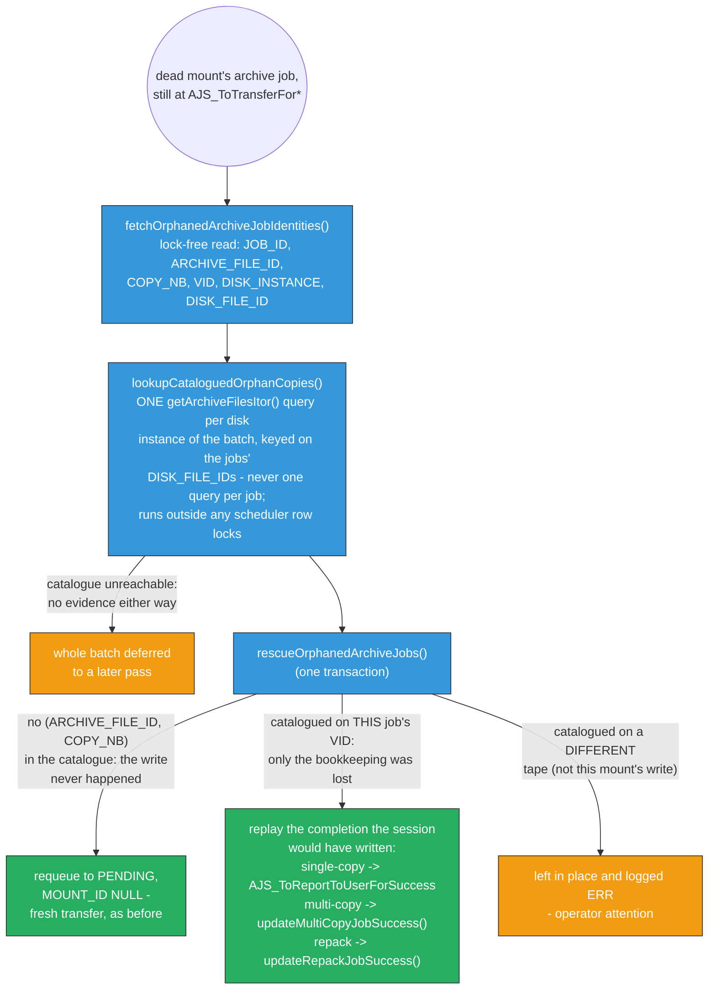
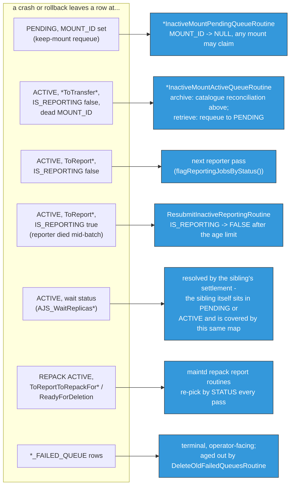
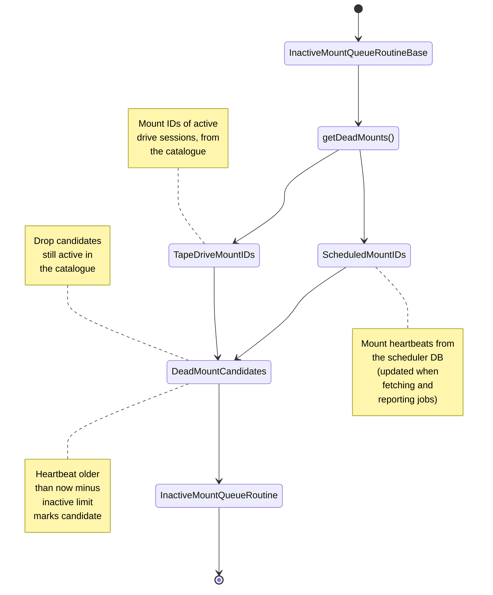

# PostgreSQL Garbage Collection

After a power cut or an unexpected crash of a tape session, jobs can be left owned by a mount that no longer exists, with no process to finish them. `cta-maintd` runs routines that find such dead mounts and release their jobs. The list of routines, and the configuration group that enables each, is in the [Maintenance Daemon](../../../components/maintenance-daemon.md#postgresql-routines) internals; this page explains how they decide which jobs to touch.

## What gets left behind

A dead mount can leave jobs in two places (see [Job lifecycle across the tables](schema.md#job-lifecycle-across-the-tables)):

- **Active tables**: jobs the mount claimed but had not finished. The `*InactiveMountActiveQueueRoutine` routines release them — retrieve jobs go straight back to the pending table with `MOUNT_ID = NULL` (a re-read is always safe), archive jobs are first [reconciled against the catalogue](#archive-jobs-are-reconciled-against-the-catalogue-before-requeueing) because their tape write may already have happened. Only jobs whose status is still a *ToTransfer* status and whose reporting has not started (`IS_REPORTING` false) are touched; jobs already being reported are handled by the reporting cleanup below.
- **Pending tables**: jobs the mount requeued to itself after a failure with retries left in that mount. No other mount would claim them, so the `*InactiveMountPendingQueueRoutine` routines reset their `MOUNT_ID` to `NULL`.

Each of these routines exists for user archive, user retrieve, repack archive and repack retrieve, covering all 12 job tables.

## Archive jobs are reconciled against the catalogue before requeueing

An archive job can be orphaned *after* its tape write and catalogue update succeeded: only the
scheduler bookkeeping write failed (even through `retryWithBackoff()`'s in-place retries — see
[failure-handling.md, Note 1](failure-handling.md)), the session ended, and the row still says
`AJS_ToTransferFor*`. Blindly requeueing it writes the copy to tape a second time, the catalogue
rejects the duplicate, and a safely archived file ends in `ARCHIVE_FAILED_QUEUE` with EOS never
told of the success. The archive flavour of the active-queue routine therefore reconciles first:

The replayed completion goes through the same settlement functions the live session would have
called — all replay-safe by their monotonic guards — so multi-copy and repack group logic is never
duplicated here. Confirmed multi-copy and repack jobs are deliberately not pre-locked by the
rescue's own row selection: the settlement functions take their own sorted group locks, and
pre-holding one group row would break that ordering against a live sibling's concurrent
settlement. A second rescue pass after a committed-but-unacknowledged first one is harmless: the
row is no longer at its transfer status, so it simply no longer matches.

## Every crash-reachable state has a collector

Every write path either commits a row into a state some routine re-picks by `STATUS`, or rolls
back whole — the repack report sweeps move queue rows, request counters and destination statistics
in **one transaction**, so a crash can only mean "nothing happened yet, the next pass sees the same
rows". The map of leftover states to their collectors:

Two details make the map sound. First, dead-mount detection cannot outrun the rescue: a mount's
`MOUNT_QUEUE_LAST_FETCH` heartbeat row is only deleted once a cleanup pass finds **zero** jobs
left for it, so the detection data always outlives the jobs it protects. Second, the in-memory
failed-job accumulators in the tape-session report packers need no collector of their own: a
dropped batch simply leaves its rows at their transfer status, owned by the mount — the first row
of this map.

## Detecting dead mounts

`RelationalDB::getDeadMounts` combines two sources:

1. **Heartbeats in the scheduler DB.** `MOUNT_QUEUE_LAST_FETCH` holds one row per (`MOUNT_ID`, `QUEUE_TYPE`). It is updated whenever a mount fetches jobs or reports a transferred batch, and when a job is requeued to the same mount. Rows older than the routine's inactive limit (`age_for_collection_secs` of its configuration group, 900 s by default) are dead-mount candidates (`fetchDeadMountCandidates`).
2. **Active sessions in the catalogue.** `getTapeDriveMountIDs` reads `SESSION_ID` from every row of the catalogue's `DRIVE_STATE` table. The session ID is cleared when the session finishes, crashes or the drive is put down. Any candidate whose mount ID is still a live session is dropped, so a slow but alive mount is never cleaned up, even with a too-short limit.

The remaining candidates are dead: no process can still be changing their rows. Once a routine has cleaned up a (`MOUNT_ID`, `QUEUE_TYPE`) pair, it deletes the matching `MOUNT_QUEUE_LAST_FETCH` row so the pair is not processed again.

### Heartbeat refresh on report

A mount can spend longer than the inactive limit writing and reporting a batch it has already fetched, without fetching again. If only fetches refreshed the heartbeat, such a busy mount would look inactive, and the active-table routine could requeue jobs it is still reporting, so they would be transferred again and counted twice. `setJobBatchTransferred()` and `setRepackJobBatchTransferred()` of the archive and retrieve mounts therefore also refresh the heartbeat, through the same `updateMountQueueLastFetch()` UPSERT used on fetch, via each mount's `refreshMountLivenessHeartbeat()`.

- **Separate transaction.** `updateMountQueueLastFetch()` sets the query-summary and row-count telemetry of its transaction, so it runs in its own transaction after the caller's report commits, rather than overwriting the report transaction's telemetry.
- **Client-side throttle.** The UPSERT's `WHERE` clause already makes a refresh within 5 s of the previous one a no-op, but that still costs a round-trip. With small `fetchMaxFiles` or `flushMaxFiles`, a fetch and the following report often fall within that window, so each mount object also records its last attempt and skips the call entirely inside it.

## Reporting and housekeeping

- **Stuck reporting.** If the process reporting a job dies, the job stays in the active table with `IS_REPORTING` true. `ResubmitInactiveReportingRoutine` resets the flag on jobs whose last update is older than the inactive limit, so they are picked up for reporting again.
- **Old failed jobs.** `DeleteOldFailedQueuesRoutine` deletes jobs that have stayed in the failed tables longer than `age_for_deletion_secs` (14 days by default).
- **Old heartbeats.** `CleanMountLastFetchTimeRoutine` deletes `MOUNT_QUEUE_LAST_FETCH` rows older than the same `age_for_deletion_secs`, for mounts no routine cleaned up.
- **Expired disk-system sleeps.** `DeleteExpiredDiskSystemSleepEntriesRoutine` deletes expired `DISK_SYSTEM_SLEEP_TRACKING` rows. Mount decisions already ignore expired entries; this only removes the leftovers.
