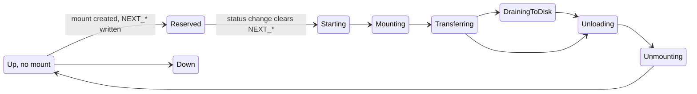
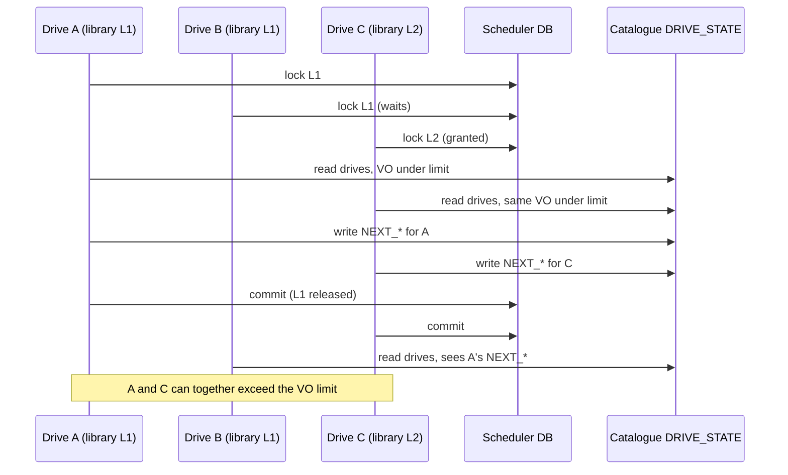

# PostgreSQL Mount Scheduling

This page details how the PostgreSQL backend implements the steps of the [Scheduling Algorithm](../scheduling-algorithm.md): how queue summaries are computed, how a mount is reserved on a drive, how a mount claims jobs, which locks are taken, and what is known to fall short. Read that page first; this one is for people changing the code. The tables and columns referred to here are described in [PostgreSQL Schema](schema.md).

## Queue summaries

Mount choice reads four views that total the pending tables, counting only jobs no mount has claimed (`MOUNT_ID IS NULL`). They are plain SQL views defined in `scheduler/rdbms/schema/postgres_scheduler_schema.sql`, next to the tables. They are not materialised and no trigger maintains them: every read runs the aggregation over the whole pending table. The archive view:

```sql
CREATE VIEW ARCHIVE_QUEUE_SUMMARY AS (
  SELECT STATUS, TAPE_POOL, MOUNT_POLICY, MOUNT_ID,
         COUNT(*)                     AS JOBS_COUNT,
         SUM(SIZE_IN_BYTES)           AS JOBS_TOTAL_SIZE,
         MIN(START_TIME)              AS OLDEST_JOB_START_TIME,
         MAX(START_TIME)              AS YOUNGEST_JOB_START_TIME,
         MAX(PRIORITY)                AS ARCHIVE_PRIORITY,
         MIN(MIN_ARCHIVE_REQUEST_AGE) AS ARCHIVE_MIN_REQUEST_AGE,
         MAX(LAST_UPDATE_TIME)        AS LAST_JOB_UPDATE_TIME
  FROM ARCHIVE_PENDING_QUEUE
  WHERE MOUNT_ID IS NULL
  GROUP BY STATUS, TAPE_POOL, MOUNT_POLICY, MOUNT_ID);
```

| View | One candidate per | Totals carried |
| --- | --- | --- |
| `ARCHIVE_QUEUE_SUMMARY`, `REPACK_ARCHIVE_QUEUE_SUMMARY` | (tape pool, mount policy) | job count, total bytes, oldest and youngest job, highest priority, smallest minimum age |
| `RETRIEVE_QUEUE_SUMMARY`, `REPACK_RETRIEVE_QUEUE_SUMMARY` | (VID, mount policy, activity, disk system) | same |

`RelationalDB::fetchMountInfo` runs three queries inside the locked transaction: one `UNION ALL` of the two archive views, then the user retrieve view, then the repack retrieve view (`postgres/ArchiveJobSummary.hpp`, `postgres/RetrieveJobSummary.hpp`). For archive, only rows with status `ToTransferForUser` or `ToTransferForRepack` become candidates. Retrieve rows whose disk system is in `DISK_SYSTEM_SLEEP_TRACKING` are flagged as sleeping.

Neither the views nor the queries have an `ORDER BY`: PostgreSQL returns rows in whatever order the aggregation produces, and all ordering happens later in C++, in `Scheduler::sortAndGetTapesForMountInfo`.

## Creating the mount

For the chosen candidate, `createArchiveMount` or `createRetrieveMount` (`scheduler/rdbms/TapeMountDecisionInfo.cpp`):

1. takes a new `MOUNT_ID` from `MOUNT_ID_SEQ`;
2. writes the mount into the drive's `NEXT_*` columns in the catalogue: this is the **next mount**, a reservation;
3. commits, which releases the scheduling lock on the logical library.

## Drive state and next mounts

Each row of the catalogue's `DRIVE_STATE` table has two sets of mount columns:

- **Current mount, `CURRENT_*`**: what the drive is doing now. Written by the tape daemon through `reportDriveStatus` as the session moves through its states. Cleared when the drive reports Up, Probing or Down.
- **Next mount, `NEXT_*`**: the reservation written when a mount is created: `NEXT_MOUNT_TYPE`, `NEXT_VID`, `NEXT_TAPE_POOL`, `NEXT_VO`. The table also has `NEXT_ACTIVITY` and `NEXT_PRIORITY`, but they are not written.

When drives are counted (`Scheduler::getExistingAndNextMounts`), each row can produce two entries: one for an active current mount and one for any next mount. Both count toward VO and tape-pool totals, and both put their VID in `tapesInUse`.

The idea dates from the objectstore's original drive register (2017), whose drive-state protobuf gained `nextmounttype`, `nextvid` and related fields so that a busy drive could hold a next mount queued behind its current one and count double while both existed. Those fields are still in `objectstore/cta.proto` but nothing writes them, and since drive state moved to the catalogue the objectstore backend writes no `NEXT_*` columns either. A drive using the PostgreSQL backend only asks for work when idle, so here a next mount is only ever a short reservation that turns into the current mount.



### How the reservation is written and cleared

Both happen in `RdbmsDriveStateCatalogue::updateTapeDriveStatus` (`catalogue/rdbms/RdbmsDriveStateCatalogue.cpp`), which handles every drive-state update in two cases:

| Case | When it applies | Effect on `NEXT_*` |
| --- | --- | --- |
| 1. Status unchanged | The `UPDATE … WHERE DRIVE_STATUS = :DRIVE_STATUS` matches a row. This covers routine reports (byte counters during Transferring) and the reservation itself, which is written while the drive is still Up. | Writes `NEXT_MOUNT_TYPE`, `NEXT_VID`, `NEXT_TAPE_POOL` and `NEXT_VO` only if the caller set `nextMountType`; otherwise leaves them as they are. |
| 2. Status changes | Case 1 matched no row. | Always sets `NEXT_MOUNT_TYPE = 'NO_MOUNT'` and clears the other three. |

The in-memory helpers in `TapeDrivesCatalogueState` (`setDriveStarting` and the others) never touch `nextMountType`. The clearing is done in SQL so that every status transition gets it without changing each helper.

| Moment | `CURRENT_*` | `NEXT_*` | Counts toward VO limit |
| --- | --- | --- | --- |
| Drive idle, reports Up | none | none | 0 |
| Mount created (status still Up, case 1) | none | X (reserved) | 1 |
| Drive reports Starting (case 2) | X | cleared | 1 |
| Transferring … Unmounting | X | none | 1 |
| Session ends, reports Up | none | none | 0 |

!!! note
    The reservation is cleared by the drive's next status change, not by a timeout. If `cta-taped` stops right after the mount is created, the reservation stays until the drive changes status for some other reason, for example when it is restarted or put down.

## Claiming a batch

One SQL statement picks the jobs, trims the batch to the byte limit and moves the rows from pending to active, stamped with the mount's ID (`postgres/ArchiveJobQueue.cpp`, `postgres/RetrieveJobQueue.cpp`). Simplified, for user archive:

```sql
WITH sel AS (
  SELECT JOB_ID, PRIORITY, SIZE_IN_BYTES FROM ARCHIVE_PENDING_QUEUE
  WHERE TAPE_POOL = :pool AND STATUS = 'AJS_ToTransferForUser'
    AND (MOUNT_ID IS NULL OR MOUNT_ID = :myMount)
  ORDER BY PRIORITY DESC, ARCHIVE_FILE_ID
  LIMIT :files
  FOR UPDATE SKIP LOCKED),
cut AS (                        -- stop once the running byte total exceeds :bytes
  SELECT JOB_ID FROM (
    SELECT JOB_ID, SUM(SIZE_IN_BYTES) OVER (ORDER BY PRIORITY DESC, JOB_ID) AS total
    FROM sel) s
  WHERE total <= :bytes),
moved AS (
  DELETE FROM ARCHIVE_PENDING_QUEUE q USING cut
  WHERE q.JOB_ID = cut.JOB_ID RETURNING q.*)
INSERT INTO ARCHIVE_ACTIVE_QUEUE (…, MOUNT_ID, DRIVE, HOST, …)
SELECT …, :myMount, :drive, :host, … FROM moved;
```

Archive claims take an advisory lock on the tape pool name (`rdbms/ArchiveMount.cpp`), retrieve claims on the VID (`rdbms/RetrieveMount.cpp`). Each fetch also updates `MOUNT_QUEUE_LAST_FETCH`.

Where each row goes once its transfer succeeds or fails is described in [Job lifecycle across the tables](schema.md#job-lifecycle-across-the-tables).

## Locks and concurrency

All locks are PostgreSQL advisory transaction locks taken through `Transaction::takeNamedLock` (`postgres/Transaction.cpp`), keyed on a 32-bit hash of a name, and held until the transaction commits.

| Lock name | Taken by | Serialises |
| --- | --- | --- |
| Logical library | Choosing a mount | Drives of the same library choosing at the same time |
| Tape pool | Claiming an archive batch | Archive mounts on the same pool fetching jobs |
| VID | Claiming a retrieve batch | Fetches for the same tape |

The mount-choice lock covers one logical library, but VO drive limits apply across all libraries:



Drives of the same library choose one at a time; drives of different libraries are not coordinated.

## Known limitations

Ranked by impact, as reviewed in November 2026. None is confirmed by a test yet; update this list as they are fixed.

**Lock covers one library, but VO limits are global (high).**
Mount choice locks the drive's logical library, while the VO count is taken over every drive in the `DRIVE_STATE` table. Two drives in different libraries can both read the table before either writes its reservation, both see the VO under its limit, and both create a mount (see the diagram above). The code comments in `createArchiveMount` and `updateTapeDriveStatus` saying other-library schedulers "see the marker" only hold when one writes before the other reads.

**Thresholds apply per mount policy, not per queue (medium).**
The summary views group by mount policy (and by activity and disk system for retrieve), and each row is judged on its own. Nothing merges rows of the same tape pool or VID. A pool whose jobs are split across two policies, each below `minBytesToWarrantAMount`, mounts only after `minRequestAge`, even when the total is over the threshold.

**One failed mount creation ends the search (medium).**
If `createArchiveMount` or `createRetrieveMount` throws after taking the lock, it aborts the transaction and sets `m_lockTaken = false`. `getNextMount` catches the error and tries the next tape or candidate, but every later attempt throws `SchedulingLockNotHeld` straight away, so the call returns no mount.

**The scheduling timeout is ignored (medium).**
`RelationalDB::getMountInfo` takes `timeout_us` and never uses it, and no `lock_timeout` is set, so `pg_advisory_xact_lock` waits as long as it takes. `cta-taped`'s `wdGetNextMountMaxSecs` and its `TimeoutException` handling never apply to this backend, unless the PostgreSQL server has a lock timeout configured.

**`takeNamedLock` hides lock failures (low).**
It logs the error and returns, and the caller marks the lock as taken anyway. This does not lead to scheduling without the lock, because the failed statement aborts the PostgreSQL transaction and the next query fails too; the effect is a misleading error raised one step after the real failure.

**Libraries, tape pools and VIDs share one lock keyspace (low).**
All go through `takeNamedLock`, which folds `std::hash` to 32 bits; `lockGlobal` uses key 0 in the same space. Archive mounts on one pool therefore fetch batches one at a time, so `SKIP LOCKED` rarely matters there, and a hash collision between unrelated names makes them wait on each other.
