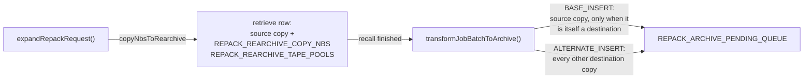
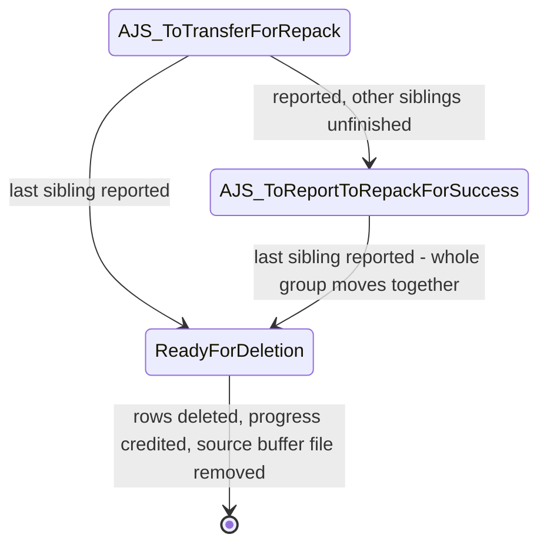

# PostgreSQL Repack Workflows

Repack expansion selects the copies to write; the PostgreSQL scheduler records the source tape copy on the retrieve job and queues the destination copies after retrieval. See [PostgreSQL Schema](schema.md) for the queue and tracking tables.

## Select the destination copies

`Scheduler::expandRepackRequest()` uses the same rules for both scheduler backends. For each file on the repacked tape, it records the copy numbers to write in `copyNbsToRearchive`:

| Repack type | Copies to write |
| --- | --- |
| `MoveOnly` | The copy on the repacked tape. |
| `AddCopiesOnly` | The missing copies required by the storage class. |
| `MoveAndAddCopies` | The copy on the repacked tape and any missing copies required by the storage class. |

Missing copies are found by comparing the storage class's required copy count with the file's catalogue copies, and routed via the archive routes — which must map distinct copy numbers to distinct tape pools, or expansion rejects the request. `AddCopiesOnly` skips files that already have enough copies and leaves existing copies in place.

## Queue the retrieve and archive jobs

The retrieve row identifies the source copy by VID, file sequence and block ID. For `AddCopiesOnly` the source copy is outside the destination set, so the subrequest's internal job list can be empty — it still carries normal retry limits. Reading copy 1 to add copies 2 and 3 queues two archive jobs, each with `REQUEST_JOB_COUNT` 2; `BASE_INSERT` fires only for the Move* types, where the source copy is itself rewritten.

## Complete a multi-copy request

`updateRepackJobSuccess()` settles a reported archive job against its siblings. The sibling group is `(REPACK_REQUEST_ID, ARCHIVE_FILE_ID)`, not the file ID alone: the same file can be in two repack requests at once, and those rows are not siblings.

A sibling still being written is never touched by another copy's settlement; only the last report moves the whole group to `ReadyForDeletion`, which is what allows the source file's deletion from the disk buffer.

The scheduler locks each sibling group before evaluating completion and counts each job once. A group with a failed copy stays in the active queue until every sibling has finished. See [PostgreSQL Failure Handling](failure-handling.md) for the failure and buffer-cleanup paths.

## Record progress

Retrieved files and bytes are counted from the completed retrieve rows; a user-provided file already in the disk buffer has no retrieve mount ID and contributes only to archive work. Archive totals come from the rows actually inserted into the archive queue.

The retrieve-to-archive transform and its progress update commit in one transaction, and the progress statement locks the tracking row `FOR NO KEY UPDATE`: the same transaction's child-queue inserts hold `FOR KEY SHARE` locks on that row through their foreign keys, which `FOR UPDATE` conflicts with — two workers on the same repack request would deadlock.

A per-file subrequest creation failure only increments the request's failure counters. Check `FAILED_TO_CREATE_ARCHIVE_REQ` when testing expansion, since the expansion call returns normally after recording it.
