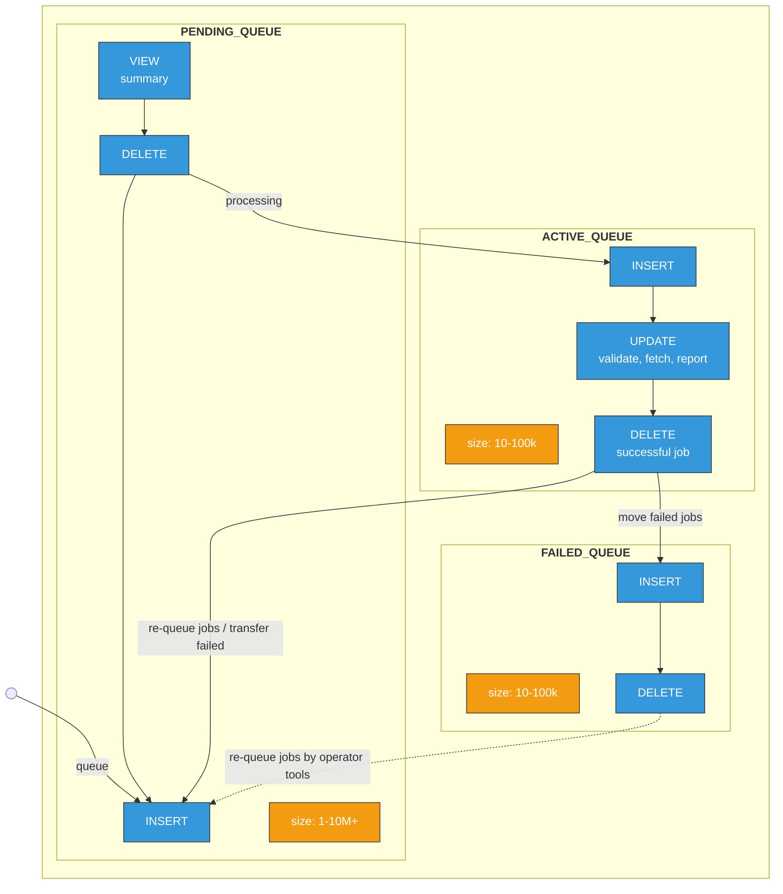

# PostgreSQL Schema

The schema is defined in `scheduler/rdbms/schema/postgres_scheduler_schema.sql`. The commands `cta-scheduler-schema-create` and `cta-scheduler-schema-drop` connect with the username from the connection string in the configuration file and create or drop it.

To give the schema a different name, see [Scheduler Configuration](../../../../../ops/deploy-and-configure/configuration/scheduler.md#postgresql-backend).

## Tables

| Table | Holds |
| --- | --- |
| `ARCHIVE_PENDING_QUEUE`, `RETRIEVE_PENDING_QUEUE` | Jobs queued by the frontend and waiting for a mount. |
| `ARCHIVE_ACTIVE_QUEUE`, `RETRIEVE_ACTIVE_QUEUE` | Jobs claimed by a mount, and then the same rows while the result is reported to the disk system. |
| `ARCHIVE_FAILED_QUEUE`, `RETRIEVE_FAILED_QUEUE` | Jobs whose report to the disk system failed for good, kept for operators. |
| `REPACK_*` versions of all six | Same columns, for repack traffic, so repack never competes for rows with user jobs. |
| `*_QUEUE_SUMMARY` views | Per-queue totals over the pending tables, used to choose mounts; see [Queue summaries](mount-scheduling.md#queue-summaries). |
| `MOUNT_QUEUE_LAST_FETCH` | Heartbeat: when each mount last fetched jobs from each queue type. Used to detect dead mounts; see [PostgreSQL Garbage Collection](garbage-collection.md). |
| `DISK_SYSTEM_SLEEP_TRACKING` | Disk systems that are full; retrieves to them are held back until the sleep expires. |
| `REPACK_REQUEST_TRACKING` | Repack requests and their progress. |
| `REPACK_REQUEST_DESTINATION_STATISTICS` | Per repack request, the destination tapes files are written to. |
| `MOUNT_ID_SEQ` (sequence) | Source of mount IDs. |

The pending, active and failed tables of one workflow have identical columns (`CREATE TABLE … (LIKE … INCLUDING ALL)`), so moving a job between them is one `DELETE … RETURNING` feeding an `INSERT`. None of the tables is partitioned.

A job row contains everything needed to do the transfer and report the result, so a drive never has to go back to the frontend:

- **What to transfer**: `ARCHIVE_FILE_ID`, `COPY_NB`, `SIZE_IN_BYTES`, `CHECKSUMBLOB`, the disk-side URL and path, and the target: `TAPE_POOL` for archive; `VID`, `FSEQ` and `BLOCK_ID` for retrieve, with the other tape copies in `ALTERNATE_*` columns.
- **How urgent it is**: `MOUNT_POLICY`, `PRIORITY`, `MIN_*_REQUEST_AGE`, `START_TIME`. Retrieve adds `ACTIVITY` and `DISK_SYSTEM_NAME`.
- **Who is working on it**: `MOUNT_ID`, `DRIVE`, `HOST`, `LOGICAL_LIBRARY`, set when a mount claims the job, plus `STATUS`.
- **Retries and reporting**: report URLs, retry counters (`RETRIES_WITHIN_MOUNT`, `TOTAL_RETRIES`, `TOTAL_REPORT_RETRIES` and their maxima), `FAILURE_LOG`, `IS_REPORTING`.

## Job lifecycle across the tables

The diagram shows typical table sizes (orange). The pending tables are by far the largest: they hold all queued work, which is why insertion into them is kept separate from the update-heavy active tables. Every mount decision reads the summary views, which aggregate over the whole pending table. A mount that claims jobs deletes them from the pending table and inserts them into the active table, so the active tables only hold the work currently on drives or being reported, and stay much smaller.

**Queuing.** `RelationalDB::queueArchive` inserts one row per tape copy into `ARCHIVE_PENDING_QUEUE`; the rows share one `ARCHIVE_REQUEST_ID` and record the copy count in `REQUEST_JOB_COUNT`. `RelationalDB::queueRetrieve` inserts one row into `RETRIEVE_PENDING_QUEUE`. Both have a bulk path used by [opportunistic batching](opportunistic-batching.md), and repack inserts into the `REPACK_*` tables in bulk. A new job has `MOUNT_ID = NULL`.

**After a mount claims it** ([Claiming a batch](mount-scheduling.md#claiming-a-batch)), the outcome decides where the row goes. The backend-independent meaning of each outcome is in [Job outcomes and reporting](../../../workflows/index.md#job-outcomes-and-reporting); this table adds the tables involved (`ArchiveRdbJob.cpp`, `RetrieveRdbJob.cpp`, `RelationalDB.cpp`):

| Outcome | Where the row goes |
| --- | --- |
| Transfer OK | Stays in ACTIVE, marked to report success; deleted once reported. |
| Failed, retries left in this mount | Back to PENDING, keeping this `MOUNT_ID`. |
| Failed, this mount's retries used up | Back to PENDING with `MOUNT_ID = NULL`. |
| Failed, all retries used up | Stays in ACTIVE, marked to report failure. |
| Report could not be delivered after all report retries | FAILED table; operator tools can requeue it to PENDING. |
| Drive or daemon died mid-session | Rows keep the dead `MOUNT_ID` until `cta-maintd` releases them; see [PostgreSQL Garbage Collection](garbage-collection.md). |

## Repack request statistics

Repack migrates files from one tape to another: to free library slots when denser media arrive, to make additional copies, or to reclaim space after files were deleted from the catalogue. `REPACK_REQUEST_TRACKING` holds the progress of each queued repack request, and `REPACK_REQUEST_DESTINATION_STATISTICS` the destination tapes its files are written to.
