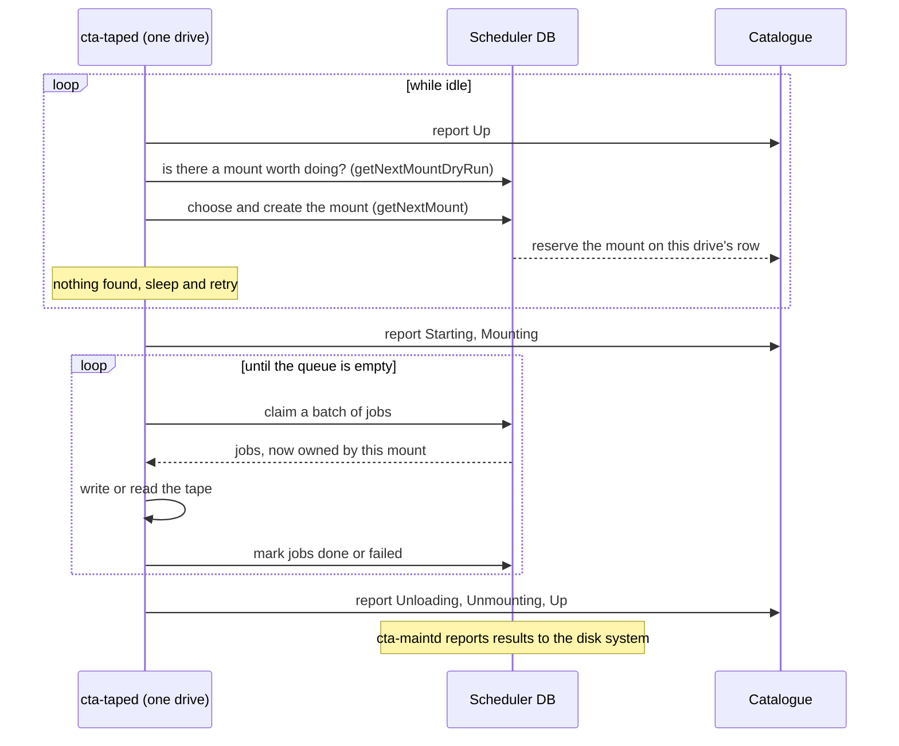

# Scheduling Algorithm

!!! warning "This page describes the PostgreSQL backend"

    The PostgreSQL backend is being stabilised and will become the standard one. The objectstore backend will be deprecated in a future version. Where the two differ (queue summaries, locking, next-mount reservations, the order jobs are claimed), this page describes PostgreSQL. The objectstore behaviour is summarised in the [backend comparison](index.md#backend-comparison).

This page explains how an idle drive chooses its next mount and how it then works through the jobs of that mount. It assumes the [scheduling concepts](../../../../concepts/data-management/scheduling.md) (why CTA batches work, thresholds, priorities, VO limits) and starts where the [request path](../../workflows/index.md#the-request-path) leaves off: the jobs are queued in the scheduler DB and unclaimed.

No process runs this algorithm on behalf of the others: every `cta-taped` runs it for its own drive, coordinating with the other drives only through the [shared state](../index.md). The decision logic (filtering, ranking and choosing a candidate) lives in `scheduler/Scheduler.cpp` and is shared by both scheduler backends. It reaches the queues only through the `SchedulerDatabase` interface; how queues are stored, summarised, locked and claimed is backend-specific and is described in the [Scheduler DB overview](index.md).

## Terms

[Job](../../../../concepts/glossary.md#job), [tape mount](../../../../concepts/glossary.md#tape-mount) and the other user-facing terms are defined in the [Glossary](../../../../concepts/glossary.md). In code, each mount has one type (archive for user, archive for repack, retrieve, or label) and a numeric mount ID. This page also uses:

| Term | Meaning |
| --- | --- |
| **Candidate mount** | Also *potential mount*. A mount the drive could do, built from one queue summary (`PotentialMount` in the code): an archive for a tape pool or a retrieve for a VID. The drive filters and ranks the candidates and addresses the first one it can serve. |
| **Mount thresholds** | `minBytesToWarrantAMount` and `minFilesToWarrantAMount`: how much queued work justifies a mount (`taped MountCriteria` in the `cta-taped` configuration). |
| **Task injector** | The part of a drive's tape session that pulls batches of jobs from the scheduler once the tape is mounted, and turns each job into a disk task and a tape task for the session's worker threads. It fetches the next batch when those threads run low on work. `MigrationTaskInjector` for archive, `RecallTaskInjector` for retrieve. |

## A drive's session

There is no central allocator in CTA: an idle drive is free by definition and actively looks for work on the scheduler DB. `DataTransferSession::execute()` repeats one loop, polling roughly every 10 seconds.
The process responsible for doing this is `taped`, the tape daemon. All operations below are executed by the former.



Two decisions are made along the way, at different levels:

- **Which mount to take**, once per session: a tape pool to write to or a tape to read, chosen from queue summaries and drive state ([Choosing a mount](#choosing-a-mount)).
- **Which jobs to run, in what order**, on every batch: job rows from the one queue the mount serves ([Running a mount](#running-a-mount)).

## Choosing a mount

The choice is made in `Scheduler::getNextMount()`. It gathers some inputs, described below in the order they are read, then turns the queues into a list of candidate mounts, drops those that do not qualify, ranks the rest and creates the best one that can actually be served.

Before the real run, the drive does a **dry run** of the same logic without taking the scheduling lock (`Scheduler::getNextMountDryRun()`, using `SchedulerDatabase::getMountInfoNoLock`). Only if the dry run finds something does the drive take the lock (`SchedulerDatabase::getMountInfo`) and run it for real. What the lock covers is backend-specific: one logical library in PostgreSQL, the whole instance in the objectstore.

```mermaid
flowchart TD
--8<-- "docs/includes/mermaid-classes.txt"

  A["Logical library usable?"] --> B

  subgraph LOCK["Scheduling lock"]
    B["<b>Input 1</b>: read queue summaries (getMountInfo)"] --> C
    C["<b>Input 2</b>: apply current mount policies"] --> D
    D["<b>Input 3</b>: read all drive states (getExistingAndNextMounts)"] --> E
    E["<b>Input 4</b>: keep retrieves for tapes in this library, attach tape pool and VO"] --> F
    F["Filter: enough work, VO under limit, not sleeping"] --> G
    G["Rank: priority, user archive, oldest job"] --> H{"Next candidate"}
    H -- "archive" --> I["Free writable tape in the pool?"]
    H -- "retrieve" --> J["Tape not in use?"]
    I -- "yes" --> K
    J -- "yes" --> K
    I -- "no" --> H
    J -- "no" --> H
    K["Create mount (new mount ID), release lock"]
  end

  H -- "none left" --> Z["Nothing to do, sleep"]

  class LOCK group
```

### Input 1: queue summaries

To choose a mount, the scheduler does not look at jobs one by one. It asks the scheduler DB for a **summary** of the waiting work (`SchedulerDatabase::getMountInfo()`): for each queue and mount policy, aggregate figures over the jobs that no mount has claimed yet. Each summary becomes one candidate mount, a `PotentialMount`, with:

- the queue type (archive for user, archive for repack, retrieve) and the tape pool or VID;
- the number of files and bytes queued;
- the oldest and youngest job;
- the highest priority and the smallest minimum request age among the queued jobs, and the mount policy names.

Retrieve candidates whose destination disk system is full are flagged as sleeping. A summary covers only part of a queue: one tape pool and mount policy for archive, one VID, mount policy, activity and destination disk system for retrieve. One queue can therefore give several candidates, and the thresholds apply to each of them separately, not to the queue as a whole (see [Filtering](#filtering-does-the-candidate-tapetape-pool-qualify)). For how PostgreSQL computes the summaries see [Queue summaries](postgresql/mount-scheduling.md#queue-summaries); the objectstore differences are in the [Backend comparison](index.md#backend-comparison).

### Input 2: current mount policies

The scheduler reads, from the catalogue, the current priority and minimum age of each policy found in the queues (`fillMountPolicyNamesForPotentialMounts`). These override the values copied into the jobs when they were queued.

### Input 3: what the other drives are doing

`Scheduler::getExistingAndNextMounts()` reads every row of the catalogue's `DRIVE_STATE` table. A drive counts as busy in two cases:

- **It has a current mount**: its status is Starting, Mounting, Transferring, Unloading, Unmounting, DrainingToDisk or CleaningUp, and its `CURRENT_*` columns name the tape, pool and VO.
- **It has a next mount**: a mount was just chosen for it but it has not reported Starting yet. The `NEXT_*` columns hold this reservation. Only the PostgreSQL backend writes it; see [Drive state and next mounts](postgresql/mount-scheduling.md#drive-state-and-next-mounts).

From these entries the scheduler builds `tapesInUse` (tapes that must not be mounted again) and the number of mounts per VO and per tape pool. The asking drive's own row is ignored.

### Input 4: tapes and VOs

From the catalogue:

- **Tapes**: for retrieve, which VIDs are in this drive's logical library and readable (ACTIVE or REPACKING); for archive, which tapes in the library can be written to.
- **VOs**: which VO owns each tape pool, and its drive limits. Repack mounts are counted against the dedicated default repack VO.

### Filtering: does the candidate tape/tape pool qualify?

Filtering and ranking happen in `Scheduler::sortAndGetTapesForMountInfo()`. A candidate is kept only if it has **enough work**, its VO is **under its drive limit**, and it is **not sleeping**:

```text
enough work =     bytesQueued / (1+N) >= minBytesToWarrantAMount
              OR  filesQueued / (1+N) >= minFilesToWarrantAMount
              OR (N == 0 AND age of oldest job > minRequestAge)

    N = mounts already serving the same tape pool (archive only; 0 for retrieve)
    repack archive: both thresholds doubled

under limit = mounts of this VO (read or write) < readMaxDrives / writeMaxDrives
```

The `1+N` divisor means a second archive mount on the same pool needs twice the queued work, a third needs three times, and so on. The age condition alone never adds a second mount to a pool already being served.

`bytesQueued`, `filesQueued` and the oldest job are those of **one candidate**, not of the whole tape pool or tape. For example, with `minFilesToWarrantAMount = 500`, a tape with 300 retrieve jobs under policy `physics` and 300 under policy `default` gives two candidates of 300 files each. Neither passes the files threshold, although the tape has 600 files queued. The tape is mounted only once the oldest job of one of the two candidates is older than its policy's minimum request age; that mount then claims all 600 jobs.

### Ranking: which candidate tape/tape pool goes first?

Survivors are sorted with `PotentialMount::operator<` by these keys in order:

1. **Priority**, from the mount policy. Higher wins. If equal,
2. **User archive** beats every other mount type. If the mount type is the same,
3. **Oldest job**: the candidate that has waited longest wins. Finally, if they've both waited the same,
4. **VID or tape pool name**, alphabetically, so the order is deterministic.

### Taking the first candidate tape to be served

`getNextMount()` walks the ranked list:

- **Archive**: take the first writable tape in the candidate pool that is not in `tapesInUse`. If the pool has none, try the next candidate.
- **Retrieve**: skip the candidate if its VID is in `tapesInUse`.
- If the list runs out, there is nothing to do; the drive sleeps and asks again later.

For the chosen candidate the backend creates the mount (`TapeMountDecisionInfo::createArchiveMount` / `createRetrieveMount`): it allocates a mount ID and releases the scheduling lock. Between that moment and the moment this drive reports Starting, another drive can run its own choice. The PostgreSQL backend therefore also records the mount as the drive's **next mount** in the catalogue, so that the other drive sees the tape as taken and counts the mount against the VO; the objectstore backend writes no reservation.

| Step | Code |
| --- | --- |
| Lock and read summaries | `SchedulerDatabase::getMountInfo` (`RelationalDB`, `OStoreDB`) |
| Apply mount policies | `Scheduler::fillMountPolicyNamesForPotentialMounts` |
| Read drive states | `Scheduler::getExistingAndNextMounts` |
| Tapes, VOs, filter, rank | `Scheduler::sortAndGetTapesForMountInfo` |
| Walk candidates | `Scheduler::getNextMount` |
| Create the mount | `SchedulerDatabase::TapeMountDecisionInfo` (`scheduler/rdbms/TapeMountDecisionInfo.cpp`, `scheduler/OStoreDB/OStoreDB.cpp`) |

The full list of calls a backend must implement is the [backend contract](index.md#backend-contract).

## Running a mount

A mounted drive works through a tape pool (archive) or a single VID (retrieve). The drive's task injector asks for batches of jobs (`ArchiveMount::getNextJobBatch`, `RetrieveMount::getNextJobBatch`) until a request comes back empty.

There is no per-mount time or size limit: a mount runs until its queue is empty, the tape is full (archive), or the session fails. Jobs queued for that tape pool or VID while the tape is mounted are claimed by the same mount, so **as long as new jobs keep arriving, the tape stays mounted**. Nothing preempts a running mount: higher-priority work elsewhere, or another VO waiting for a drive, only influences what the next idle drive chooses.

| | Archive | Retrieve |
| --- | --- | --- |
| Who asks | `MigrationTaskInjector` | `RecallTaskInjector` |
| Batch size | First request 2 × `maxFiles` and 2 × `maxBytes`, then refills as tasks complete | Up to `maxBatchFiles` (or the RAO limit) |
| Jobs eligible | This tape pool, not yet claimed or already this mount's | This VID, not yet claimed or already this mount's, disk system not full |
| Order claimed | Backend-specific | Backend-specific |
| Order on tape | As claimed; each file gets the next fSeq after the last one on the tape | Reordered by position on tape ([RAO](../../../../concepts/tape/rao.md)) when the drive supports it |

The mount was chosen by the queue's highest priority. Which jobs of the queue go first depends on the backend: PostgreSQL claims the highest-priority jobs first, the objectstore claims them in queue order. See [Order jobs are claimed](index.md#backend-comparison).

"Already this mount's" covers jobs that failed in this mount with retries left: they are requeued still owned by the mount, so no other drive sees them, and come back in a later batch. What happens to every other outcome is described in [Job outcomes and reporting](../../workflows/index.md#job-outcomes-and-reporting).

Each fetch also refreshes the mount's heartbeat, which is how `cta-maintd` tells a dead session from a slow one. When a request returns no jobs, the drive finishes its last transfers, unmounts, reports Up and goes back to the idle loop above.

For the SQL behind batch claims in the PostgreSQL backend, see [Claiming a batch](postgresql/mount-scheduling.md#claiming-a-batch).
