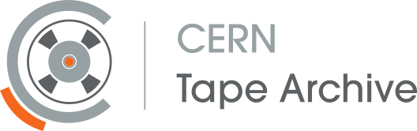

---
hide:
  - navigation
  - toc
---

# CERN Tape Archive Documentation

Technical documentation for understanding, deploying, operating and developing **CERN Tape Archive (CTA)**.
CTA manages tape storage alongside a disk system such as [EOS](https://eos.web.cern.ch/) or [dCache](https://www.dcache.org/).

## Getting started

Choose a starting point below.

-   :material-information-outline:{ .lg .middle } [__Understanding CTA__](concepts/index.md)

    ---

    Learn about CTA concepts, architecture, file lifecycle, and terminology.

    [CTA concepts](concepts/index.md)
    · [Glossary](concepts/glossary.md)

-   :material-server:{ .lg .middle } [__Running CTA__](ops/index.md)

    ---

    Install, configure, monitor, and upgrade a CTA deployment.

    [Operations guide](ops/index.md) ·
    [Installation](ops/deploy-and-configure/deployment/installation/index.md) · [Upgrading CTA](ops/run-and-maintain/upgrades/cta.md)

-   :material-code-tags:{ .lg .middle } [__Developing CTA__](dev/index.md)

    ---

    Set up a development environment, build from source, run tests, and contribute changes.

    [Developer guide](dev/index.md)
    · [Conventions](dev/guides/conventions/index.md)

-   :material-forum:{ .lg .middle } [__Getting help__](https://cta-community.web.cern.ch/)

    ---

    Ask questions about operating and developing CTA, or report a bug.

    [Community forum](https://cta-community.web.cern.ch/)
    · [Issue tracker](https://gitlab.cern.ch/cta/CTA/-/issues)

## Project resources

- [Main CTA website](https://cta.web.cern.ch/): project background, presentations, and publications.
- [Source code](https://gitlab.cern.ch/cta/CTA): browse the repository and contribute.
- [Changelog](changelog.md): features, fixes, and changes in each release.
