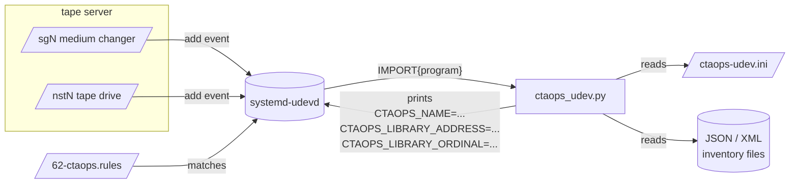

# ctaops-udev

`ctaops-udev` is a small udev helper that labels tape hardware on a CTA tape
server with three udev properties so other CTA tools can address each device by a stable logical name instead of a kernel index that changes across reboots:

| Property | Set on | Meaning |
| --- | --- | --- |
| `CTAOPS_NAME` | medium-changer `sgN` and tape drive `nstN` | Logical name (library or `library-tech-location`) |
| `CTAOPS_LIBRARY_ADDRESS` | tape drive `nstN` | SCSI element address of the drive inside its parent changer |
| `CTAOPS_LIBRARY_ORDINAL` | tape drive `nstN` | 0-based ordinal of the drive within its parent changer |

It also creates persistent device symlinks under `/dev/tape/by-name/` from the `CTAOPS_NAME` value.

!!! warning "Not stable, CERN-context specific"
    The `ctaops-udev` RPM is provided **as-is** and is **not stable**. The
    implementation hard-codes assumptions that are only true at CERN today
    — see [Assumptions](#assumptions) below — and it depends on inventory
    files produced by vendor tools (`itdt` for IBM, `slapi` for Spectra
    Logic) that you must generate and place under `/etc/cta-ops/library_drive_config/`
    yourself.

    Use it as a working reference. Expect to fork the parsers, the
    location regexes, and the configuration layout to fit your own site.

## Why it matters for `ctaops-sdk`

[`ctaops-sdk`](../../../dev/guides/python/ctaops-sdk/index.md) discovers tape libraries and drives
**entirely from udev metadata**. Its
[local repositories](../../../api/python/ctaops-sdk/reference/infrastructure-repository.md) read exactly the three properties listed above:

- `CTAOPS_NAME` resolves a `NamedLibrary.name` (for changers) or a
  `NamedDrive.name` (for drives).
- `CTAOPS_LIBRARY_ADDRESS` and `CTAOPS_LIBRARY_ORDINAL` populate the
  `DriveLibraryLocation` of each drive bound to a library.

Without these properties on the devices, the corresponding `Named*` /
`Located*` repositories silently skip the hardware. `ctaops-udev` is the
reference mechanism CTA uses to populate them; any equivalent udev source works.

## How it works



When a tape device appears, the udev rule ([`62-ctaops.rules`](https://gitlab.cern.ch/cta/CTA/-/blob/main/tools/ctaops-udev/src/62-ctaops.rules)) runs the helper script. The script:

1. Loads its configuration from `/etc/udev/ctaops-udev.ini`.
2. Identifies whether the device is a medium changer or a tape drive.
3. For a **medium changer**: looks up the library inventory file by
   `vendor`-`model`-`serial`, picks the first non-excluded logical
   library name and prints `CTAOPS_NAME=<library_name>`.
4. For a **tape drive**: walks up to the drive's SCSI target, finds the
   sibling medium changer, parses *its* inventory, locates the row whose
   serial matches the drive, and prints
   `CTAOPS_NAME=<library>-<tech>-<location>`,
   `CTAOPS_LIBRARY_ADDRESS=<element_addr>`, and
   `CTAOPS_LIBRARY_ORDINAL=<ordinal>`.

`systemd-udevd` then sets these as standard udev properties on the
device, and the udev rule creates a `tape/by-name/<CTAOPS_NAME>` symlink.

## Assumptions

The current implementation is tailored to the hardware mix CTA runs at CERN. The most CERN-specific pieces are:

- **IBM ordinal calculation**: assumes drive element addresses start at
  `257` and are sequential, so `ordinal = elementAddress - 257`.
- **Spectra ordinal calculation**: assumes
  `ordinal = partitionDriveNumber - 1` and
  `address = partitionDriveNumber + 255`.
- **Location regexes**: IBM locations must match `drive_F<frame>C<col>R<row>`;
  Spectra locations must match `FR<frame>/DBA<n>/fLTO-DRV<n>`.
- **Inventory production**: you must produce the JSON / XML inventory
  files with the vendor tools (`itdt` for IBM, `slapi` for Spectra)
  and name them `<VENDOR>-<MODEL>-<SERIAL>.<json|xml>`.
- **Drive technology mapping**: the bundled `[tech_model_drive_map]`
  covers the LTO8 → LTO10 and TS1155 → TS1170 drives in use at CERN.

If any of these assumptions does not hold for your site, you will need to adjust the parsers and/or the configuration file.

## Installation

`ctaops-udev` is shipped as an RPM only (it has to install udev rules
under `/usr/lib/udev/rules.d/`, which `pip` is not the right tool for).

!!! abstract "Install the RPM"
    ```bash
    dnf install ctaops-udev
    udevadm control --reload-rules && udevadm trigger
    ```

Copy the packaged sample to the path read by the helper, then adapt it for your site:

```bash
install -m 0644 /usr/lib/udev/ctaops-udev.ini /etc/udev/ctaops-udev.ini
```

The RPM lays down:

| Path | Purpose |
| --- | --- |
| `/usr/lib/udev/rules.d/62-ctaops.rules` | The udev rule that fires on tape devices |
| `/usr/lib/udev/ctaops-udev` | The Python helper script (run by udev) |
| `/usr/lib/udev/ctaops-udev.ini` | Default configuration (sample) |
| `/usr/share/man/man8/ctaops-udev.8ctaops` | Man page |

### Prerequisites

- `python3`
- [`pyudev`](https://pyudev.readthedocs.io/) (`python3-pyudev` on RHEL-likes)
- `systemd-udev`

### Generate the inventory files

For each tape library, drop one inventory file under
`/etc/cta-ops/library_drive_config/`. The filename convention is
`<VENDOR>-<MODEL>-<SERIAL>.<json|xml>`. You can read these three values
from the medium changer device with `sg_inq`.

=== "IBM library"
    ```bash
    /opt/itdt/itdt -f /dev/smc RoS GET /v1/drives \
        > /etc/cta-ops/library_drive_config/IBM-03584L22-0000078AA6480401.json
    ```

=== "Spectra library"
    ```bash
    /usr/bin/slapi --config /root/SPECTRA/slapi.conf \
        --server spectralib2 drivelist \
        > /etc/cta-ops/library_drive_config/SPECTRA-PYTHON-92400068FC.xml
    ```

## Configuration

The script reads `/etc/udev/ctaops-udev.ini` at every invocation. All sections are optional and fall back to baked-in defaults.

```ini
[global]
library_config_dir = /etc/cta-ops/library_drive_config
exclude_vendor_logical_library = BACKUP, BACKUP2

[tech_model_drive_map]
LTO8   = 3588-F8C, IBM Ultrium-TD8 Fibre
LTO9   = 3588-F9C, IBM Ultrium-TD9 Full Height Fibre
LTO10  = 3588-FAC, IBM Ultrium-TDA Full Height Fibre
TS1155 = 3592-55F
TS1160 = 3592-60F
TS1170 = 3592-70F

[vendor_map_suffix]
IBM     = .json
SPECTRA = .xml
```

| Key | Purpose |
| --- | --- |
| `global.library_config_dir` | Where inventory files live |
| `global.exclude_vendor_logical_library` | Vendor logical-library names to ignore when picking `CTAOPS_NAME` for a changer (e.g. internal `BACKUP` partitions) |
| `tech_model_drive_map.<tech>` | Comma-separated SCSI model strings that should map to `<tech>` in the drive name |
| `vendor_map_suffix.<vendor>` | File extension expected for that vendor's inventory file |

## Diagnostics

Inspect what udev did with a given device:

```bash
udevadm info --query=all --name=/dev/nst0
udevadm test /sys/class/scsi_tape/nst0
```

Check udev daemon logs for invocation failures:

```bash
journalctl -u systemd-udevd | grep ctaops-udev
```

## See also

- [Stable Drive Identities and udev Rules](udev-rules.md) — commissioning and verification.
- [Source manual](https://gitlab.cern.ch/cta/CTA/-/blob/main/tools/ctaops-udev/ctaops-udev.8ctaops.md).

- [`ctaops-sdk`](../../../dev/guides/python/ctaops-sdk/index.md) — the library that consumes the
  udev properties this tool produces.
- `udev(7)`, `systemd-udevd(8)`, `udevadm(8)` — the underlying mechanism.

## License

GPL-3.0-or-later Copyright © 2026 CERN
